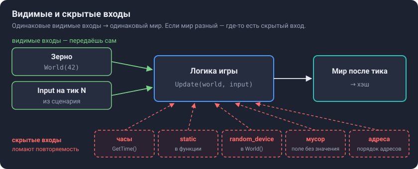
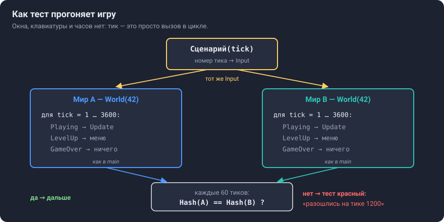
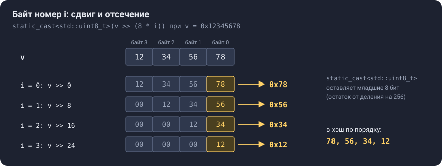
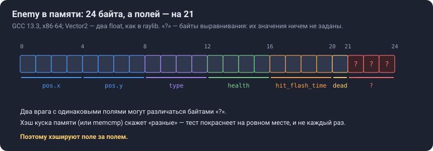
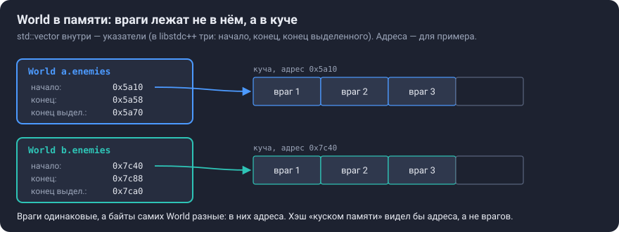
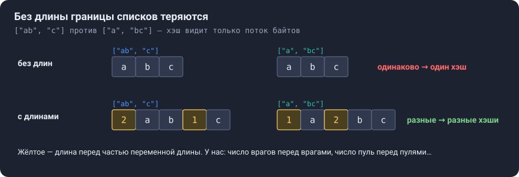
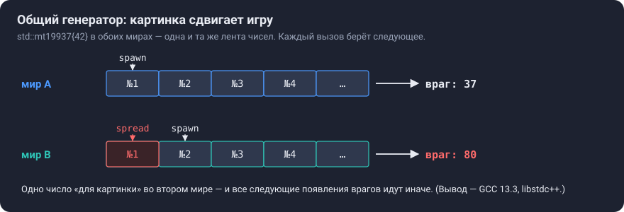
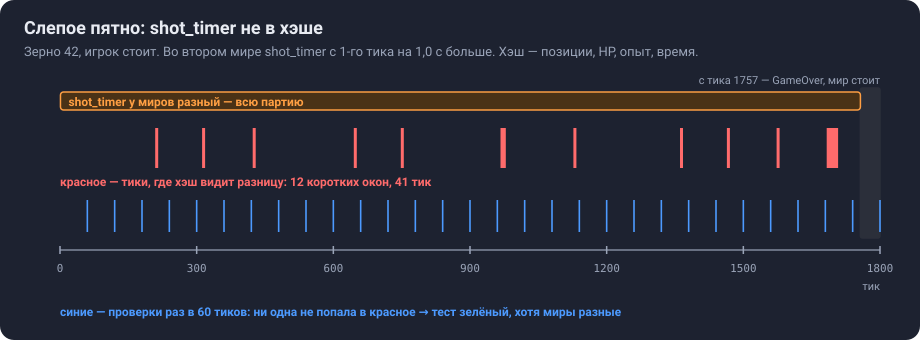

# Урок B4. Повторяемость: хэш состояния и тест

**Коротко.** Программа повторяема (детерминирована), если одни и те же входы всегда дают один и тот же результат. Проверяют это тестом: два прогона с одинаковыми входами, и по ходу их миры сравниваются. Чтобы не сравнивать мир поле за полем, его сворачивают в одно число — хэш.

**Что строишь в шаге** (`docs/roadmap.md`, B4): тест — два мира `World(42)`, один сценарий ввода «номер тика → `Input`», по 3600 тиков; хэши сравниваются по ходу, например каждые 60 тиков. **Готово, когда:** тест зелёный; нарочная поломка делает его красным; вывод записан в `NOTES.md`.

## Как читать этот урок

- В каждом разделе — пример кода, «почему так» и «что будет, если иначе». Примеры учебные, на выдуманных типах. Код игры появляется только там, где разбираем конкретную её строку.
- **Ответь сам** — вопрос к тебе. Сначала ответь — вслух или строкой в блокноте, — потом открой «Ответ» (нажать на треугольник). В CLion ответы и схемы видно в режиме Preview, на GitHub — сразу.
- Кроме вопросов есть **Допиши** — дописать пропуск в примере — и **Сам** — задание без ответа: это уже часть шага.
- Схемы лежат в `docs/lessons/img/`.

| Раздел | Что поймёшь | Ориентир, мин |
|---|---|---|
| 1. Зачем | что сломается без теста и чего он не проверяет | 10 |
| 2. Скрытые входы | откуда берётся «разное» при одинаковых входах | 15 |
| 3. Тест на нашем коде | как тест прогоняет игру без окна | 20 |
| 4. Хэш | как свернуть мир в одно число | 25 |
| 5. Какие поля класть | главный вопрос шага | 20 |
| 6–7. Подвохи, `git bisect` | края; как найти коммит-виновник | 15 |
| 8–9. Собеседование, самопроверка | рассказать и проверить себя | 20 |

---

## 1. Зачем

**Без теста.** Через месяц, в этапе C, приходит баг: «на 12-й минуте враг прошёл сквозь игрока». Чтобы его повторить, нужна та же партия — то же зерно и тот же ввод по тикам. Если игра повторяема, запускаешь её хоть сто раз — баг на месте, его можно разглядеть в отладчике. Если нет — каждый запуск идёт по-своему, и баг «то есть, то нет».

Кому нужна повторяемость:
- **воспроизведению багов** — зерно плюс записанный ввод дают ту же партию;
- **реплеям** (этап J) — хранят зерно и ввод по тикам, а не состояние мира;
- **балансу по симуляциям** (этап J) — тысячи прогонов без окна, результат зависит только от зерна и стратегии;
- **сети** (`docs/roadmap.md`, «Куда игра может расти») — при lockstep по сети ходит только ввод, а рассинхрон ловят, сравнивая хэши.

**Что уже есть.** B3 сделал логику повторяемой *в принципе*: шаг всегда `kTick`, ввод приходит параметром `Input`, случайность — только из `world.rng` с зерном. «В принципе» — это пока убеждение. Тест превращает его в факт и дальше сторожит: если правка через месяц сломает повторяемость (`static` в функции логики, `GetTime()`, поле без значения), тест покраснеет в тот же день.

**Чего этот тест не проверяет — правильность.** Он спрашивает не «правильно ли посчитано», а «одинаково ли»:

```cpp
#include <cstdio>

int Doubled(int x) { return x * 3; }                  // ошибка: должно быть x * 2

int main() {
    std::printf("%d %d\n", Doubled(5), Doubled(5));   // повторяемость: оба раза одно и то же
    std::printf("%d\n", Doubled(5) == 10);            // правильность: 1 — верно, 0 — нет
}
```

Вывод — `15 15`, затем `0` (прогон Claude, GCC 13.3). Функция повторяема — и неправильна. Тест B4 скажет «всё хорошо», тест на правильность — «ошибка». Правильность проверяют другие тесты: например, `TryLevelUp: exp exactly at threshold -> level rises` в `tests/tests.cpp` сверяет `world.level == 1`.

**Ответь сам 1.1.** В логику закралась ошибка: опыт за кристалл начисляется дважды — одинаково в обоих мирах. Покраснеет ли тест B4? Какой тест должен это поймать?

<details>
<summary>Ответ</summary>

Не покраснеет: оба мира ошибаются одинаково, хэши совпадут. Поймать должен тест на правильность — «один кристалл → опыт вырос ровно на его `value`». B4 ловит другое: входы одинаковые, а результат разный.

</details>

---

## 2. Скрытые входы

**Идея.** Видимые входы игры — зерно и `Input` на каждый тик: их передаёшь ты. **Скрытый вход** — всё остальное, что влияет на результат. Повторяемость ломают только они.

**Аналогия.** Два одинаковых калькулятора: нажимаешь одинаковые кнопки — получаешь одинаковый ответ. Если ответы разные, значит, в одном из них кнопки нажимает кто-то ещё. *Граница аналогии:* в калькуляторе неверный ответ видно сразу, а в игре скрытый вход может поменять последний бит одного `float` — и разница всплывёт через минуты или не всплывёт вовсе.



### 2.1. `static` в функции — самый вероятный будущий баг

```cpp
#include <cstdio>

struct World { int score = 0; };

void Update(World &w) {
    static int calls = 0;               // одна переменная на всю программу, а не на мир
    ++calls;
    if (calls % 2 == 0) w.score += 10;  // «каждый второй вызов — бонус»
    w.score += 1;
}

int main() {
    World a, b;                         // два одинаковых мира
    for (int tick = 0; tick < 3; ++tick) {
        Update(a);                      // у обоих один и тот же «ввод» — просто тик
        Update(b);
    }
    std::printf("%d %d\n", a.score, b.score);
}
```

**Ответь сам 2.1.** Что напечатает программа? Предскажи до того, как открыть ответ.

<details>
<summary>Ответ</summary>

`3 33` (прогон Claude, GCC 13.3). Вызовы идут по очереди: мир `a` получает номера 1, 3, 5 — бонуса нет ни разу; мир `b` — 2, 4, 6 — бонус каждый раз. Входы одинаковые, миры разные: `static` — одна переменная на все миры программы, то есть скрытый вход.

</details>

**Что если мир в игре один?** Тогда такой `static` может долго молчать: счётчик один, мир один. Сломается он там, где миров больше одного или мир создаётся заново: в тесте (два мира в одной программе) и при повторном прогоне с тем же зерном в той же программе — `static` не сбрасывается вместе с миром.

### 2.2. Время

```cpp
#include <chrono>
#include <cstdio>

long long Now() { return std::chrono::steady_clock::now().time_since_epoch().count(); }

int Damage() { return 10 + static_cast<int>(Now() % 2); }   // 10 или 11 — как повезёт с часами

int main() {
    for (int i = 0; i < 4; ++i) std::printf("%d ", Damage());
    std::printf("\n");
}
```

Часы — вход, которого нет ни в зерне, ни во вводе: запуски печатают разные строки, например `10 10 10 10` и `11 10 10 11` (прогон Claude, GCC 13.3). Поэтому с B3 логика получает время только как `kTick`.

### 2.3. Остальные скрытые входы — коротко

| Скрытый вход | Пример | Как у нас |
|---|---|---|
| Случайное зерно | `std::random_device` | только в `World()` (`world.h`). Нынешние 11 тестов создают `World world;` — зерно случайное, но генератор они не трогают. Тест B4 — `World(42)` |
| Неинициализированная память | поле без значения по умолчанию | чтение — неопределённое поведение. У части полей значения по умолчанию нет (`Exp::pos`, `Bullet::vel`, …), но при создании их всегда заполняют; новое поле — сразу со значением |
| Адреса в памяти | сравнение `<` указателей на разные объекты | результат не задан стандартом (cppreference, «Comparison operators»). У нас `&self > &other` в `UpdateSeparation` сравнивает элементы **одного** вектора — это порядок номеров, он задан |
| Порядок обхода | `std::unordered_map` с адресами в ключах | таких контейнеров нет. Порядок обхода зависит от хэшей ключей, а адреса у двух миров разные |
| Плавающая точка | другой компилятор, флаги, процессор | раздел 2.4 |
| Распределения `<random>` | другая стандартная библиотека | раздел 2.4 |
| Потоки | порядок выполнения | этап J |

**Ответь сам 2.2.** Где здесь скрытый вход — и почему не в двух других функциях?

```cpp
#include <random>

constexpr float kTick = 1.f / 60.f;

struct State {
    float speed = 100.f;
    std::mt19937 rng{42};
};

float A(const State &s) { return s.speed * kTick; }
float B()               { static float t = 0.f; t += kTick; return t; }
int   C(State &s)       { return std::uniform_int_distribution<>(0, 3)(s.rng); }
```

<details>
<summary>Ответ</summary>

В `B`: её `static float t` копится через все вызовы — от всех миров и всех партий программы. `C` тоже даёт «случайное», но генератор лежит в состоянии и создан с зерном — это видимый вход, у двух состояний с одним зерном числа одинаковые. `A` зависит только от состояния.

</details>

**Ответь сам 2.3.** Почему тест берёт `World(42)`, а не так: `const auto seed = std::random_device{}(); World a(seed), b(seed);` — ведь зерно у миров одно?

<details>
<summary>Ответ</summary>

Миры между собой совпадут — это верно. Но при каждом запуске теста зерно новое: если тест упал, следующий запуск — уже другая партия, и падение не повторить и не отладить. С числом 42 упавший тест падает одинаково при каждом запуске.

</details>

### 2.4. Плавающая точка и стандартная библиотека

Отдельные операции IEEE 754 (`+`, `-`, `*`, `/`, `sqrt`) округляются однозначно. Но сборка может поменять результат:
- GCC по умолчанию разрешает сливать `a * b + c` в одну инструкцию FMA (`-ffp-contract=fast`), если сборке разрешены такие инструкции процессора, например с `-march=native`. У FMA одно округление вместо двух — последний бит может отличаться.
- Переставлять операции — считать `(a + b) + c` как `a + (b + c)` — GCC по умолчанию не вправе (`-fno-associative-math`): по документации GCC это меняет результат и нарушает стандарты C и C++. Разрешает это `-ffast-math`.
- Распределения из `<random>` стандарт задаёт по смыслу, а не по алгоритму. P2059R0: `uniform_int_distribution(0, 100)` от `std::mt19937` без зерна печатает 53 на MSVC и 82 на libstdc++ (82 подтверждено прогоном Claude, GCC 13.3). У нас и на Windows (MinGW), и на Linux — libstdc++.

Glenn Fiedler («Floating Point Determinism») на вопрос о повторяемости отвечает «да, если…»: на разных компьютерах — если исполняемый файл собран тем же компилятором, машины той же архитектуры и сделаны приёмы под платформу.

**Для нашего теста это хорошая новость:** оба мира идут в одном процессе, в одном исполняемом файле. Покраснел тест — виноват наш код, а не процессор. Поэтому тест сравнивает **два прогона**, а не записанное заранее число: записанный хэш сломался бы при смене компилятора, стандартной библиотеки и после каждой задуманной правки игры.

---

## 3. Тест на нашем коде: как он прогоняет игру



### 3.1. Тик — это вызов, а не 1/60 секунды ожидания

В игре `main` по часам решает, сколько тиков выполнить в кадре (B3). В тесте часов нет: тик — один шаг логики, вызов в обычном цикле. 3600 тиков — это 60 секунд **игрового** времени, а настоящего — миллисекунды: весь прогон 3600 тиков на коде игры занял 5–8 мс (прогон Claude, Linux, GCC 13.3, без оптимизаций). На твоём ПК число будет своё.

**Что если тиков 9 миллионов?** Посчитать придётся все: тик N считается из того, что получилось после тика N−1. Время — цена тика × число тиков, а тик дорожает с числом врагов: `UpdateSeparation` сравнивает каждого с каждым, n·(n−1) проверок. Замер Claude (Linux, GCC 13.3, без оптимизаций, враги сеткой вдали от игрока, среднее по 100 тикам):

| Врагов | Один тик | 9 млн тиков |
|---|---|---|
| 9 | ≈ 2 мкс | ≈ 15–18 с |
| 100 | 0,10–0,13 мс | ≈ 15–20 мин |
| 1024 | ≈ 11 мс | ≈ 27 ч |

Тест запускается после каждой правки, поэтому он должен идти секунды. Длинные прогоны — дело симуляций баланса (этап J), а как ускорить тик — тема этапа E.

### 3.2. Сценарий ввода

Клавиатуры в тесте нет, значит, `Input` на каждый тик нужно откуда-то взять. **Сценарий** — функция «номер тика → ввод»: одинаковый номер всегда даёт одинаковый ответ, поэтому оба мира получают одно и то же. Пример на выдуманном типе, не на нашем `Input`:

```cpp
struct Keys { bool right = false; bool fire = false; };

Keys Scenario(int tick) {        // номер тика → что «нажато» на этом тике
    Keys k;
    k.right = tick < 60;         // первые 60 тиков (1 с игры) держим «вправо»
    k.fire = tick % 30 == 0;     // на каждом 30-м тике — «выстрел»
    return k;
}
```

**Ответь сам 3.1.** Что вернут `Scenario(59)` и `Scenario(60)`? А что сломается, если написать `k.fire = Now() % 2 == 0;` (часы из 2.2)?

<details>
<summary>Ответ</summary>

`Scenario(59)`: `right = true`, `fire = false` (59 % 30 = 29). `Scenario(60)`: `right = false`, `fire = true` (60 % 30 = 0). С часами сценарий перестаёт быть функцией номера тика: ответ зависит от того, *когда* его позвали, — миры могут получить разный ввод, а каждый запуск теста — свою партию. Сценарий должен зависеть только от номера тика.

</details>

### 3.3. Состояния игры: прогон идёт, как в `main`

В `main` каждый тик сначала смотрит `world.game_state`: `Playing` — `Update`, `LevelUp` — меню (`UpdateLevelUp`, потом `ApplyUpgrade`), `GameOver` — ждать рестарта (`main.cpp`, цикл `while (accumulator >= kTick)`). Если в тесте просто звать `Update` 3600 раз, получится не игра (проверено прогоном Claude на коде игры):
- `Update` на мире в `LevelUp` переводит его в `Playing` — меню пропускается;
- на мире в `GameOver` тоже ставит `Playing`, а следующий вызов — снова `GameOver`: мир мигает между состояниями.

**Числа для проверки себя** (прогон Claude на коде от 18.10.2026): зерно 42, игрок стоит, в меню сразу берётся первая карточка → 6 повышений уровня, смерть на 1757-м тике (около 29 с игрового времени), дальше 1843 тика — `GameOver`.

**Ответь сам 3.2.** Сценарий «стоять» из чисел выше: сколько тиков из 3600 он на самом деле что-то проверяет? Что это значит для выбора сценария?

<details>
<summary>Ответ</summary>

1757. После смерти мир в `GameOver`, и в прогоне, как в `main`, с ним ничего не происходит: 1843 тика тест сравнивает два застывших мира. Сценарий, в котором партия длится дольше и игрок что-то делает, проверит больше кода. Какой именно — решаешь ты.

</details>

**Ответь сам 3.3.** Ты скопировал `switch` по состоянию из `main` в тест. Через месяц в `main` добавили паузу. Что станет с тестом?

<details>
<summary>Ответ</summary>

Копия в тесте о паузе не знает: тест проверяет уже не ту игру, в которую играют. Две копии одного `switch` — второй похожий случай. Подумай, кто ещё должен уметь «прожить один тик в любом состоянии», — и выносить ли это в библиотеку, решай сам.

</details>

### 3.4. Когда сравнивать и как сравнить генератор

| Как часто | Что узнаешь |
|---|---|
| только в конце | разошлись миры или нет |
| раз в 60 тиков | секунду, с которой искать |
| каждый тик | точный тик, но хэш считается 3600 раз |

Короткое расхождение проверка раз в 60 тиков может пропустить, если его не видно в полях хэша, — раздел 5.2.

**Генератор сравнивают напрямую.** У движков `<random>` есть `operator==`: он сравнивает внутренние состояния (cppreference, `std::mersenne_twister_engine`).

```cpp
#include <cstdio>
#include <random>

int main() {
    std::mt19937 a{42}, b{42};
    std::printf("%d\n", a == b);   // зерно одно, чисел ещё не брали
    b();                           // во втором взяли одно число
    std::printf("%d\n", a == b);
    a();                           // и в первом — одно
    std::printf("%d\n", a == b);
}
```

**Ответь сам 3.4.** Что напечатают три строки?

<details>
<summary>Ответ</summary>

`1`, `0`, `1` (прогон Claude, GCC 13.3). Состояние генератора — не только зерно, но и сколько чисел уже взяли: после `b()` генераторы разные, после `a()` — снова одинаковые.

</details>

### 3.5. «Зелёный сразу» — ещё не доказательство

На сегодняшнем коде тест, скорее всего, пройдёт с первого запуска — и это ничего не доказывает: так же «зелёным» был бы тест, который ничего не сравнивает. Сломай нарочно хотя бы раз:
- (а) другой вход — другое зерно или другой ввод на одном тике у второго мира;
- (б) скрытый вход в коде — например, `static`-счётчик в функции логики, как в 2.1.

Тест должен покраснеть, а сообщение — показать тик. В Catch2 для этого есть `INFO` и `CAPTURE`: сообщение копится и печатается вместе со следующей проверкой, которую Catch2 выводит, а по умолчанию он выводит только проваленные (документация Catch2, «Logging macros»). Пример на пустом месте, не на нашем тесте:

```cpp
#include <catch2/catch_test_macros.hpp>

TEST_CASE("CAPTURE: shows the value on failure", "[demo]") {
    for (int tick = 1; tick <= 3; ++tick) {
        CAPTURE(tick);             // при провале — строка вида «tick := 2» (по документации Catch2)
        CHECK(tick != 2);          // нарочно падает на втором проходе
    }
}
```

### 3.6. Где жить коду — решаешь ты

Помогает вопрос «кто будет этим пользоваться?». Нужно одному файлу — живёт в нём; нескольким целям (игре и тестам) — в библиотеке `survivor_core`. Сам тест и сценарий нужны только тестам — место в `tests/tests.cpp`. Выбирать нужно для хэша:

| Вариант | Сейчас | Потом |
|---|---|---|
| **A.** Хэш тоже в `tests/tests.cpp`, служебные функции — в безымянном `namespace` (нужны одному `.cpp`) | ни игра, ни `CMakeLists.txt` не меняются | когда хэш понадобится игре (отладочная панель — этап D, реплеи — J), перенести в библиотеку без изменения поведения |
| **B.** Хэш в библиотеку: `src/hash.h` и `src/hash.cpp`, дописать их в `add_library(survivor_core …)` | два файла и правка CMake. Ловушка: тело обычной функции в заголовке без `inline` — `multiple definition` (карточка 11); методы, написанные прямо в структуре, неявно `inline` (cppreference, «inline specifier») | игра пользуется хэшем сразу |

Мнение Claude: A — сейчас у хэша один пользователь, тест; по правилу «сначала работает, потом красиво» переносить стоит, когда появится второй.

---

## 4. Хэш: свернуть мир в число

**Зачем число, а не сравнение полей.** Тест сравнивает миры много раз за прогон. Хэш — одно число на каждый момент: его дёшево сравнить, напечатать в сообщении теста («тик 1200: 3f2a… против 91c0…»), записать в реплей, отправить по сети.

**Аналогия** — отпечаток пальца: короткий; у одного человека всегда одинаковый; у разных почти всегда разный. *Граница:* у хэша совпадения у разных миров возможны (коллизии). Для идеального 64-битного хэша вероятность, что конкретная пара разных миров совпадёт, — 1 / 2⁶⁴ ≈ 5 × 10⁻²⁰. FNV-1a не идеален, но для поиска случайного расхождения двух прогонов этого с запасом хватает (оценка Claude).

### 4.1. FNV-1a

Алгоритм — RFC 9923 («The FNV Non-Cryptographic Hash Algorithm», февраль 2026), раздел 2:
1. начать с числа offset basis;
2. для каждого байта: `hash ^= байт`, затем `hash *= FNV prime` по модулю 2⁶⁴;
3. вернуть `hash`.

Константы для 64 бит — там же, раздел 5: offset basis = 14695981039346656037 (`0xCBF29CE484222325`), prime = 1099511628211 (`0x100000001B3`). RFC советует FNV-1a для общего использования: на коротких данных он перемешивает биты лучше, чем FNV-1, где те же два действия идут в обратном порядке. FNV — **некриптографический** хэш: RFC не рекомендует его там, где злоумышленник не должен суметь подобрать совпадение (разделы 1.2 и 6). Нам это и не нужно: мы ищем случайное расхождение, а не защищаемся.

Весь механизм — его можно взять как есть: он ничего не знает про игру, это не решение шага.

```cpp
#include <bit>
#include <cstdint>

struct Fnv1a {
    std::uint64_t value = 14695981039346656037ull;   // offset basis (RFC 9923)

    void Byte(std::uint8_t b) {
        value ^= b;
        value *= 1099511628211ull;                    // FNV prime; переполнение беззнакового — по модулю 2^64
    }
    void U32(std::uint32_t v) {                       // младший байт первым — на любом процессоре одинаково
        for (int i = 0; i < 4; ++i) Byte(static_cast<std::uint8_t>(v >> (8 * i)));
    }
    void U64(std::uint64_t v) {
        for (int i = 0; i < 8; ++i) Byte(static_cast<std::uint8_t>(v >> (8 * i)));
    }
    void F32(float f) { U32(std::bit_cast<std::uint32_t>(f)); }   // биты числа, а не его значение
    void Bool(bool b) { Byte(b ? 1 : 0); }
};
```

**Почему `std::uint64_t`:**
- *беззнаковый* — умножение переполняется на каждом байте. Переполнение беззнакового по правилам языка — счёт по модулю 2^N, а знакового — неопределённое поведение (cppreference, «Arithmetic operators», раздел «Overflows»);
- *ровно 64 бита везде* — `unsigned long` на 64-битной Windows 32 бита (модель LLP64), а на 64-битном Linux 64 (LP64) (cppreference, «Fundamental types», раздел «Data models»). С `unsigned long` хэши на Windows и Linux были бы разными.

**Ответь сам 4.1.** Что вернёт `Fnv1a`, если не скормить ему ни одного байта?

<details>
<summary>Ответ</summary>

Сам offset basis: `cbf29ce484222325`. Это строка 1 вывода программы из 4.6.

</details>

### 4.2. Байты целого: сдвиг и отсечение

`static_cast<std::uint8_t>(v >> (8 * i))` достаёт байт номер `i`: сдвиг вправо на 8·i бит переносит его в младшие 8 бит, а перевод в 8-битный беззнаковый тип оставляет только их — остаток от деления на 2⁸ = 256 (cppreference, «Implicit conversions», раздел «Integral conversions»). Значения на схеме проверены прогоном Claude (GCC 13.3).



**Почему не скопировать байты из памяти** (`std::memcpy` в массив)? Тогда порядок байтов — тот, в каком их хранит процессор. Windows и Linux у нас на x86-64, где порядок одинаковый, так что сейчас разницы нет; сдвиги дают один порядок на любом процессоре — бесплатно.

### 4.3. Биты `float`

Хэш ест байты. У `int` байты взять просто, а у `float`? Четыре способа, которые приходят в голову первыми.

**`static_cast<std::uint32_t>(f)` — неверно.** Это преобразование *значения*: дробная часть отбрасывается. `100.2f` и `100.7f` оба дают 100 — хэш не увидит, что враг сдвинулся на полпикселя, а именно такие расхождения и надо ловить.

**`*reinterpret_cast<std::uint32_t*>(&f)` — неопределённое поведение.** Правило алиасинга (cppreference, `reinterpret_cast`, раздел «Type aliasing»): объект можно читать через его тип, через знаковый или беззнаковый вариант этого типа и через `char`, `unsigned char`, `std::byte`. `float` через `std::uint32_t` — нельзя. На правиле держится оптимизация: компилятор считает, что запись через `float*` не меняет того, что читается через `std::uint32_t*`. У GCC это `-fstrict-aliasing`, он включён на `-O2`, `-O3`, `-Os` (документация GCC, «Optimize Options»).

Эксперимент — отдельная программа, **так писать нельзя**:

```cpp
#include <cstdint>
#include <cstdio>

[[gnu::noinline]] std::uint32_t Mix(float *pf, std::uint32_t *pu) {
    *pu = 1;        // запись через std::uint32_t
    *pf = 2.0f;     // запись через float: для компилятора — «другой объект»
    return *pu;     // компилятор вправе считать, что здесь всё ещё 1
}

int main() {
    float x = 0.f;
    std::printf("%u\n", Mix(&x, reinterpret_cast<std::uint32_t *>(&x)));
}
```

**Ответь сам 4.2.** Предскажи вывод с `-O0` и с `-O2`. Потом проверь на своём GCC 13.1.

<details>
<summary>Ответ</summary>

GCC 13.3, Linux (прогоны Claude 17 и 21.10.2026): `-O0` — 1073741824 (это биты `2.0f`), `-O2` — 1, `-O2 -fno-strict-aliasing` — снова 1073741824. В ассемблере `-O2` функция просто возвращает константу 1. `-Wall -Wextra` молчат. Debug и Release дают разный ответ — типичный признак неопределённого поведения.

</details>

**`union` — тоже нет.** В C++ чтение не того члена `union`, который записывали последним, — неопределённое поведение. GCC разрешает это как расширение, если читать через сам `union` (описание `-fstrict-aliasing`), но это уже диалект одного компилятора.

**`std::memcpy` — можно** (так в примере на cppreference). **`std::bit_cast` — лучше всего:**

```cpp
const std::uint32_t bits = std::bit_cast<std::uint32_t>(f);   // те же 32 бита, другой тип
```

- C++20, заголовок `<bit>`;
- компилируется, только если размеры равны и оба типа тривиально копируемые: перепутать `float` с `std::uint64_t` не выйдет — будет ошибка компиляции, а не тихая порча;
- `constexpr`, если в типах нет указателей, `union`, `volatile` и ссылок (cppreference);
- возвращает значение — не нужна переменная под `memcpy`.

**Биты против значений.** `-0.f == 0.f` — истина, а биты разные: `0x80000000` и `0x00000000`. NaN не равен даже самому себе. Для теста нужны именно биты: одинаковые вычисления дают одинаковые биты, а `-0` вместо `+0` — тоже другое вычисление.

**Допиши 4.3.** В мире есть `double` (время). Допиши в `Fnv1a` метод `F64(double d)` по образцу `F32`.

<details>
<summary>Ответ</summary>

```cpp
void F64(double d) { U64(std::bit_cast<std::uint64_t>(d)); }
```

У `double` 64 бита — поэтому `std::uint64_t` и `U64`.

</details>

**Что если вызвать `F32` для `double`?** Скомпилируется молча: `double` неявно превратится во `float`, и хэш перестанет видеть мелкие различия. Прогон Claude (GCC 13.3): 29,1833333330 и 29,1833333340 как `double` дают разные хэши, а через `F32` — одинаковые. С `-Wall -Wextra -Wpedantic` предупреждений 0; заметит только `-Wconversion` (или `-Wfloat-conversion`): «conversion from 'double' to 'float' changes value».

### 4.4. Почему нельзя хэшировать структуру куском памяти

Соблазн: `hash(&enemy, sizeof(enemy))` — все байты разом. Не выйдет по трём причинам.

**1. Выравнивание.**



`sizeof(Enemy)` = 24, а полей — на 21 байт: `Vector2 pos` 8 + `EnemyType type` 4 + `float health` 4 + `float hit_flash_time` 4 + `bool dead` 1. После `dead` (смещение 20) компилятор добавил 3 байта, чтобы следующий `Enemy` в векторе начинался с адреса, кратного 4 (прогон Claude, GCC 13.3, x86-64). Значения этих байтов ничем не заданы.

**2. Указатели.**



`std::vector` внутри — указатели на память в куче (в libstdc++ их три: `_M_start`, `_M_finish`, `_M_end_of_storage`, файл `bits/stl_vector.h` из GCC 13; `sizeof(std::vector<int>)` = 24). Байты `World` — это адреса, а не враги.

**3. `float` по смыслу.** Свойство `std::has_unique_object_representations_v<T>` ввели как раз чтобы узнать, можно ли хэшировать тип как массив байтов (cppreference). На GCC 13.3 оно ложно для `Enemy`, `Vector2` и `float` (у `float` одно значение NaN имеет много битовых записей) и истинно для `int`, `bool` и `enum` (прогон Claude).

**Ответь сам 4.4.** Два мира с одинаковыми врагами. Совпадёт ли хэш куском памяти всего `World`? А одного `Enemy`?

<details>
<summary>Ответ</summary>

`World` — нет: у векторов разные адреса в куче. `Enemy` — как повезёт: поля одинаковые, а три байта выравнивания ничем не заданы. Это худший случай — тест иногда краснеет «на ровном месте». Поэтому хэшируют поле за полем.

</details>

### 4.5. Однозначная кодировка: длина перед списком



Хэш видит не структуру мира, а поток байтов. Если выписать подряд всех врагов, потом все пули, границы между списками теряются. Лечение — **длина перед каждой частью переменной длины**. Заодно самое частое расхождение — «врагов стало на одного больше» — хэш увидит сразу.

**Допиши 4.5.** Допиши в `Fnv1a` метод `Str(const std::string &s)` так, чтобы `["ab", "c"]` и `["a", "bc"]` давали разные хэши.

<details>
<summary>Ответ</summary>

```cpp
void Str(const std::string &s) {
    U64(s.size());                                   // сначала длина
    for (char c : s) Byte(static_cast<std::uint8_t>(c));
}
```

Прогон Claude: без `U64(s.size())` два набора дают один хэш, с ним — разные. `s.size()` — `std::size_t`; через `U64` длина занимает 8 байт на любой системе.

</details>

### 4.6. Всё вместе — учебная программа

Тип `Particle` в игре нет. Сначала прочитай и **предскажи**, какие строки вывода совпадут, потом запусти (отдельная цель или онлайн-компилятор).

```cpp
// fnv_demo.cpp — отдельная учебная программа, не часть игры
#include <bit>
#include <cmath>
#include <cstdint>
#include <cstdio>
#include <vector>

struct Fnv1a {
    std::uint64_t value = 14695981039346656037ull;   // offset basis (RFC 9923)

    void Byte(std::uint8_t b) {
        value ^= b;
        value *= 1099511628211ull;                    // FNV prime; беззнаковое переполнение — по модулю 2^64
    }
    void U32(std::uint32_t v) {                       // младший байт первым — на любом процессоре одинаково
        for (int i = 0; i < 4; ++i) Byte(static_cast<std::uint8_t>(v >> (8 * i)));
    }
    void U64(std::uint64_t v) {
        for (int i = 0; i < 8; ++i) Byte(static_cast<std::uint8_t>(v >> (8 * i)));
    }
    void F32(float f) { U32(std::bit_cast<std::uint32_t>(f)); }   // биты числа, а не его значение
    void Bool(bool b) { Byte(b ? 1 : 0); }
};

struct Particle {          // учебный тип, не из игры
    float x;
    float y;
    int kind;
    bool alive;
};

void Add(Fnv1a &h, const Particle &p) {
    h.F32(p.x);
    h.F32(p.y);
    h.U32(static_cast<std::uint32_t>(p.kind));
    h.Bool(p.alive);
}

void Add(Fnv1a &h, const std::vector<Particle> &v, bool with_size) {
    if (with_size) h.U64(v.size());                   // сначала длина
    for (const Particle &p : v) Add(h, p);
}

std::uint64_t HashTwoLists(const std::vector<Particle> &a, const std::vector<Particle> &b, bool with_size) {
    Fnv1a h;
    Add(h, a, with_size);
    Add(h, b, with_size);
    return h.value;
}

int main() {
    const Particle p1{1.5f, 2.f, 0, true};
    const Particle p2{3.f, 4.f, 1, true};

    Fnv1a empty;
    std::printf("1) пустой хэш:             %016llx\n", static_cast<unsigned long long>(empty.value));

    std::printf("2) [p1] и [p2]:            %016llx\n", static_cast<unsigned long long>(HashTwoLists({p1}, {p2}, true)));

    Particle q = p1;
    q.x = std::nextafter(q.x, 100.f);                  // соседнее число float
    std::printf("3) x на одно число больше: %016llx\n", static_cast<unsigned long long>(HashTwoLists({q}, {p2}, true)));

    std::printf("4) без длин: [p1, p2] + [] = %016llx\n", static_cast<unsigned long long>(HashTwoLists({p1, p2}, {}, false)));
    std::printf("   без длин: [p1] + [p2]   = %016llx\n", static_cast<unsigned long long>(HashTwoLists({p1}, {p2}, false)));
    std::printf("   с длинами: [p1, p2] + [] = %016llx\n", static_cast<unsigned long long>(HashTwoLists({p1, p2}, {}, true)));
    std::printf("   с длинами: [p1] + [p2]   = %016llx\n", static_cast<unsigned long long>(HashTwoLists({p1}, {p2}, true)));

    std::printf("5) static_cast<uint32_t>: 100.2f -> %u, 100.7f -> %u; bit_cast: %08x и %08x\n",
                static_cast<std::uint32_t>(100.2f), static_cast<std::uint32_t>(100.7f),
                std::bit_cast<std::uint32_t>(100.2f), std::bit_cast<std::uint32_t>(100.7f));

    std::printf("6) sizeof(Particle) = %zu, полей на %zu байт\n", sizeof(Particle), 3 * sizeof(float) + sizeof(bool));
}
```

**Ответь сам 4.6.** Какие строки вывода совпадут? Что изменится, если в строке 3 вместо `std::nextafter` написать `q.x = 1.5f;`?

<details>
<summary>Ответ</summary>

Вывод (GCC 13.3, Linux, прогоны Claude 17 и 21.10.2026; совпадает с `-O0` и `-O2`, флаги `-Wall -Wextra -Wpedantic -Wconversion` молчат):

```
1) пустой хэш:             cbf29ce484222325
2) [p1] и [p2]:            27690a98ba1ae7bb
3) x на одно число больше: 23d567866f1b491e
4) без длин: [p1, p2] + [] = fc5c09cb1e9f36c1
   без длин: [p1] + [p2]   = fc5c09cb1e9f36c1
   с длинами: [p1, p2] + [] = e8339ec1cbbfecaf
   с длинами: [p1] + [p2]   = 27690a98ba1ae7bb
5) static_cast<uint32_t>: 100.2f -> 100, 100.7f -> 100; bit_cast: 42c86666 и 42c96666
6) sizeof(Particle) = 16, полей на 13 байт
```

- Строка 1 — сам offset basis: байтов не было.
- Строка 3: сдвиг на самое маленькое возможное для `float` расстояние меняет хэш целиком.
- Строка 4: без длин два разных набора дают один хэш; с длинами — разные. Последняя строка 4 совпадает со строкой 2 — это тот же набор.
- Строка 5: `static_cast` не видит полпикселя, `bit_cast` видит.
- Строка 6: 3 байта выравнивания.

С `q.x = 1.5f;` частица `q` равна `p1`, и строка 3 совпадёт со строкой 2.

</details>

---

## 5. Какие поля класть — главный вопрос шага

**Критерий:** если у двух миров отличается только это поле — разойдётся ли партия дальше? Да — поле влияет на игру, в хэш его **обязательно**. Нет — поле только для картинки, класть по желанию.

**Пример из игры** (разбираем конкретную строку, поэтому код игры): `Enemy::hit_flash_time`. Логика его только ставит при попадании (`e.hit_flash_time = kEnemyFlashDuration;` в `UpdateBullets`) и уменьшает (`e.hit_flash_time = std::max(0.f, e.hit_flash_time - dt);` в `UpdateEnemies`), а читает только `draw.cpp` — чтобы враг мигнул. Разное у двух миров — враг мигнёт по-разному, а партия пойдёт одинаково. Как искать такие поля: в CLion встань на поле и нажми Alt+F7 (Find Usages). Если поле читает только `draw.cpp` или после создания мира его не читает никто — оно «только для картинки».

**Особый случай — `dead`.** Внутри тика логика его читает, но к моменту, когда считается хэш (между тиками), мёртвых в мире нет: `std::erase_if` в конце `Update` их убрал, и у всех оставшихся `dead == false`. Класть можно, но смысла нет.

### 5.1. Почему не класть «картинку»

Хэш — отпечаток **игры**. Сейчас поля картинки считаются одинаково в обоих мирах, и тест от них не сломается. Проблемы начинаются, когда картинке разрешено отличаться, а игре — нет:
- **сеть:** у игрока А частицы включены, у игрока Б выключены в настройках — в мире Б их нет вообще. Игры одинаковые, а хэш с частицами кричит «рассинхрон» на первом же попадании;
- **реплей:** записал с частицами, смотришь без них — реплей со сверкой хэшей «сломается» на ровном месте.

**Ответь сам 5.1.** Для разлёта чисел урона (чистая картинка) хотят взять случайность из генератора мира. Абстрактный пример:

```cpp
#include <cstdio>
#include <random>

int main() {
    std::mt19937 a{42}, b{42};                       // два мира с одним зерном
    std::uniform_int_distribution<> spawn(0, 100);   // «где появится враг» — игра
    std::uniform_int_distribution<> spread(-5, 5);   // «разлёт числа урона» — только картинка

    spread(b);                                       // во втором мире показали число урона

    const int x_a = spawn(a);                        // враг появляется в обоих мирах
    const int x_b = spawn(b);
    std::printf("%d %d\n", x_a, x_b);
}
```

Предскажи: два числа совпадут? Почему? Что это значит для игры?

<details>
<summary>Ответ</summary>

`37 80` (прогон Claude, GCC 13.3, libstdc++). Оба генератора — одна и та же лента чисел; `spread` во втором мире взял число №1, и `spawn` там получил уже №2.



В игре это значит: чисто визуальная правка — разлёт чисел урона из `world.rng` — поменяла бы, где появляются враги, и сломала бы все реплеи, записанные до неё. Поэтому случайность картинки держат отдельно от генератора игры. А раз картинке можно отличаться — её поля и в хэш не кладут.

</details>

### 5.2. Почему все поля игры, а не половину

Ты не знаешь заранее, где появится следующий скрытый вход. Каждое пропущенное поле — слепое пятно: расхождение, начавшееся в нём, тест увидит, только когда оно доберётся до положенных в хэш полей, — или не увидит вовсе.

Опыт Claude на коде игры (21.10.2026): два мира `World(42)`, игрок стоит, в меню сразу Enter. Во втором мире подменено одно поле — как будто это сделал скрытый вход. Хэш — из позиций и HP игрока и врагов, числа врагов, опыта и времени; сравнение раз в 60 тиков.

| Где расходятся миры | Этот хэш заметил | Тот же хэш + это поле |
|---|---|---|
| `enemy_spawn_timer` +0,1 с на тике 500 | на тике 600 | на тике 540 |
| `shot_timer` +1,0 с с первого тика | ни разу за 3600 тиков | на тике 60 |



Во второй строке миры разные всю партию, а хэш видит разницу лишь 41 тик из 1757 — двенадцатью короткими окнами, — и ни одна проверка раз в 60 тиков в них не попала. Тест зелёный.

**Что если поле добавят в мир через месяц?** Его придётся добавить и в хэш — иначе тест молча ослепнет к нему. Дешёвая защита — комментарий у структур в `world.h`: новое поле, влияющее на игру, — добавь в хэш, и где этот хэш лежит.

**Правило, чтобы не разбирать каждое поле до бесконечности** (мнение Claude): влияет на игру — клади; сомневаешься — тоже клади. Лишнее сейчас не вредит, а пропуск делает тест слепым.

**Ответь сам 5.2.** Ты положил в хэш всё, кроме генератора `rng`. В `UpdateLevelUp` кто-то лишний раз вызвал `world.rng()`. Когда тест это заметит — сразу, позже или никогда? От чего это зависит?

<details>
<summary>Ответ</summary>

Позже: когда генератор в следующий раз повлияет на поля хэша — при следующем появлении врага (`RandomEdgePoint`, `RandomEnemyType`) или при следующем меню (`FillLevelUpMenu`). Если партия кончится раньше — никогда. Сравнить генераторы напрямую (`==`, раздел 3.4) — увидишь сразу.

</details>

**Сам 5.3.** Без ответа — это уже часть шага. Выпиши поля `World` и вложенных структур (`Player`, `Enemy`, `Bullet`, `Exp`, `DamagePopup`, `LevelUpMenu`) в два столбца: «влияет на игру» и «только картинка». Где сомневаешься — помечай «?» и спроси.

---

## 6. Подвохи и края — коротко

- `World()` берёт зерно из `std::random_device` — в тесте только `World(42)`.
- `std::size_t` → в хэш как `std::uint64_t`, явно: тогда хэш не зависит от ширины `size_t`.
- `enum class` → `static_cast` к целому: неявного преобразования нет.
- Порядок полей в хэше важен: хэш (a, b) ≠ хэш (b, a). Порядок выбрать один раз.
- `double` через `F32` молча теряет точность (4.3).
- Прогон в тесте проходит `LevelUp` и `GameOver` так же, как `main` (3.3).
- Тест зелёный сразу — сломай нарочно (3.5).
- Повторяемость — только в пределах одного исполняемого файла (Fiedler). Сравнивать хэши Windows и Linux — другая, гораздо более трудная задача, в B4 она не входит.

## 7. По желанию: `git bisect`

Как найти коммит, который сломал повторяемость, если заметил это через двадцать коммитов? Двоичным поиском по истории: git берёт середину, ты говоришь «хорошо» или «плохо», он делит пополам дальше. 16 коммитов — 4 проверки, 1000 — 10.

```
git bisect start
git bisect bad                 # текущий коммит плохой
git bisect good <хэш коммита>  # этот был хорошим
git bisect run <скрипт>        # дальше git проверяет сам
git bisect reset               # вернуться туда, где был
```

`git bisect run` понимает код возврата скрипта: 0 — коммит хороший; от 1 до 127, кроме 125, — плохой; 125 — «этот коммит не проверить», git его пропустит; другой код прерывает поиск (git-scm.com, `git bisect`, раздел «Bisect run»). Значит, скрипт собирает тесты; не собралось — выходит с кодом 125; собралось — запускает тест и возвращает его код. Сначала проверь, с каким кодом выходит тестовая программа, когда тест падает: в PowerShell — `$LASTEXITCODE`, в cmd — `echo %ERRORLEVEL%`. Скрипт можно писать на `sh` для Git Bash — он входит в Git for Windows.

**Упражнение:** несколько коммитов, в одном — нарочная поломка повторяемости; `git bisect run` находит его сам.

## 8. Как рассказать на собеседовании

**Ответ на 30 секунд.** «Логика игры детерминирована: одно зерно и одна запись ввода дают ту же партию. Это проверяет тест: два мира с одинаковым зерном и сценарием ввода идут по 3600 тиков, и раз в секунду их хэши сравниваются. Хэш — FNV-1a по полям, которые влияют на игру: `float` — через `std::bit_cast`, у списков — сначала длина. Структуры целиком не хэширую из-за выравнивания и указателей. Сравниваю два прогона, а не записанное число: плавающая точка повторяется только в пределах одной сборки».

Вопросы следом:
- **Что делает программу недетерминированной?** Скрытые входы — раздел 2.
- **Что этот тест не проверяет?** Правильность — раздел 1.
- **Что такое строгий алиасинг и почему `*reinterpret_cast<std::uint32_t*>(&f)` — неопределённое поведение?** Раздел 4.3 и эксперимент.
- **Почему нельзя хэшировать структуру как кусок памяти?** Раздел 4.4.
- **Чем `std::bit_cast` лучше `memcpy`?** Проверка размеров при компиляции, `constexpr`, возвращает значение; `memcpy` тоже законен.
- **Почему `std::uint64_t`, а не `unsigned long`?** LLP64 и LP64.
- **Почему в хэше не все поля, а только те, что влияют на игру?** Раздел 5.
- **Можно ли FNV-1a для паролей?** Нет: некриптографический.
- **Как найти коммит, который сломал тест?** `git bisect run`.

## 9. Самопроверка

Без ответов: вспоминай сам, потом сверяйся с разделами.

1. Чем тест на повторяемость отличается от теста на правильность? Приведи ошибку, которую B4 не поймает.
2. Почему `static` в функции логики ломает тест, а в игре с одним миром может долго молчать?
3. Убери из учебной программы `h.U64(v.size())`. Какие строки вывода изменятся, а какие совпадут?
4. Что вернёт `static_cast<std::uint32_t>(0.5f)` и почему это плохо для хэша?
5. Почему тест сравнивает два прогона, а не записанный хэш?
6. Почему поля «только для картинки» лучше не класть в хэш, а поля игры — все до одного?
7. Как сделать тест красным, не трогая код игры? А трогая?
8. Скрипт для `git bisect run`: что он делает, если проект на этом коммите не собирается?
9. Расскажи вслух ответ «на 30 секунд» и засеки время.

## 10. Источники

- RFC 9923, «The FNV Non-Cryptographic Hash Algorithm», февраль 2026 — https://www.rfc-editor.org/rfc/rfc9923.html (разделы 1.2, 2, 5, 6).
- cppreference: `std::bit_cast` — https://en.cppreference.com/w/cpp/numeric/bit_cast ; правило алиасинга — https://en.cppreference.com/w/cpp/language/reinterpret_cast ; `std::has_unique_object_representations` — https://en.cppreference.com/w/cpp/types/has_unique_object_representations ; сравнение указателей — https://en.cppreference.com/w/cpp/language/operator_comparison ; модели данных — https://en.cppreference.com/w/cpp/language/types ; переполнение — https://en.cppreference.com/w/cpp/language/operator_arithmetic ; перевод в беззнаковый тип — https://en.cppreference.com/w/cpp/language/implicit_conversion ; `std::mersenne_twister_engine` — https://en.cppreference.com/w/cpp/numeric/random/mersenne_twister_engine ; `inline` — https://en.cppreference.com/w/cpp/language/inline
- GCC 13.1, «Optimize Options» (`-fstrict-aliasing`, `-ffp-contract`, `-fassociative-math`, `-ffast-math`) — https://gcc.gnu.org/onlinedocs/gcc-13.1.0/gcc/Optimize-Options.html
- Glenn Fiedler, «Floating Point Determinism» — https://gafferongames.com/post/floating_point_determinism/
- P2059R0, «Make Pseudo-random Numbers Portable» — https://www.open-std.org/jtc1/sc22/wg21/docs/papers/2020/p2059r0.pdf
- Catch2, «Logging macros» (`INFO`, `CAPTURE`) — https://github.com/catchorg/Catch2/blob/devel/docs/logging.md
- `git bisect` — https://git-scm.com/docs/git-bisect
- libstdc++ из GCC 13, `bits/stl_vector.h` — поля `_M_start`, `_M_finish`, `_M_end_of_storage`.
- Прогоны Claude, GCC 13.3, Linux: 17.10.2026 — эксперимент с алиасингом, вывод учебной программы, `sizeof`; 19–21.10.2026 — учебные примеры этого урока, прогоны на коде игры (3600 тиков, состояния, слепые пятна, время тика). Для кода игры — `raymath.h` и функции столкновений из исходников raylib 6.0 в папке сборки (`cmake-build-debug/_deps/raylib-src`).
