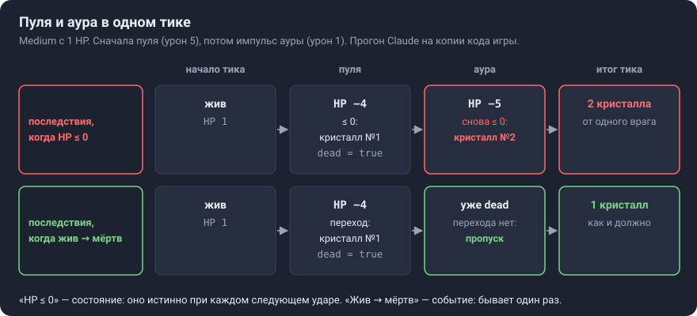
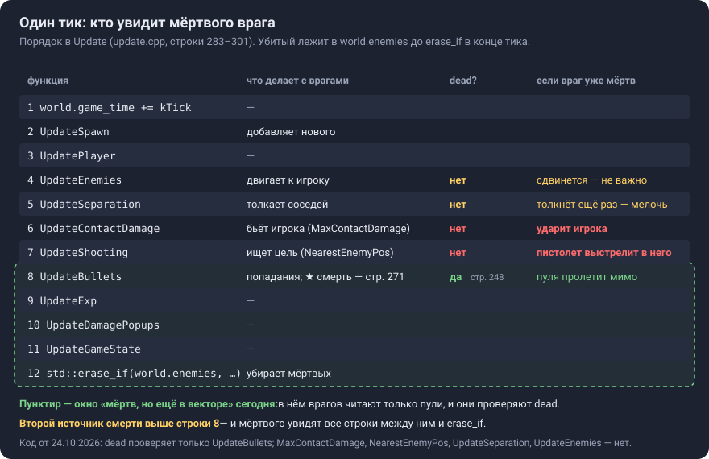
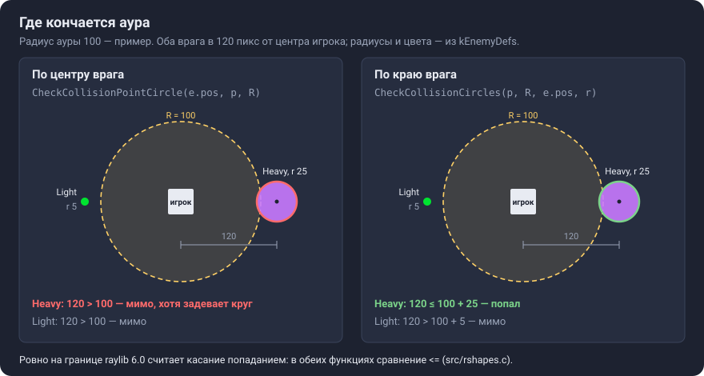

# Урок C1. Аура: урон по области и одна смерть на двоих

**Коротко.** Аура — второе оружие: круг вокруг игрока, который раз в N секунд бьёт всех врагов внутри. Нарисовать круг и завести таймер — знакомое дело. Новое в шаге другое: у врага появляется второй источник смерти, и оба источника могут ударить в одном тике. Смерть — событие: она случается один раз, сколько бы ударов ни пришлось на тик. Её последствия — кристалл и деление `Splitter` — должны срабатывать один раз и жить в одном месте.

**Что строишь в шаге** (`docs/roadmap.md`, C1): аура вокруг игрока — урон всем в радиусе раз в N секунд; интерфейсов пока нет. Края: враг убит аурой и пулей в одном тике — кристалл один, а `Splitter` даёт два `Twin`, не четыре; враг ровно на границе радиуса. **Готово, когда:** аура видна и убивает; тест «двойная смерть в одном тике» зелёный.

## Как читать этот урок

- Примеры учебные, на выдуманных типах (`Monster`, монеты). Код игры — там, где разбираем конкретную его строку; номера строк — по `src/update.cpp` на 24.10.2026.
- **Ответь сам** — вопрос к тебе. Сначала ответь — вслух или строкой в блокноте, — потом открой «Ответ». **Допиши** — дописать пример. **Сам** — задание без ответа: это уже часть шага.
- Схемы лежат в `docs/lessons/img/`.
- Сегодняшнее следующее действие (`PLAN.md`) — разделы 1 и 2 и вопросы 1–2 из раздела 7; ответы — в чат.

| Раздел | Что поймёшь | Ориентир, мин |
|---|---|---|
| 1. Зачем | что сломает аура, сделанная копией пули | 5 |
| 2. Идея | аура — круг и таймер; смерть — событие | 10 |
| 3. Как устроено у нас | где умирает враг и кто увидит мёртвого | 15 |
| 4. Пример | монеты: порядок, одно место, один проход | 20 |
| 5. Подвохи и края | граница круга, таймер, новые `Twin`, тест | 15 |
| 6–7. Собеседование, самопроверка | рассказать и проверить себя | 15 |

---

## 1. Зачем

**Что даст игре.** Пистолет бьёт одного врага — ближайшего — раз в `fire_interval` (2 с на старте, `Player` в `src/world.h`). Аура бьёт всех, кто подошёл близко, и целиться ей не нужно. В жанре это классика: в Vampire Survivors так устроен Garlic — «Damages nearby enemies», на первом уровне урон 5 раз в 1,3 с (Vampire Survivors Wiki, «Garlic», разделы «Effects» и «Levels»).

**Что сломается без нового.** Сейчас врага убивает одна строка — `e.dead = true` в `UpdateBullets` (строка 271), — и в тике она стоит позже всех, кто читает врагов. Аура добавляет второе место, где враги умирают. Самое простое — скопировать в ауру блок смерти из `UpdateBullets` (строки 263–271). Прогон Claude на копии кода игры показывает, что выйдет из такой копии:

| Где в `Update` стоит аура-копия | Что случилось в одном тике | Ожидали | Вышло |
|---|---|---|---|
| после `UpdateBullets` | пуля и аура добили `Medium` | 1 кристалл | 2 |
| после `UpdateBullets` | пуля и аура добили `Splitter` | 2 `Twin` | 4 |
| перед `UpdateContactDamage` | аура убила ближнего врага; пистолет готов, второй враг жив | пуля — в живого | пуля — в убитого |

<details>
<summary>Как получены числа</summary>

Копия `Update` (строки 283–301) с импульсом ауры в одном из трёх мест. Аура-копия — строки 263–271 из `UpdateBullets` с уроном ауры вместо урона пули и без проверки `dead`; радиус 100, урон 1, попадание — `CheckCollisionCircles`. `World(42)`, появление врагов отключено, игрок в (640, 360). Функции столкновений — из исходников raylib 6.0 в папке сборки.

- Строки 1–2 таблицы: враг (`Medium` или `Splitter`) с 1 HP в 40 пикс справа от игрока — внутри ауры и не касается игрока (по горизонтали касание начинается с 26 пикс: полразмера игрока 16 + радиус врага 10). На враге лежит пуля без скорости, как в тестах `UpdateBullets`.
- Строка 3: `Medium` с 1 HP в 60 пикс справа — внутри ауры; второй `Medium` в 200 пикс сверху — снаружи; `shot_timer` равен `fire_interval`. Пуля ушла вправо, к убитому, со скоростью (300, 0).
- Урон 1 — потому что для ошибки неважно, сколько: у добитого врага HP и так ≤ 0. Зато новые `Twin` (HP 3) переживают импульс, и их можно сосчитать.

</details>

**Почему сейчас.** Аура — не последний источник смерти: в C3 появятся вращающиеся клинки, в самостоятельной задаче C — цепная молния (`docs/roadmap.md`, этап C). Если последствия смерти не живут в одном месте, каждое новое оружие — ещё одна копия блока смерти и ещё одно место, где можно забыть проверку. На собеседовании это спросят так: «как сделать, чтобы два источника урона в одном тике не создали два кристалла?» (`docs/roadmap.md`, C1).

**Ответь сам 1.1.** Пуль в одном тике бывает несколько — тест `UpdateBullets: hit kills splitter with multiple bullets -> only two twins spawned` кладёт три на один `Splitter`, — а `Twin` всё равно два. Что в `UpdateBullets` от этого защищает? Почему аура-копия эту защиту не получила?

<details>
<summary>Ответ</summary>

Строка 248: `if (e.dead) continue;` — каждая следующая пуля пропускает врага, которого уже пометили мёртвым. Защита живёт в цикле по врагам, а не в блоке смерти (строки 264–271). Копия взяла блок смерти без этой строки, и для неё добитый враг с HP ≤ 0 — повод «умереть» ещё раз.

</details>

---

## 2. Идея

### 2.1. Аура — круг и таймер

Раз в N секунд аура даёт **импульс**: каждому врагу, который сейчас внутри круга, — урон. Между импульсами аура ничего не делает. Таймер копит время, как `shot_timer` у пистолета: каждый тик прибавляет `dt`, дошёл до N — импульс, N вычесть, остаток оставить.

Импульс — **разовое событие**, как попадание пули, поэтому его урон на `dt` не умножают. Ловушка из A5 (`NOTES.md`, «Ловушки»): удар 30, умноженный на `dt`, при 60 тиках в секунду давал 30 × 1/60 = 0,5 HP. На `dt` умножается только то, что «в секунду», — здесь это ход таймера.

**А почему не урон в секунду — каждый тик понемногу?** Так тоже можно, но у нас каждое попадание рождает число урона, и живёт оно 2 с (`DamagePopup::lifetime`). Урон 5 в секунду — это 5 × 1/60 ≈ 0,083 за тик: над каждым врагом 60 чисел «0.1» в секунду (формат `{:.1f}` в `draw.cpp`, прогон Claude), а одновременно — 60 × 2 = 120. Импульс даёт одно число на врага за раз.

| Как бить | Как устроено | Цена |
|---|---|---|
| **Общий импульс** — в шаге он: «урон всем в радиусе раз в N секунд» | один таймер на всю ауру | враг, вошедший сразу после импульса, ждёт почти N секунд |
| **Свой срок у каждого врага** — так Garlic в Vampire Survivors | вошёл — удар сразу; дальше не чаще раза в N с, даже если выйти и вернуться | поле у каждого врага на каждое такое оружие — и его тоже в хэш |
| **Урон в секунду** | каждый тик урон/с × `dt` | 60 чисел урона в секунду на каждого врага |

**Ответь сам 2.1.** Аура — урон 5 раз в 1,3 с. Что в её коде умножается на `dt`, а что нет? Что будет, если перепутать?

<details>
<summary>Ответ</summary>

Таймер прибавляет `dt` каждый тик — так 1,3 секунды остаются 1,3 секунды. Урон импульса — без `dt`: это разовое событие. Если умножить урон на `dt`, импульс снимет 5 × 1/60 ≈ 0,08 HP вместо 5 — та же ошибка, что с ударом в A5.

</details>

### 2.2. Смерть — событие, а не состояние

Условие `e.health <= 0.f` — это **состояние**: «сейчас HP не выше нуля». Оно остаётся истинным и при втором ударе, и при десятом. Смерть — **событие**: переход «был жив → стал мёртв». Он случается один раз. Последствия — кристалл, деление — привязывают к событию. Если привязать их к состоянию, каждый следующий удар по уже мёртвому повторит их.



Это различие ты уже встречал в B3, во вводе (урок B3, раздел 4; карточка 4): «держат» — состояние, его видит каждый тик кадра; «нажали» — событие, оно должно сработать ровно один раз. `e.health <= 0.f` — это «держат», смерть — «нажали».

**Аналогия — купон на бесплатный кофе.** За стойкой два бариста, оба принимают купоны. Правило «купон настоящий — налить кофе» по одному купону даст две чашки: каждый бариста проверит, что купон настоящий. Правило «купон настоящий и не погашен — налить и поставить штамп» даст одну: второй увидит штамп. У нас штамп — `dead`, кофе — кристалл и `Twin`, бариста — пуля и аура.

*Где аналогия кончается:*

- бариста видит штамп сам, а код — только если в нём написана проверка `dead`. Сейчас её пишут не все, кто читает врагов: `MaxContactDamage` и `NearestEnemyPos` — нет (раздел 3.2). Это бариста, который на штампы не смотрит;
- погашенный купон сразу убирают в ящик, а наш мёртвый враг лежит в `world.enemies` до `std::erase_if` в конце `Update` (строка 297). Всё, что выполняется в тике после смерти, его ещё «видит».

**Ответь сам 2.2.** У смерти врага потом появятся новые последствия — например, звук (этап F) или счётчик убийств для экрана итогов. Где их добавлять — рядом с проверкой `e.health <= 0.f` или там, где ставится `dead = true`? Что будет, если к тому времени источников смерти три и в каждом своя копия последствий?

<details>
<summary>Ответ</summary>

Там, где ставится `dead = true`, — то есть в момент перехода: он бывает один раз на смерть. Рядом с `e.health <= 0.f` без проверки `dead` звук и счётчик сработают на каждый удар по мёртвому. А при трёх копиях последствий звук и счётчик придётся дописать в три места; забыл одно — враги, убитые этим оружием, умирают молча и не считаются. Отсюда 2.3.

</details>

### 2.3. Последствия — в одном месте

Последствия смерти — кристалл, деление, потом, например, звук и счётчик — записываются в одном месте. Тогда новое оружие добавляет только «как я бью», а «что бывает, когда враг умер» уже есть. Это навык шага — «один источник истины для последствий события» (`docs/roadmap.md`, C1).

Где это место — решаешь ты. Два способа:

- **сразу** — все источники бьют через одну функцию «нанести урон», а она сама проверяет переход «жив → мёртв» и запускает последствия;
- **одним проходом** — источники только снимают HP, а после всех источников один проход по врагам: «HP ≤ 0 и ещё не `dead`» → `dead = true` и последствия.

У каждого способа своя цена — её разберём в разделе 4 на монетах.

---

## 3. Как устроено на нашем коде

### 3.1. Где сейчас умирает враг

Весь бой пистолета — в `UpdateBullets` (строки 236–281). Одно попадание запускает три разных набора действий:

| Когда | Что | Строки |
|---|---|---|
| каждое попадание | вспышка `hit_flash_time`, число урона в `damage_popups`, `e.health -= …` | 256–263 |
| смерть — один раз | кристалл (если `exp` вида не 0), деление `Splitter` через `OnSplitterDeath`, `e.dead = true` | 264–271 |
| дела пули | `b.dead = true` и выход из цикла по врагам | 272–275 |

У ауры есть первые две строки таблицы, третьей нет: пули у неё нет. Мигать ли врагу и показывать ли число урона от ауры — решаешь ты; смерть — та же самая.

Ещё две детали понадобятся:

- `OnSplitterDeath(world, enemies, splitter)` (строки 222–233) кладёт двух `Twin` не в `world.enemies`, а в переданный вектор. `UpdateBullets` передаёт свой `enemies_to_spawn` и вливает его после цикла (строка 280): добавлять в вектор, по которому идёт цикл, нельзя — при перевыделении `push_back` делает недействительными все итераторы и ссылки на элементы (cppreference, `std::vector::push_back`; `NOTES.md`, «Ловушки»; задача A).
- Строка 248, `if (e.dead) continue;`, — единственное место в `update.cpp`, где врагов проверяют на `dead` до уборки (`std::erase_if`, строка 297).

### 3.2. Порядок тика: кто увидит мёртвого



`Update` (строки 283–301) вызывает функции по порядку, а мёртвых убирает только в конце: `std::erase_if` удаляет из вектора все элементы, для которых условие истинно, за один линейный проход (cppreference, `std::erase_if (std::vector)`). Это известный приём: пометить объект мёртвым и оставить на месте, при обновлении пропускать мёртвых, а «трупы» убрать вторым проходом, когда обход закончен (Роберт Нистром, Game Programming Patterns, глава «Update Method», раздел «Be careful modifying the object list while updating»). Слабое место приёма — слово «пропускать»: каждый, кто читает врагов между смертью и уборкой, должен делать это сам.

Сегодня это никому не нужно: враг умирает только в строке 8 схемы, после всех, кто `dead` не проверяет. От места ауры в `Update` зависит, кто увидит мёртвого как живого. Прогон Claude на копии кода игры (условия — в разделе 1, «Как получены числа»):

- аура перед `UpdateContactDamage` убила `Medium`, который касался игрока, — игрок всё равно получил 30 урона: `MaxContactDamage` берёт урон у всех касающихся, мёртвых тоже (так и записано в `docs/backlog.md`);
- аура там же убила ближнего врага при готовом пистолете — `NearestEnemyPos` выбрала убитого, и пуля ушла к нему (строка 3 таблицы в разделе 1).

**Ответь сам 3.1.** Аура стоит сразу после `UpdateBullets`. Кого она встретит в `world.enemies`, кроме обычных живых врагов? Что должно случиться с каждым?

<details>
<summary>Ответ</summary>

Двух новеньких.

- Врагов, убитых пулями в этом тике: `dead == true`, HP ≤ 0. Их надо пропустить — иначе второй кристалл и ещё два `Twin` (раздел 1).
- `Twin`, рождённых пулями в этом тике: `UpdateBullets` влил их в `world.enemies` в строке 280. Они живые, и импульс по ним пройдёт: в прогоне с уроном ауры 1 у обоих осталось 2 HP из 3. Хорошо это или плохо — решение дизайна (раздел 5.3).

</details>

**Сам 3.2.** Без ответа — это уже часть шага. Реши, где в `Update` будет стоять аура. Для своего места выпиши всех, кто после неё в этом тике читает врагов, и для каждого — проверяет ли он `dead` и что должно случиться с убитым аурой врагом. Где ответ «должен пропустить», а проверки нет, — это работа шага, и её закрепит тест (раздел 5.4).

### 3.3. Таймер: образец — пистолет

`UpdateShooting` (строки 207–220) — готовый образец таймера с остатком: `p.shot_timer += dt;`, проверка `p.shot_timer < p.fire_interval`, потом `p.shot_timer -= p.fire_interval;`. Отличий от ауры два:

- когда цели нет, пистолет держит таймер на интервале (строка 214), чтобы потом не выдать очередь выстрелов (`NOTES.md`, «Ловушки»). У ауры «нет цели» — в круге никого; что делать тогда — раздел 5.2;
- пистолет выбирает одного (`NearestEnemyPos`), аура проходит по всем.

### 3.4. Где хранить ауру — решаешь ты

У пистолета параметры — поля `Player`: `fire_interval`, `bullet_damage`, `shot_timer` и другие. Ауре нужны радиус, урон, интервал и таймер.

| Вариант | Сейчас | Потом |
|---|---|---|
| Поля в `Player`, как у пистолета | меньше всего правок; `ApplyUpgrade` дотянется до них так же | `Player` растёт; в C3 оружие уйдёт в классы — переносить |
| Своя структура для ауры — поле в `Player` или в `World` | всё про ауру рядом; одно имя для хэша и тестов | ещё один тип уже сейчас |

Интерфейс `Weapon` — не сейчас: «второе оружие — ещё не повод», интерфейс приходит в C3, когда нужно третье оружие (`docs/roadmap.md`, C1 и C3).

### 3.5. Хэш-тест и новые поля

Тест `[hash]` видит только то, что в него положили (урок B4, раздел 5). Новое поле, которое влияет на игру, — таймер ауры точно, — добавь в `AddPlayer` или `AddGameToHash` в `tests/tests.cpp`. И вспомни строку из `docs/backlog.md`: `CHECK(w1.game_state == GameState::Playing)` в конце `[hash]` покраснеет без всякой поломки, если повышение уровня или смерть придутся ровно на последний тик. Аура меняет баланс — врагов убивают быстрее, кристаллов больше, — так что после неё этот тест стоит перепроверить.

---

## 4. Пример: монеты

Учебные программы, не часть игры. В каждой — `Monster` с HP, монета вместо кристалла и два источника урона: меч бьёт одного, огонь — всех.

### 4.1. Два источника — сколько монет?

```cpp
// coins_demo.cpp — учебная программа, не часть игры
#include <cstdio>
#include <vector>

struct Monster {
    int hp;
    bool dead = false;
};

int coins = 0;                                      // сколько монет выпало

void Sword(std::vector<Monster> &ms, int damage) {  // бьёт одного: первого живого
    for (auto &m : ms) {
        if (m.dead) continue;
        m.hp -= damage;
        if (m.hp <= 0) {
            m.dead = true;
            ++coins;
        }
        break;
    }
}

void Fire(std::vector<Monster> &ms, int damage) {   // бьёт всех
    for (auto &m : ms) {
        m.hp -= damage;
        if (m.hp <= 0) {
            m.dead = true;
            ++coins;
        }
    }
}

int main() {
    std::vector<Monster> ms{{3}};                   // один монстр, 3 HP
    Sword(ms, 3);
    Fire(ms, 1);
    std::printf("coins = %d, hp = %d\n", coins, ms[0].hp);
}
```

**Ответь сам 4.1.** Что напечатает программа? Предскажи до того, как открыть ответ.

<details>
<summary>Ответ</summary>

`coins = 2, hp = -1` (прогон Claude, GCC 13.3). Меч довёл HP до 0 — монета и `dead = true`. Огонь на `dead` не смотрит: HP стал −1, условие `m.hp <= 0` снова истинно — вторая монета.

</details>

### 4.2. Поменяй порядок

**Ответь сам 4.2.** Поменяй две строки в `main` местами: сначала `Fire(ms, 1);`, потом `Sword(ms, 3);`. Сколько монет теперь? О чём это говорит?

<details>
<summary>Ответ</summary>

`coins = 1, hp = -1` (прогон Claude). Огонь снял 1 — HP 2, монстр жив; меч добил — одна монета. Ошибка в `Fire` осталась, но при этом порядке её не видно. В игре так же: аура-копия перед `UpdateBullets` лишнего кристалла не даёт — пули пропускают `dead`, — а после `UpdateBullets` даёт (раздел 1). Тест, который проверяет только «удобный» порядок, ошибку не поймает.

</details>

**Измени одну деталь.** Добавь в `Fire` первой строкой цикла `if (m.dead) continue;` — как в `Sword`. С исходным порядком выйдет `coins = 1, hp = 0` (прогон Claude): огонь мёртвого пропустил.

### 4.3. Одно место

Проверка в `Fire` помогла — но только огню. Третий источник (яд), четвёртый — каждый должен не забыть и проверку, и монету. А когда у смерти появится второе последствие — звук, — его придётся дописать во все копии.

**Допиши 4.3.** Перепиши пример так, чтобы урон, переход «жив → мёртв» и монета были в одной функции `Hit(Monster &m, int damage)`, а `Sword` и `Fire` только выбирали, кого бить.

<details>
<summary>Ответ</summary>

```cpp
void Hit(Monster &m, int damage) {      // одно место: урон, переход «жив → мёртв», последствия
    if (m.dead) return;
    m.hp -= damage;
    if (m.hp <= 0) {
        m.dead = true;
        ++coins;
    }
}

void Sword(std::vector<Monster> &ms, int damage) {   // бьёт одного: первого живого
    for (auto &m : ms) {
        if (m.dead) continue;
        Hit(m, damage);
        break;
    }
}

void Fire(std::vector<Monster> &ms, int damage) {    // бьёт всех
    for (auto &m : ms) Hit(m, damage);
}
```

При обоих порядках — `coins = 1` (прогон Claude). Новый источник теперь пишет только «кого бить», новое последствие дописывается в одно место.

Цена: порядок источников по-прежнему решает, **кто** убил и что видят следующие. Убитый мечом монстр для огня уже мёртв.

</details>

### 4.4. Один проход в конце хода

Другой способ — не решать смерть сразу. Источники только снимают HP, а один проход после них ставит `dead` и выдаёт монеты.

```cpp
// coins_pass.cpp — учебная программа, не часть игры: смерти одним проходом в конце хода
#include <cstdio>
#include <vector>

struct Monster {
    int hp;
    bool dead = false;
};

int coins = 0;

void Fire(std::vector<Monster> &ms, int damage) {    // только урон — всем
    for (auto &m : ms) m.hp -= damage;
}

void Sword(std::vector<Monster> &ms, int damage) {   // только урон — первому живому
    for (auto &m : ms) {
        if (m.dead) continue;
        m.hp -= damage;
        break;
    }
}

void CollectDeaths(std::vector<Monster> &ms) {       // одно место: переход и последствия
    for (auto &m : ms) {
        if (!m.dead && m.hp <= 0) {
            m.dead = true;
            ++coins;
        }
    }
}

int main() {
    std::vector<Monster> ms{{3}, {5}};
    Fire(ms, 3);          // первый: 0 HP, но dead ещё false
    Sword(ms, 2);         // в кого попадёт меч?
    CollectDeaths(ms);
    std::printf("coins = %d, hp = %d и %d\n", coins, ms[0].hp, ms[1].hp);
}
```

**Ответь сам 4.4.** Что напечатает программа? В кого попал меч и почему?

<details>
<summary>Ответ</summary>

`coins = 1, hp = -2 и 2` (прогон Claude, GCC 13.3). Огонь оставил первому 0 HP, но `dead` у него ещё `false`: смерть оформит только `CollectDeaths`. Меч ищет первого не `dead` и бьёт труп — 2 урона ушли в пустоту, второй монстр остался с 2 HP. Это родня пистолета, который стреляет в убитого (раздел 1): там мёртвого не проверили, тут его ещё не пометили.

Цена этого способа: до прохода «мёртв» значит «HP ≤ 0», и всем, кто выбирает цель или бьёт игрока, нужно смотреть на HP, а не на `dead`. Плюс: монета выдаётся ровно один раз при любом порядке источников — проход один.

</details>

**Почему проход — до уборки, а не в следующем тике?** Если отложить смерти дольше, например до следующего тика, `erase_if` к тому времени уже уберёт врага, и в «событии смерти» останутся только его номер или ссылка — на то, чего больше нет. Нистром предупреждает о том же для очереди событий: к моменту обработки мир успевает измениться, объект может быть уже удалён (Game Programming Patterns, «Event Queue», раздел «The state of the world can change under you»). Очередь событий в плане — этап F.

### 4.5. Что в примере соответствует игре

| В примере | В игре |
|---|---|
| `Monster`: `hp`, `dead` | `Enemy`: `health`, `dead` |
| монета | кристалл в `world.exps` и два `Twin` от `OnSplitterDeath` |
| `Sword` — бьёт одного, пропускает `dead` | пуля в `UpdateBullets` (строка 248) |
| `Fire` — бьёт всех | импульс ауры |
| `Hit` или `CollectDeaths` | твоё решение в C1 |

Чего в примере нет — а в игре есть:

- уборки в конце хода: монстры не удаляются, а в игре `erase_if` в конце тика убирает мёртвых — окно «мёртв, но в векторе» закрывается;
- новых монстров: в игре смерть `Splitter` добавляет `Twin`, и они попадают под всё, что выполняется в тике дальше (раздел 5.3);
- других читателей: в игре мёртвого ещё видят касание и пистолет (раздел 3.2).

---

## 5. Подвохи и края

### 5.1. Граница круга



«Внутри ауры» можно понимать двумя способами — по центру врага или по краю. Для маленького `Light` (радиус 5) разница почти не видна, для `Heavy` (25) — заметна: на схеме он задевает нарисованный круг, а по центру урона нет. Игрок видит касание кругов, поэтому «по краю» совпадает с картинкой, — но выбор твой. Главное — рисовать круг тем же радиусом, которым бьёшь (`NOTES.md`, №3: один `rect()` и для рисования, и для столкновений).

**Ровно на границе.** В raylib 6.0 обе функции сравнивают квадраты расстояний через `<=` (`src/rshapes.c`: `CheckCollisionPointCircle` — строка 2262, `CheckCollisionCircles` — 2324), так что касание — это попадание. Для теста «ровно на границе» нужны числа, которые во `float` считаются точно. Прогон Claude: аура радиуса 100 в (0, 0), `Heavy` (25) в (75, 100) — расстояние ровно 125 = 100 + 25 (треугольник 3-4-5, как в задаче B) — попал; в (75.01, 100) — нет. А точки, которые лежат на границе лишь математически, ведут себя как повезёт с округлением: из 90 точек на окружности радиуса 125 (углы 0°–89° через градус) попали 79, промахнулись 11 — среди промахов точка под 45°.

**Как рисовать.** Внутри `BeginMode2D`…`EndMode2D`: аура привязана к игроку в мире, а не к экрану (карточка 9). Справка по raylib 6.0 (`src/raylib.h`): `DrawCircleV` — залитый круг (строка 1282), `DrawCircleLinesV` — контур (1287), `DrawRing` — кольцо (1292); полупрозрачность — `Fade`, как у сетки в `draw.cpp`.

### 5.2. Таймер

- **Никого в круге.** Два честных варианта: импульс идёт по расписанию, даже пустой, — или таймер ждёт на N, и первый вошедший получает удар сразу. Нечестный — пропускать импульс и копить время дальше: когда враг войдёт, импульсы пойдут подряд, тик за тиком, пока таймер не опустеет (`NOTES.md`, «Ловушки»: таймер, который копит время без цели). Выбери вариант и закрепи тестом.
- **`if` или `while`.** В игре `dt` = `kTick` = 1/60 с, и при N больше тика за тик выходит не больше одного импульса — `if` хватает. Но тест может позвать функцию с большим `dt`, как `UpdateShooting(world, 3.f)` в `tests/tests.cpp`: с `if` выйдет один импульс и остаток, с `while` — сколько поместится. Тот же выбор был в накопителе кадра («собеседование» B: `if` вместо `while`). Реши, что значит «промотать 3 секунды», и запиши это в имени теста.

### 5.3. Новые `Twin` в том же тике

`Twin` появляются в `world.enemies` в тот же тик, когда умер `Splitter`, и дальше по тику это обычные живые враги. Прогон Claude (условия раздела 1, урон ауры 1):

- аура после пуль: `Twin` от пули сразу получили импульс — у обоих 2 HP из 3;
- аура до пуль: `Splitter` убила аура, а пуля, которая лежала на нём, попала в новорождённого `Twin` — из двух выжил один, выпал кристалл.

Ни то ни другое не ошибка — это порядок событий в тике. Но порядок должен быть выбран тобой, а не получиться сам. Если важно, чтобы новенькие не получали урон в тик рождения, — это ещё одно правило и ещё один тест. Нистром пишет о том же: новый объект, добавленный в конец списка, успевает подействовать в кадре, в котором появился («Update Method», тот же раздел).

### 5.4. Тест «двойная смерть в одном тике»

Правила тестов — прежние (`PLAN.md`, «Правила кода»): подготовка — вызов — проверки; ожидание — правило, а не число баланса. Для края шага:

- **подготовка:** враг, которого в одном тике добивают оба источника: мало HP, пуля на нём, он в круге, таймер ауры на пороге импульса;
- **ожидание правилом:** «один кристалл» — сколько даёт одна смерть; «два `Twin`» — сколько даёт одно деление;
- **проверь, что сработали оба источника.** Иначе тест зелёный по чужой причине: таймер не дошёл до импульса — и двойной смерти просто не было (карточка 34: «тест зелёный, а мир стоит»). Например: пуля после вызова помечена `dead` или убрана, таймер ауры сброшен;
- **порядок:** из 4.2 — ошибку видно только при одном порядке. Источники в тесте должны идти в том порядке, в каком стоят в `Update`;
- **сломай нарочно** (`NOTES.md`, №34): убери проверку `dead` у ауры — тест должен покраснеть.

### 5.5. Остальное — коротко

- Импульс по 30 врагам — 30 чисел урона разом, если ты их показываешь.
- В `docs/backlog.md` к C1 относятся четыре строки: выход пули из цикла записан в трёх местах; `Update*` смешивают обязанности; `MaxContactDamage` не пропускает `dead`; `CHECK` на `Playing` в конце `[hash]`. После шага их стоит закрыть или переписать.

---

## 6. Как рассказать на собеседовании

**Ответ на 30 секунд.** «У врага два источника смерти — пуля и аура, — и оба могут ударить в одном тике. Смерть — событие: переход „жив → мёртв“ случается один раз. Последствия — кристалл, деление — привязаны к переходу, а не к условию HP ≤ 0, которое остаётся истинным при каждом следующем ударе. Мёртвый лежит в векторе до уборки в конце тика, поэтому всё, что читает врагов после первой смерти, пропускает `dead`. Последствия записаны в одном месте, и это закреплено тестом: пуля и аура убивают `Splitter` в одном тике — два `Twin`, не четыре».

Вопросы следом:

- **Почему не удалить врага из вектора сразу при смерти?** Удаление посреди обхода сдвигает элементы: следующий пропустится, итераторы станут недействительными. Помечают `dead`, а убирают одним `erase_if` после всех систем (раздел 3.2).
- **«Сразу» или «одним проходом»?** Цена каждого — разделы 4.3 и 4.4. Что выбрал ты и почему.
- **Аура убила врага, который в том же тике касается игрока. Должен ли игрок получить урон?** Зависит от порядка в тике. Главное — порядок выбран и закреплён тестом, а не получился сам (разделы 3.2 и 5.4).
- **Как это масштабируется на десять видов оружия?** Одна точка входа для урона и одно место для последствий; дальше — очередь событий (Game Programming Patterns, «Event Queue»; в плане — этап F).
- **Как тестировать порядок событий в одном тике?** Подготовить мир, где оба события случаются в одном тике; проверить, что оба действительно случились; ожидание — правилом; сломать нарочно (раздел 5.4).

## 7. Самопроверка

Без ответов: вспоминай сам, потом сверяйся с разделами. **Сегодня — вопросы 1 и 2**, ответы — в чат.

1. Что сломается, если аура просто скопирует блок смерти из `UpdateBullets`? Назови два разных последствия в зависимости от того, где она стоит в `Update`.
2. Чем «враг умер» отличается от «HP ≤ 0»? Объясни на купоне и назови обе границы аналогии в нашем коде.
3. Аура стоит перед `UpdateContactDamage`. Кто ещё в этом тике увидит убитого ею врага как живого и что из этого выйдет?
4. Почему таймер ауры прибавляет `dt`, а урон импульса на `dt` не умножают?
5. `Heavy` в 120 пикс от игрока, радиус ауры 100. Попадёт ли он под ауру при проверке «по центру» и «по краю»? Как выбрать?
6. «Сразу» и «одним проходом»: что у каждого способа остаётся зависящим от порядка в тике?
7. Тест «двойная смерть в одном тике» зелёный. Как убедиться, что он ловит ошибку, а не зелёный по чужой причине?

## 8. Источники

- `docs/roadmap.md`, этап C, шаг C1; `docs/backlog.md` — строки, отнесённые к C1.
- `NOTES.md`: №3 (один `rect()`), №32 (лишние `Twin`), №34 (тест зелёный, а ошибку не ловит), «Ловушки» (`dt` и разовые события, таймер без цели, `push_back` во время цикла).
- Урок B3, раздел 4 «Ввод: состояние и событие»; урок B4, раздел 5 «Какие поля класть»; карточки 4, 9 и 34 в `docs/cards.md`.
- Код игры на 24.10.2026: `src/update.cpp` (строки указаны в тексте), `src/world.h` (`Player`, `kEnemyDefs`, `DamagePopup`), `src/draw.cpp`, `tests/tests.cpp`.
- raylib 6.0, исходники в папке сборки `cmake-build-debug/_deps/raylib-src`: `src/rshapes.c` — `CheckCollisionPointCircle` (строка 2262), `CheckCollisionCircles` (2324), `CheckCollisionCircleRec` (2341); `src/raylib.h` — `DrawCircleV` (1282), `DrawCircleLinesV` (1287), `DrawRing` (1292).
- Robert Nystrom, Game Programming Patterns: «Update Method», раздел «Be careful modifying the object list while updating» — https://gameprogrammingpatterns.com/update-method.html ; «Event Queue», раздел «The state of the world can change under you» — https://gameprogrammingpatterns.com/event-queue.html
- Vampire Survivors Wiki, «Garlic», разделы «Effects» и «Levels» — https://vampire.survivors.wiki/w/Garlic
- cppreference: `std::erase, std::erase_if (std::vector)` — https://en.cppreference.com/w/cpp/container/vector/erase2 ; `std::vector::push_back` — https://en.cppreference.com/w/cpp/container/vector/push_back
- Прогоны Claude 24.10.2026, GCC 13.3, Linux: учебные программы раздела 4; копия `Update` из кода игры с аурой-копией в трёх местах (разделы 1, 3.2, 5.3); границы круга (5.1); число урона за тик (2.1). Функции столкновений — из `src/rshapes.c` raylib 6.0, `raymath.h` — из той же папки.
