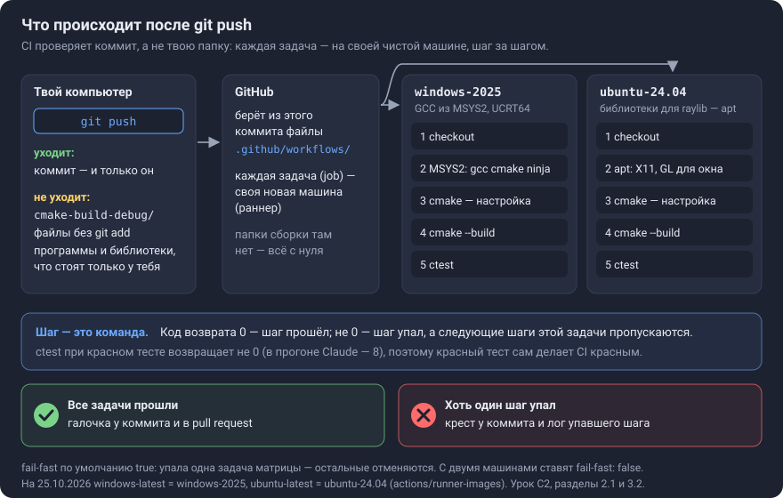
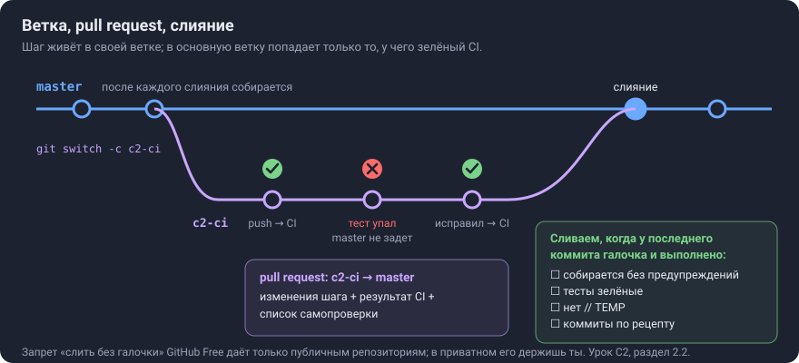
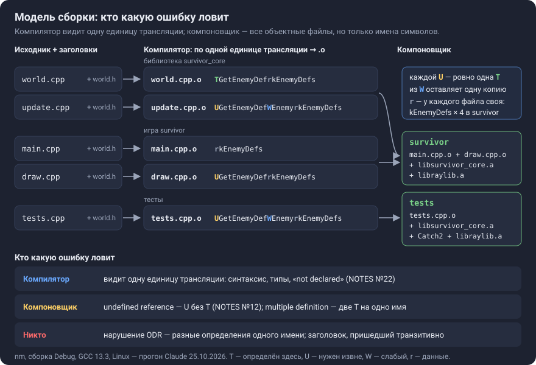

# Урок C2. Среда и CI: каждый push проверяет чистая машина

**Коротко.** Сейчас «собирается без предупреждений, тесты зелёные» знает одна-единственная папка — `cmake-build-debug` на твоём компьютере. CI (continuous integration, непрерывная интеграция) — сервис, который на каждый `git push` берёт последний отправленный коммит, на чистой виртуальной машине собирает игру и запускает тесты — у нас на Windows и на Linux — и ставит у коммита зелёную галочку или красный крест. Ветки и pull request добавляют правило: в основную ветку попадает только то, у чего галочка. Перед этим — среда: свежий GCC из MSYS2, тот же, что поставит себе CI. Мини-урок шага — модель сборки: почему одни ошибки ловит компилятор, другие — только компоновщик, а третьи — никто.

**Что строишь в шаге** (`docs/roadmap.md`, C2): сначала среда — GCC из MSYS2 (окружение UCRT64) вместо встроенного в CLion GCC 13.1 и решение про C++23; потом GitHub Actions — сборка и тесты на Windows и Linux, значок статуса в README; с этого шага каждый шаг — в своей ветке, а в основную ветку — через pull request с зелёным CI и списком самопроверки. **Готово, когда:** CI зелёный; сломанный тест делает его красным; значок в README; первый PR влит в основную ветку.

## Что сделать

Где ты сейчас — `PLAN.md`, «Сейчас».

| Часть | Что сделаешь | Готово, когда | Ориентир, мин |
|---|---|---|---|
| П1 | ставишь MSYS2 и GCC 16.2 | `gcc --version` печатает 16.2.0 | 15 |
| П2 | CLion собирает игру новым GCC | в выводе CMake `GNU 16.2.0`, тесты зелёные | 15 |
| П3 | пробный прогон CI на GitHub | во вкладке Actions зелёный запуск `trial` | 15 |
| П4 | настоящий CI: готовый файл | две зелёные задачи; на Windows в «Tool versions» — 16.2.0 | 15 |
| П5 | нарочная поломка теста | обе задачи красные, после отката — зелёные | 15 |
| П6 | README со значком | в ветке `c2-ci` на GitHub — `README.md` со значком | 10 |
| П7 | PR → слияние → удалить ветку | PR влит, CI на `master` зелёный | 10 |
| 2.4 | мини-урок «модель сборки» | ответишь на вопросы 5–6 из раздела 7 | 15 |

## Слова урока

| Слово | Что это |
|---|---|
| CI (continuous integration) | сервис, который на каждый push сам собирает проект и запускает тесты на чистой машине |
| workflow | файл в `.github/workflows/`: когда запускать и что делать |
| задача (job) | одна машина и её шаги; у нас две — Windows и Linux |
| шаг (step) | одна команда (`run:`) или готовое действие (`uses:`) |
| образ, раннер (runner) | виртуальная машина GitHub с уже установленными программами: `ubuntu-24.04`, `windows-2025` |
| действие (action) | готовый шаг из чужого репозитория на GitHub: `actions/checkout`, `msys2/setup-msys2` |
| матрица | список вариантов одной задачи; GitHub запускает задачу по разу на каждый вариант |
| shell (оболочка) | программа, которая выполняет команды из `run:`; на Linux — bash, на Windows по умолчанию PowerShell, у нас — оболочка MSYS2 |
| `${{ … }}` | выражение GitHub: значение подставляется в текст до запуска шага |
| `\|` и `>-` в YAML | `\|` оставляет строки отдельными, `>-` склеивает их в одну через пробел |
| MSYS2, UCRT64 | набор программ под Windows и его окружение, в котором лежит твой GCC 16.2 |
| CMake, Ninja | CMake пишет план сборки, Ninja выполняет его и пересобирает только изменённое |
| ветка | подвижный ярлык на коммит; работа шага идёт в своей ветке |
| pull request (PR) | запрос на GitHub «влей мою ветку в основную»; на его странице — изменения и результат CI |
| upstream | ветка на GitHub, с которой связана твоя: туда уходит `git push` без аргументов |
| fast-forward (перемотка) | слияние, при котором ярлык ветки просто сдвигается вперёд, без нового коммита |
| единица трансляции | один `.cpp` вместе со всеми подключёнными заголовками — то, что компилятор обрабатывает за один вызов |
| компоновщик | склеивает скомпилированные файлы и библиотеки в одну программу |
| ODR | правило одного определения: у используемой функции или переменной (не `inline`) во всей программе ровно одно определение |

Подробнее про ветки, PR, upstream и fast-forward — урок `docs/lessons/C2-git.md`.

## Как читать этот урок

- Примеры учебные (`add_test.cpp`, `Bonus`, `Damage`, `Stats`); код и файлы игры — там, где разбираем конкретную строку. Код, репозиторий и цифры — на 25.10.2026.
- **Ответь сам** — вопрос к тебе. Сначала ответь — вслух или строкой в блокноте, — потом открой «Ответ». **Сам** — задание без ответа: это уже часть шага.
- Каждое число — из источника или прогона. Прогоны Claude — на Linux (Ubuntu 24.04): GCC 13.3, 14.2 и 16.2, clang 18. На Windows я ничего не запускал — это проверишь ты, а потом CI.
- Схемы лежат в `docs/lessons/img/`.
- Начни с раздела «Практика»: там по шагам — скачать, установить, настроить, первый прогон. Разделы 1–5 объясняют, что ты делаешь и почему; на них ссылаются шаги практики.
- Где ты сейчас и что следующее — `PLAN.md`, «Сейчас» и «Следующее действие».

| Раздел | Что поймёшь | Ориентир, мин |
|---|---|---|
| Практика П1–П7 | что делать руками: установка, настройка, пробный и настоящий CI, поломка, значок, PR | 95 |
| 1. Зачем | что уже ломалось без CI и чего CI не даст | 5 |
| 2.1–2.3. Идея | чистая машина; ветка и PR; один компилятор дома и в CI | 12 |
| 2.4. Мини-урок | модель сборки: кто какую ошибку ловит | 10 |
| 3. Как устроено у нас | что CI повторит за CLion; две машины; твои решения | 15 |
| 4. Примеры | учебный workflow; три программы про компоновку; регистр букв | 25 |
| 5. Подвохи и края | fail-fast, MSYS2 обновляется, шаблон PR, защита ветки | 10 |
| 6–7. Собеседование, самопроверка | рассказать и проверить себя | 15 |

---

## Практика: от установки до первого прогона

Здесь — что делать руками, по порядку, без поиска в интернете. Зачем каждое действие и как оно устроено внутри — в разделах 1–5, ссылки стоят прямо в шагах. Каждая часть заканчивается тем, что видно на экране; дошёл до «Готово, когда» — напиши в чат, что получилось.

Все части с «Готово, когда» — в начале урока, «Что сделать».

### П1. MSYS2 и GCC 16.2

**Зачем.** CI будет повторять твою сборку, поэтому сначала делаем сборку такой, какую он повторит (раздел 2.3). Знать CI для этого не нужно. Папки `C:\msys64` у тебя на диске сейчас нет (проверено 25.10.2026) — ставим с нуля.

**1.** Открой https://www.msys2.org/ и скачай установщик из шага 1 на странице — на 25.10.2026 это `msys2-x86_64-20260927.exe`. Нужна 64-битная Windows 10 версии 1809 или новее (там же, шаг 2); у тебя Windows 11.

**2.** Запусти и оставь папку по умолчанию — `C:\msys64` (у тебя MSYS2 стоит в `C:\dev\utilities\msys64` — это тоже подходит; дальше в уроке подставляй свой путь вместо `C:\msys64`). MSYS2 советует как раз такой путь: «a short ASCII-only path on a NTFS volume, no accents, no spaces» (MSYS2, «Installer»).

**3.** В конце установки откроется терминал окружения UCRT64 (msys2.org, шаг 5). Закрыл — запусти `C:\msys64\ucrt64.exe`: у каждого окружения свой файл запуска (MSYS2, «Terminals»).

**4.** Обнови MSYS2 целиком: `pacman -Suy`. Если pacman напишет «To complete this update all MSYS2 processes including this terminal will be closed» — согласись, снова открой `ucrt64.exe` и ещё раз выполни `pacman -Suy`: второй проход обновит остальное (MSYS2, «Updating MSYS2»).

**5.** Поставь компилятор: `pacman -S mingw-w64-ucrt-x86_64-toolchain` — это группа из 12 пакетов: GCC, отладчик gdb, make и другие (packages.msys2.org). pacman задаст два вопроса — на оба жми Enter:

- `Enter a selection (default=all)` — Enter ставит все пакеты группы;
- `Proceed with installation? [Y/n]` — заглавная `Y` значит, что Enter — это «да».

Тексты вопросов и что значит пустой ответ — из исходников pacman в MSYS2 (`src/pacman/util.c`, `src/pacman/sync.c`).

**Готово, когда:** в том же терминале `gcc --version` печатает в первой строке `16.2.0`, а `which gcc` — `/ucrt64/bin/gcc` (папка окружения UCRT64 — `/ucrt64`, MSYS2, «Environments»).

**Если не так.** Версия другая — выполни шаг 4 ещё раз. `gcc: command not found` — ты в терминале другого окружения (MSYS, MINGW64): закрой его и открой `ucrt64.exe`.

### П2. CLion собирает игру новым GCC

**Зачем.** Сейчас CLion собирает встроенным GCC 13.1 (раздел 2.3). Переключаем его на GCC из MSYS2 — тот же, что поставит себе CI.

**1. Toolchain.** `File | Settings | Build, Execution, Deployment | Toolchains` → кнопка добавления → `MinGW` (CLion, «Toolchains»). Имя — `UCRT64`. В поле **Toolset** — `C:\msys64\ucrt64`: так в справке CLion настраивают окружение MSYS2, только там пример для `clang64` (CLion, «Configure CLion on Windows», раздел про MSYS2). CLion сам ищет компиляторы; если поле осталось пустым — выбери вручную `gcc.exe`, `g++.exe` и `gdb.exe` из `C:\msys64\ucrt64\bin`. CMake и Build Tool оставь встроенные: «By default, CLion will use bundled Ninja as the Build Tool» (там же).

**2. Профиль.** `File | Settings | Build, Execution, Deployment | CMake` → профиль `Debug`:

- **Toolchain** — выбери `UCRT64` (CLion, «CMake profiles»: «From this drop down list, select the desired toolchain»);
- **Build directory** — впиши `cmake-build-debug-ucrt64`.

Новая папка — потому что CMake запоминает путь к компилятору в кэше папки сборки (`docs/roadmap.md`, «Среда», «Как обновить», п. 3); в новой папке настройка пойдёт с нуля. Старая `cmake-build-debug` останется — её можно удалить потом. Новая папка в git не попадёт: в `.gitignore` стоит `cmake-build-*/`.

**3.** Нажми OK. CLion перезагрузит проект. В окне **CMake** (внизу) найди строку `The CXX compiler identification is GNU 16.2.0`.

**4.** `Build | Build Project` — в окне сборки не должно быть ни одного `warning`. Потом запусти конфигурацию «All CTest».

**Готово, когда:** в выводе CMake — `GNU 16.2.0`; сборка без предупреждений; 23 теста зелёные.

**Если не так.**

- Предупреждения или ошибки сборки — пришли их текстом: на Linux с GCC 16.2 их не было (прогон Claude), на Windows у тебя их тоже не было (25.10.2026).
- **Toolset не принимает папку MSYS2** — после Apply снова стоит «Bundled MinGW», версия «11.0 w64», — а если указать компиляторы вручную, тестовый запуск CMake падает: `The C compiler identification is unknown`, `is not able to compile a simple test program`, `FAILED: [code=1]` без единого сообщения. Так было у тебя 25.10.2026. Причина: `gcc.exe` только запускает настоящий компилятор `cc1.exe` из `ucrt64\lib\gcc\x86_64-w64-mingw32\16.2.0\`, а тому нужны 8 DLL из `ucrt64\bin` — `libgmp-10`, `libisl-23`, `libmpc-3`, `libmpfr-6`, `libzstd`, `zlib1`, `libgcc_s_seh-1`, `libwinpthread-1` (таблица импорта `cc1.exe`, `objdump -p`, проверка Claude). Windows ищет DLL рядом с программой и в `PATH`; в терминале UCRT64 `ucrt64\bin` в `PATH` есть, а CLion её туда не добавил. Почему CLion не принял папку, так и не выяснили. Решение — файл окружения тулчейна: «a shell script that initializes the environment», в том числе для «changing the `PATH`»; он действует на настройку CMake, сборку и запуск программ (CLion, «Toolchains»). Блокнотом создай `.bat` вне проекта, например `C:\dev\utilities\ucrt64-env.bat`, с одной строкой `set "PATH=<папка MSYS2>\ucrt64\bin;%PATH%"` (тип файла — «Все файлы»), и укажи его в Toolchains → `UCRT64` → **Add environment** → **From file**. Проверка: у C++ Compiler подсказка ведёт в `ucrt64\bin`, предупреждения под компиляторами нет. Поле Toolset при этом может так и показывать «Bundled MinGW» — компилятор всё равно берётся из `PATH`.
- Строки `The CXX compiler identification is GNU …` в выводе нет — CMake печатает её только при первой настройке папки, дальше берёт компилятор из кэша (прогон Claude). Покажет снова `Tools | CMake | Reset Cache and Reload Project` (CLion, «CMake cache»); или посмотри в кэше: `cmake-build-debug-ucrt64/CMakeFiles/<версия CMake>/CMakeCXXCompiler.cmake`, строки `CMAKE_CXX_COMPILER` и `CMAKE_CXX_COMPILER_VERSION`.
- В выводе осталось `GNU 13.1.0` — проверь, что в профиле стоит твой тулчейн, а папка сборки новая.

**После П2.** Строку компилятора в Instructions проекта и в `PROJECT_INSTRUCTIONS.md` надо поменять с `GNU 13.1.0` на `GNU 16.2.0` (`docs/roadmap.md`, «Как обновить», п. 5) — иначе следующие чаты будут считать компилятор старым. Файл поправлю я, когда напишешь, что П2 готов; вставить текст в Instructions сможешь только ты.

### П3. Пробный прогон CI

**Зачем.** Увидеть весь круг один раз на файле, где ломаться нечему: файл → push → GitHub запускает → результат во вкладке Actions. Тогда в П4 ты разбираешься только со своими командами, а не со всем сразу.

**1. Ветка.** Открой терминал в CLion: `View | Tool Windows | Terminal` или `Alt+F12`; он открывается в корне проекта (CLion, «Terminal»). Выполни `git switch -c c2-ci` — создать ветку шага и перейти в неё (раздел 2.2).

**2. Файл.** В окне Project — правый клик по корню проекта → `New | File` → впиши путь целиком: `.github/workflows/trial.yml`. Недостающие папки CLion создаст сам: «If some of the nested directories do not exist, they will be created» (CLion, «Create new files»). Содержимое:

```yaml
# Пробный запуск CI: увидеть, как GitHub выполняет файл. Не сборка игры.
name: trial
on: [push]
jobs:
  look:
    runs-on: ubuntu-24.04
    steps:
      - uses: actions/checkout@v7
      - name: What is here
        run: ls
      - name: Tools on this machine
        run: |
          g++ --version
          cmake --version
```

Что тут что — раздел 4.1. Файл проверен `actionlint` 1.7.12 — замечаний нет.

**3. Коммит и push.** `git add .github/workflows/trial.yml`, потом `git commit -m "…"` — заголовок по рецепту пишешь ты (`PLAN.md`, «Имена и коммиты»), потом `git push -u origin c2-ci`.

**4. Смотреть.** На GitHub открой репозиторий → **Actions** → слева workflow `trial` → запуск в списке → задача `look` → раскрой шаги (GitHub Docs, «Viewing workflow run history»: «Under your repository name, click Actions»).

**Готово, когда:** у запуска зелёная галочка. В шаге «What is here» — файлы твоего репозитория, а `cmake-build-debug` и `.idea` там нет: они в `.gitignore` и в коммит не попадают — это и есть «чистая машина» из раздела 2.1. В шаге «Tools on this machine» — версии g++ и CMake из образа `ubuntu-24.04` (в его README — GCC 12.4, 13.3, 14.2 и CMake 3.31.6; какая версия g++ стоит по умолчанию, README не говорит — посмотришь в логе).

**Если не так.**

- `git push` отклонён с текстом вроде ``refusing to allow a Personal Access Token to create or update workflow … without `workflow` scope`` — git входит в GitHub по токену без права менять файлы workflow: «workflow — Grants the ability to add and update GitHub Actions workflow files» (GitHub Docs, «Scopes for OAuth apps»). Вход через браузер в Git Credential Manager это право просит (в исходниках GCM в списке прав GitHub — `repo`, `gist`, `workflow`); токен, созданный вручную, — только если ты отметил `workflow`. Пришли текст ошибки — разберём, как ты входишь.
- Вкладка Actions пустая — проверь, что файл лежит именно в `.github/workflows/` и что push прошёл. Actions включены по умолчанию: «By default, GitHub Actions is enabled on all repositories and organizations» (GitHub Docs, «Managing GitHub Actions settings for a repository»).

### П4. Настоящий CI игры — готовый файл

**Как договорились 27.10.2026.** YAML — язык файла настройки, а не цель проекта. Твои слова: «не понимаю какие команды есть и язык yaml. Я явно не хочу на этом заострять внимание». Поэтому файл — готовый. Твоя часть — понимать, что делает каждая строка, отправить и проверить результат.

**Что сделать.** Содержимое ниже — в `.github/workflows/github-ci.yml` → коммит в `c2-ci` → push → GitHub → **Actions**.

**Готово, когда:** у запуска `CI` две зелёные задачи — «Windows · MSYS2 UCRT64» и «Linux · GCC 14»; в задаче Windows шаг «Tool versions» печатает GCC 16.2.0. Сделано 27.10.2026: запуск по коммиту `4209464`, обе задачи зелёные — Linux за 1 мин 5 с, Windows за 2 мин 31 с (данные GitHub API). Версию в логе проверь сам: лог без входа в GitHub мне не виден.

```yaml
# Сборка и тесты на каждый push: Windows (MSYS2 UCRT64, как у тебя) и Linux.
name: CI

on:
  push:
    paths-ignore:            # поменялись только документы — CI не запускаем
      - '**.md'
      - 'docs/**'

permissions:
  contents: read             # задаче нужно только прочитать код

concurrency:                 # новый push в ту же ветку отменяет старый запуск
  group: ${{ github.workflow }}-${{ github.ref }}
  cancel-in-progress: true

jobs:
  build:
    name: ${{ matrix.name }}
    runs-on: ${{ matrix.os }}
    timeout-minutes: 30      # зависло — стоп через 30 минут, а не через 6 часов
    strategy:
      fail-fast: false       # упала одна машина — вторая всё равно доработает
      matrix:
        include:
          - name: Windows · MSYS2 UCRT64
            os: windows-2025
            shell: msys2 {0}
            cc: gcc
            cxx: g++
          - name: Linux · GCC 14
            os: ubuntu-24.04
            shell: bash
            cc: gcc-14
            cxx: g++-14
    defaults:
      run:
        shell: ${{ matrix.shell }}

    steps:
      - name: Checkout
        uses: actions/checkout@v7

      - name: Install raylib dependencies (Linux)
        if: runner.os == 'Linux'
        run: |
          sudo apt-get update
          sudo apt-get install -y libasound2-dev libx11-dev libxrandr-dev libxi-dev libgl1-mesa-dev libglu1-mesa-dev libxcursor-dev libxinerama-dev libwayland-dev libxkbcommon-dev

      - name: Install MSYS2 toolchain (Windows)
        if: runner.os == 'Windows'
        uses: msys2/setup-msys2@v2
        with:
          msystem: UCRT64
          install: >-
            mingw-w64-ucrt-x86_64-gcc
            mingw-w64-ucrt-x86_64-cmake
            mingw-w64-ucrt-x86_64-ninja

      - name: Tool versions
        run: |
          ${{ matrix.cxx }} --version
          cmake --version
          ninja --version

      - name: Configure
        run: >-
          cmake -S . -B build -G Ninja
          -DCMAKE_BUILD_TYPE=Debug
          -DCMAKE_C_COMPILER=${{ matrix.cc }}
          -DCMAKE_CXX_COMPILER=${{ matrix.cxx }}

      - name: Build
        run: cmake --build build

      - name: Test
        run: ctest --test-dir build --output-on-failure
```

Файл проверен `actionlint` 1.7.12 — замечаний нет. Команды Linux-задачи Claude прогнал на твоём `master` (`f458e55`, Ubuntu 24.04): GCC 14.2.0, 0 предупреждений, «100% tests passed, 0 tests failed out of 23». raylib и Catch2 при этом взяты из локальных копий, без скачивания.

#### Построчно

**Блок 1. Когда запускать**

| Строка | Что делает | Почему так |
|---|---|---|
| `# Сборка и тесты…` | комментарий: всё после `#` GitHub пропускает | подсказка для человека |
| `name: CI` | имя workflow во вкладке Actions | коротко; адрес значка от него не зависит — только от имени файла (П6) |
| `on:` → `push:` | запускать на каждый push в любую ветку | CI проверяет каждый отправленный коммит |
| `paths-ignore:` → `'**.md'`, `'docs/**'` | не запускать, если изменились только `.md`-файлы и папка `docs` | коммиты «Update study files» не гоняют машины: «When all the path names match patterns in paths-ignore, the workflow will not run» (GitHub Docs, «Workflow syntax») |
| кавычки вокруг шаблонов | — | `*` в YAML — особый знак: строка `- **.md` без кавычек не разбирается — `unknown anchor` (проверка Claude: `actionlint` и PyYAML) |

**Блок 2. Права и очередь**

| Строка | Что делает | Почему так |
|---|---|---|
| `permissions:` → `contents: read` | токен задачи может только читать код | `GITHUB_TOKEN` — пропуск, который GitHub выдаёт каждой задаче: «At the start of each workflow job, GitHub automatically creates a unique `GITHUB_TOKEN`» (GitHub Docs, «GITHUB_TOKEN»). Задаче нужно только скачать код; так советует README `actions/checkout` |
| `concurrency:` → `group: ${{ github.workflow }}-${{ github.ref }}` | группа запусков: имя workflow + ветка, например `CI-refs/heads/c2-ci` | в одной группе — один запуск за раз |
| `cancel-in-progress: true` | новый push в ту же ветку отменяет запуск, который ещё идёт | результат по устаревшему коммиту уже не нужен |

**Блок 3. Задача и её варианты**

| Строка | Что делает | Почему так |
|---|---|---|
| `jobs:` | список задач; задача — одна машина и её шаги | у нас одна задача, матрица запускает её дважды |
| `build:` | идентификатор задачи — внутреннее имя | раньше было `look` |
| `name: ${{ matrix.name }}` | имя задачи на экране — из варианта матрицы | вместо `look` видно «Windows · MSYS2 UCRT64» и «Linux · GCC 14»: «Use `jobs.<job_id>.name` to set a name for the job, which is displayed in the GitHub UI» (GitHub Docs, «Workflow syntax») |
| `runs-on: ${{ matrix.os }}` | на какой машине запускать | образ назван точно, а не `windows-latest`: `-latest` указывает на новейший образ и со временем переезжает — «The `-latest` migration process is gradual» (README `actions/runner-images`), — и сборка поменялась бы без твоего коммита |
| `timeout-minutes: 30` | остановить задачу через 30 минут | по умолчанию — 360 минут; обычный запуск идёт 1–3 минуты |
| `strategy:` → `fail-fast: false` | если одна задача упала, вторая доработает | по умолчанию `true`: упавшая Windows отменила бы Linux, и ты не узнал бы, есть ли ошибка там (раздел 5) |
| `matrix:` → `include:` | список вариантов; каждый пункт `- name: …` — отдельный запуск задачи со своими переменными | два пункта — два запуска: «A matrix strategy lets you use variables in a single job definition to automatically create multiple job runs» |
| `name`, `os`, `shell`, `cc`, `cxx` | переменные варианта; в файле их читают как `matrix.name`, `matrix.os`… | всё, чем отличаются Windows и Linux, — в одном месте |
| `defaults:` → `run:` → `shell: ${{ matrix.shell }}` | в какой оболочке выполнять все `run` задачи | на Linux — `bash`, на Windows — оболочка MSYS2 (вопрос 1 ниже) |

**Блок 4. Шаги**

| Строка | Что делает | Почему так |
|---|---|---|
| `- name: Checkout` | имя шага в логе | «A name for your step to display on GitHub» |
| `uses: actions/checkout@v7` | копирует код репозитория на машину | машина пустая: «checks-out your repository under `$GITHUB_WORKSPACE`, so your workflow can access it» (README `actions/checkout`); `@v7` — вопрос 3 ниже |
| `if: runner.os == 'Linux'` | шаг выполняется только на Linux | на Windows нет `apt-get`; `runner.os` — «`Linux`, `Windows`, or `macOS`» (GitHub Docs, «Contexts») |
| `run: \|` | дальше — команды, каждая строка отдельно | вопрос 4 ниже |
| `sudo apt-get update` | обновить список пакетов Ubuntu | «Always run `sudo apt-get update` before installing a package» (GitHub Docs, «Customizing GitHub-hosted runners») |
| `sudo apt-get install -y libasound2-dev …` | поставить библиотеки звука, X11 и OpenGL | без них CMake не настроит raylib: `RandR headers not found` (прогон Claude, раздел 3.2); `sudo` — от имени администратора; `-y` — «да» на все вопросы, отвечать в CI некому |
| `if: runner.os == 'Windows'` + `uses: msys2/setup-msys2@v2` | только на Windows: поставить MSYS2 | «a fresh install of the latest MSYS2 installer release» (README `setup-msys2`) |
| `msystem: UCRT64` | окружение MSYS2 | то же, что у тебя дома; без этой строки было бы `MINGW64` |
| `install: >-` + три пакета | GCC, CMake и Ninja для UCRT64 | `>-` склеивает три строки в одну через пробел — так `install` ждёт список. Имя пакета = префикс окружения + программа: `mingw-w64-ucrt-x86_64-` + `gcc` (MSYS2, «Package Naming»). CMake и Ninja из образа не годятся: в оболочку MSYS2 из PATH Windows попадают только системные пути — `path-type: minimal` |
| `- name: Tool versions` + три команды | печатает версии компилятора, CMake и Ninja | в логе сразу видно, чем собирали, — нет вопроса «откуда 15» |
| `run: >-` (Configure) | длинная команда в несколько строк — выполняется как одна | так её проще читать |
| `-S .` | исходники — в текущей папке, корне репозитория | «Path to root directory of the CMake project to build» (`cmake(1)`) |
| `-B build` | папка сборки `build` | на чистой машине её нет — CMake создаст |
| `-G Ninja` | план сборки пишется для Ninja | как у тебя в CLion |
| `-DCMAKE_BUILD_TYPE=Debug` | отладочная сборка | как у тебя: в командах твоей сборки стоит `-g`, ключа `-O` нет (`compile_commands.json`) |
| `-DCMAKE_C_COMPILER=${{ matrix.cc }}`, `-DCMAKE_CXX_COMPILER=${{ matrix.cxx }}` | каким компилятором собирать C и C++ | C — для raylib: она написана на C (`project(survivor LANGUAGES C CXX)`); имена — из матрицы: на Linux `gcc-14`/`g++-14`, на Windows `gcc`/`g++` из MSYS2 |
| `run: cmake --build build` | собрать: CMake запускает Ninja | — |
| `run: ctest --test-dir build --output-on-failure` | запустить тесты | `--output-on-failure` — «Output anything outputted by the test program if the test should fail» (`ctest(1)`): при красном CI сразу видно, какой `CHECK` не прошёл |

#### Пять вопросов к файлу

**1. Что такое shell и зачем он разный.** Shell (оболочка) — программа, которая выполняет команды из `run:`. По умолчанию на Linux это `bash`, на Windows — PowerShell: «This is the default shell used on Windows» (GitHub Docs, «Workflow syntax»). На Windows нам нужна оболочка MSYS2. В ней `g++` — это GCC из MSYS2 UCRT64, а в PowerShell — GCC 15.2.0, который GitHub положил в образ `windows-2025` (README `runner-images`): это и было «15» в первом CI. Ещё в оболочке MSYS2 тесты находят DLL компилятора — та же причина, по которой CLion у тебя заработал с файлом окружения (П2). `msys2 {0}`: `msys2` — команда, которую создаёт `setup-msys2`, а на место `{0}` GitHub подставит путь к временному файлу со строками из `run`: «inserts the file name for the temporary script at {0}».

**2. Почему разные версии компиляторов.** На Windows — GCC 16.2 из MSYS2, тот же, что у тебя: требование шага — CI собирает тем же компилятором. На Linux GCC 16 в образе нет: «GNU C++: 12.4.0, 13.3.0, 14.2.0» (README `runner-images`, Ubuntu 24.04). Берём новейший из них, 14.2, и пишем явно `g++-14`: по умолчанию `gcc` в образе — 13-й (в списке пакетов образа — `gcc 4:13.2.0`). Другая версия заодно может поймать другие предупреждения.

**3. Почему `@v7`.** `actions/checkout` — репозиторий на GitHub, `v7` — метка (тег) в нём, то есть версия действия. 27.10.2026 метка `v7` указывала на тот же коммит, что `v7.0.1`, — последний выпуск (`git ls-remote`, проверка Claude); `v2` у `setup-msys2` — на `v2.33.0`. Так авторы дают исправления внутри большой версии, а переход на `v8` остаётся твоим решением: «Tags are useful for letting you decide when to switch between major and minor versions» (GitHub Docs, «Using pre-written building blocks»). Минус: метку автор может передвинуть, поэтому для чужих действий GitHub советует хэш коммита — «We recommend that you use a SHA value when using third-party actions». Это отложено (раздел 5).

**4. Что такое `|`.** Знак YAML: текст ниже — как есть, с переводами строк. GitHub выполняет его как скрипт, каждая строка — отдельная команда. `>-` — наоборот, склеивает строки в одну. Как их читает парсер YAML (проверка Claude, PyYAML):

| Запись | Что получает GitHub |
|---|---|
| `run: \|` + две строки | `'sudo apt-get update\nsudo apt-get install -y libx11-dev\n'` — две команды |
| `install: >-` + три строки | `'mingw-w64-ucrt-x86_64-gcc mingw-w64-ucrt-x86_64-cmake mingw-w64-ucrt-x86_64-ninja'` — одна строка |

**5. Что такое `${{ matrix.cxx }}`.** Выражение GitHub: до запуска шага GitHub вычисляет то, что внутри `${{ }}`, и подставляет результат в текст — «the expressions inside `${{ }}` are evaluated and then substituted with the resulting values» (GitHub Docs, «Script injections»). `matrix.cxx` — переменная `cxx` из текущего варианта матрицы. Строка `${{ matrix.cxx }} --version` в задаче Linux становится `g++-14 --version`, в задаче Windows — `g++ --version`.

### П5. Нарочная поломка

**Зачем.** Зелёный CI ничего не доказывает, пока ты не видел его красным. Так проверяем, что тесты в CI правда запускаются и упавший тест краснит запуск.

1. `tests/tests.cpp`, строка 369, тест `UpdatePlayerDamage: hit enemy to death by multiple weapons -> died once`: `CHECK(world.exps.size() == 1);` → `== 2`.
2. Коммит в `c2-ci`, push, GitHub → Actions.
3. Откат: `git revert --no-edit HEAD`, push (урок `C2-git.md`, Г7).

Если ветка шага уже влита и удалена — то же в отдельной ветке: `git switch -c c2-red-check`, поломка, коммит, `git push -u origin c2-red-check`, красный CI; потом `git switch master`, `git push origin --delete c2-red-check`, `git branch -D c2-red-check`. Ветку не сливаешь — `master` не задет; `-D`, потому что ветка не влита.

**Готово, когда:** обе задачи красные, в логе шага Test — `tests.cpp:369: FAILED` и `96% tests passed, 1 tests failed out of 23`; после отката — снова зелёные. Вывод ctest — прогон Claude на Linux с этой правкой, 27.10.2026; на Windows путь к файлу в строке `FAILED` будет другим.

### П6. README со значком

**Зачем.** Значок CI в README — первое, что видно на странице репозитория: собирается ли игра прямо сейчас.

Создай в корне `README.md` (новый файл: в окне Commit CLion он попадёт в Unversioned Files — отметь его):

```markdown
# Survivor


```

Адрес — по шаблону `https://github.com/OWNER/REPOSITORY/actions/workflows/WORKFLOW-FILE/badge.svg` (GitHub Docs, «Adding a workflow status badge»). Коммит в `c2-ci`, push. CI на этот коммит не запустится — так задумано: в нём только `.md`, а такие коммиты пропускает `paths-ignore` (П4).

**Готово, когда:** на GitHub в ветке `c2-ci` открывается `README.md` со значком.

### П7. Pull request, слияние, удаление ветки

**Зачем.** Это последний пункт «Готово, когда» шага: работа шага попадает в `master` через PR с зелёным CI (раздел 2.2).

1. На странице репозитория выбери ветку `c2-ci` → в жёлтой плашке **Compare & pull request**. Base — `master`, compare — `c2-ci` → **Create Pull Request** (GitHub Docs, «Creating a pull request»).
2. Внизу PR — проверки CI и кнопка слияния. Перед слиянием — список самопроверки: собирается без предупреждений, тесты зелёные, нет `// TEMP`, коммиты по рецепту.
3. **Merge pull request** → **Confirm merge**; способ слияния — раздел 2.2. Потом удали ветку на GitHub (GitHub Docs, «Merging a pull request»).
4. У себя: `git switch master`, `git pull`, `git branch -d c2-ci`. После squash `-d` может отказать (`not fully merged`) — раз PR влит, тогда `git branch -D c2-ci` (урок `C2-git.md`, раздел 5).

**Готово, когда:** PR влит, запуск CI на `master` зелёный, на главной странице репозитория — README со значком.

---

## 1. Зачем

**Что даст игре.** Каждый push проверен без твоего участия: собирается ли отправленный коммит и зелёные ли тесты — на двух системах. «Тесты зелёные» перестаёт зависеть от того, не забыл ли ты их запустить и что лежит в твоей папке сборки. И репозиторий начинает выглядеть как у команды: значок CI в README — первое, что увидит работодатель (`docs/roadmap.md`, этап C, «Зачем игре»; в версии 0.1 — «CI зелёный»).

**Что уже ломалось.** 17.10.2026 в основную ветку легли коммиты «Fixed input separation», и последний из них не собирался: `mouse_pos` переехал в `Input::Down`, а `UpdateLevelUp` ещё читал его из `pressed`. Это нашлось на следующий день — сборкой Claude (`docs/history.md`, «Коммиты 17.10»). С CI красный крест у этого коммита появился бы сразу после `git push` — как только машина CI дошла бы до шага сборки, — а не на следующий день.

**Что умеет старая папка сборки.** Прогон Claude при подготовке урока: скопировал проект вместе с папкой сборки, в копии нарочно сломал тест — и `cmake --build` и `ctest` в скопированной папке показали «100% tests passed». Папка сборки помнит абсолютный путь к исходникам (тот же механизм, что в `NOTES.md`, №14) и собрала старые, несломанные файлы. Настройка CMake при этом ругнулась, но сборка и тесты прошли зелёными. У CI папки сборки нет: каждый запуск начинается с пустой машины.

<details>
<summary>Как получено</summary>

Копия проекта вместе с папкой `build-gcc13` → в копии `CHECK(world.exps.size() == 1)` заменено на `== 2` → `cmake -S . -B build-gcc13` выдал «The current CMakeCache.txt directory … is different than the directory … where CMakeCache.txt was created» → `cmake --build build-gcc13` собрал → `ctest` — «100% tests passed, 0 tests failed out of 23». В `CMakeCache.txt` скопированной папки `CMAKE_HOME_DIRECTORY` указывал на исходный проект. Та же правка в свежей папке сборки — тест красный, `ctest` вернул код 8. CMake 3.28.3, GCC 13.3, Linux.

</details>

**Чего CI не даст.** CI выполняет только то, что написано в его файле: у нас это сборка и `ctest`. Игру он не запускает и на экран не смотрит. И зелёный CI не значит «ошибок нет»: тесты ловят только то, что проверяют (`NOTES.md`, №34).

**Почему сейчас.** Дальше по плану — переделки: интерфейс `Weapon` и `unique_ptr` (C3), эксперимент с `std::variant` в отдельной ветке (C4). Каждая — ветка, PR и проверка до слияния. На собеседовании спросят: «зачем команде CI?» (`docs/roadmap.md`, C2).

**Ответь сам 1.1.** Чем CI лучше правила «перед каждым коммитом запускаю All CTest»? Назови две вещи, которые это правило не ловит, даже если ты его ни разу не нарушишь.

<details>
<summary>Ответ</summary>

1. Файлы, которые есть у тебя на диске, но не в коммите: забыл `git add` новый файл — у тебя собирается, у всех остальных — нет.
2. Всё, что зависит от твоей машины: старая папка сборки, программы и библиотеки, которые стоят только у тебя, Windows вместо Linux (регистр букв в `#include`, раздел 4.3).

И правило держится на памяти, а CI — нет.

</details>

---

## 2. Идея

### 2.1. CI — чистая машина по каждому push



Как это устроено в GitHub Actions:

1. Ты делаешь `git push`.
2. GitHub ищет файлы в папке `.github/workflows` — те, что лежат в этом самом коммите, — и запускает каждый, у которого в `on:` указано это событие (GitHub Docs, «Workflows»). Отправил три коммита одним push — проверится последний: у события `push` это «Tip commit pushed to the ref» (GitHub Docs, «Events that trigger workflows»).
3. Для каждой задачи (job) берётся свежая виртуальная машина — раннер (runner) — с готовым образом системы, например `ubuntu-24.04` или `windows-2025` (GitHub, `actions/runner-images`).
4. Шаги (steps) выполняются по порядку. Шаг — это команда, и её код возврата решает: 0 — шаг прошёл, не 0 — шаг упал: «The runner will report the status of the step as fail/succeed based on this exit code» (GitHub Docs, «Workflow syntax», «Exit codes and error action preference»). После упавшего шага следующие пропускаются: у каждого шага по умолчанию условие `success()` — «Returns `true` when all previous steps have succeeded» (GitHub Docs, «Expressions», «Status check functions»).
5. Итог — у коммита: галочка или крест, и лог каждого шага.

Наши шаги — те же, что делает CLion: настройка CMake → сборка → `ctest`. `ctest` возвращает не 0, если упал хоть один тест (CMake, `ctest(1)`, «Exit code»; в прогоне Claude — 8), — поэтому красный тест сам делает CI красным.

**Аналогия — рецепт и пустая кухня.** Дома блюдо получается, потому что на полке есть то, чего нет в рецепте: особая соль, разогретая духовка. CI — повар на пустой кухне, у которого есть только рецепт — твой репозиторий. Не хватает в рецепте шага — блюдо не выйдет, и ты узнаешь, что рецепт неполный.

*Где аналогия кончается:*

- кухня не совсем пустая: в образе раннера уже стоят инструменты — в `ubuntu-24.04` это GCC 12.4, 13.3 и 14.2, CMake 3.31.6, Ninja 1.13.2 (`actions/runner-images`, Ubuntu 24.04), — и образ со временем обновляется. Поэтому что важно — ставим и указываем явно (раздел 5);
- повар пробует только то, что велено, — тесты. Вкусно ли, то есть интересно ли играть, он не скажет.

Что именно ловит «пустая кухня» в нашем проекте:

| Дома всё хорошо, потому что… | На чистой машине CI |
|---|---|
| новый файл лежит на диске, но не попал в коммит | настройка CMake: `Cannot find source file: src/weapon.cpp` (прогон Claude на учебном проекте, CMake 3.28.3) |
| старая папка сборки собрала старые файлы | папки сборки нет — каждый раз с нуля |
| библиотеки для окна raylib есть в Windows | на Linux без них raylib не настроится: `RandR headers not found; install libxrandr development package` (прогон Claude, раздел 3.2) |
| Windows не различает регистр букв в именах файлов | Linux различает: `#include "World.h"` при файле `world.h` — ошибка (раздел 4.3) |

**Ответь сам 2.1.** Ты добавил `src/weapon.cpp`, вписал его в `CMakeLists.txt`, в CLion всё собралось, тесты зелёные. Закоммитил `CMakeLists.txt`, а `weapon.cpp` забыл. Что увидишь у себя и что — в CI? Какой шаг CI упадёт первым?

<details>
<summary>Ответ</summary>

У себя — ничего: файл на диске, сборка идёт. В CI упадёт первый же шаг с CMake — настройка: `Cannot find source file: src/weapon.cpp` и следом `No SOURCES given to target` (прогон Claude на учебном проекте, CMake 3.28.3). Сборка и тесты даже не начнутся: они идут после упавшего шага.

</details>

### 2.2. Ветка и pull request — основная ветка всегда собирается



Сейчас все коммиты идут прямо в основную ветку. С C2 — по-другому (`docs/roadmap.md`, C2):

1. Шаг начинается с ветки: `git switch -c c2-ci` — создать ветку и перейти в неё (git, `git-switch`, ключ `-c`).
2. Коммиты — в ветку. `git push -u origin c2-ci` отправляет ветку и связывает её с удалённой (`-u`, `--set-upstream`, git, `git-push`). CI проверяет каждый push.
3. На GitHub открываешь **pull request** (PR) — запрос «влей мою ветку в основную». На странице PR — все изменения шага, результат CI и список самопроверки: собирается без предупреждений, тесты зелёные, нет `// TEMP`, коммиты по рецепту.
4. Галочка есть и список выполнен — сливаешь (merge). Ветку можно удалить.

Зачем это, если работаешь один:

- **основная ветка — всегда рабочая версия.** После каждого слияния она собирается и проходит тесты — на этом держатся тег версии 0.1, человек, который склонирует репозиторий, и `git bisect` (B4);
- **проверка — до, а не после.** Красный крест у коммита в основной ветке значит: сломанное уже там. Красный крест в PR значит: сломанное осталось в ветке;
- **PR — место для ревью своего кода:** весь шаг одним списком изменений, как его увидит другой человек.

Способ слияния выбираешь сам (GitHub Docs, «About merge methods on GitHub»): merge commit — «all commits from the feature branch are added to the base branch in a merge commit»; squash — «the pull request's commits are squashed into a single commit»; rebase — коммиты ветки по одному, без коммита слияния. Разница видна в истории: при merge commit и rebase в основную ветку попадут и промежуточные коммиты ветки — в том числе тот, на котором CI был красным; при squash там будет один коммит на весь PR.

**Две детали твоего репозитория** (проверено 25.10.2026):

- основная ветка называется `master`, а в плане написано `main`. `master` — потому что так называет первую ветку `git init`: «currently `master`, but this will change to `main` when Git 3.0 is released» (git, `git-init`, `--initial-branch`). Оставить или переименовать — решаешь ты (раздел 3.3). **Решено 27.10.2026: оставить `master`;**
- **Обновление 27.10.2026:** репозиторий стал публичным — список запусков CI читается через GitHub API без входа (проверка Claude), так что защита ветки на GitHub Free теперь доступна. Как было 25.10: `koulplay/survivor` без входа в GitHub не читается (`git ls-remote` просит логин) — значит, репозиторий приватный. GitHub умеет запрещать слияние без зелёного CI (защита веток и правила — rulesets), но на бесплатном плане — только в публичных репозиториях: «Protected branches are available in public repositories with GitHub Free» (GitHub Docs, «About protected branches»; то же — «About rulesets»); в приватных — с GitHub Pro и выше. В приватном на GitHub Free правило «не сливать без галочки» держится на тебе.

**Ответь сам 2.2.** Почему бы не пушить прямо в `master` и смотреть на CI после? Что даёт PR, чего не даёт красный крест у коммита в `master`?

<details>
<summary>Ответ</summary>

Крест в `master` сообщает, что сломанное уже в основной ветке: в истории, у каждого, кто сделает `git pull`, в любом будущем `git bisect`. В PR проверка идёт до слияния: сломанное остаётся в ветке, `master` не трогается. Плюс в PR виден весь шаг целиком — удобно проверить список самопроверки.

</details>

### 2.3. Среда: свежий компилятор — и тот же в CI

Сейчас CLion собирает игру своим MinGW: в `cmake-build-debug/CMakeFiles/clion-environment.txt` записано `ToolSet: 11.0 w64 (local)@C:\Program Files\JetBrains\CLion 2026.1.3\bin\mingw`, компилятор в нём — GCC 13.1 (`PROJECT_INSTRUCTIONS.md`, «environment»).

| | GCC | Дата | Источник |
|---|---|---|---|
| у тебя сейчас | 13.1 — первый выпуск ветки 13 | 26.04.2023 | gcc.gnu.org, «GCC Releases» |
| последний выпуск ветки 13 на сегодня | 13.5 | 11.09.2026 | там же |
| текущий | 16.2 | 07.08.2026 | там же |
| в MSYS2, окружение UCRT64 | пакет `mingw-w64-ucrt-x86_64-gcc` 16.2.0-6 | собран 13.10.2026 | packages.msys2.org |

Исправления из 13.2–13.5 во встроенный MinGW не попали. Стандарт при этом остаётся C++20, и всё, что в плане, собирается и на 13.1 (`docs/roadmap.md`, «Среда»), — поэтому обновление — рекомендация, а не условие.

**Что изменится в нашем коде.** Прогон Claude на Linux: игра и тесты с GCC 16.2 собираются без единого предупреждения с нашими флагами (`-Wall -Wextra -Wpedantic`), 23 теста зелёные; то же — на GCC 14.2. На Windows я не проверял — это первая проверка после обновления. Одна новость GCC 16 касается всех: язык по умолчанию теперь C++20 — «GCC 16 changes the default language version for C++ compilation from -std=gnu++17 to -std=gnu++20» (GCC 16 Release Notes). Нас она не задевает: `CMakeLists.txt` задаёт стандарт сам (`CMAKE_CXX_STANDARD 20`, `CMAKE_CXX_EXTENSIONS OFF`), и в командах компиляции стоит `-std=c++20` (прогон Claude, `build.ninja`).

**Почему «тот же в CI».** Галочка CI должна что-то говорить про твою сборку. Задача на Windows в CI поставит MSYS2 и тот же пакет GCC — сегодня это 16.2. Но машина CI ставит MSYS2 заново при каждом запуске, а MSYS2 — «a rolling release distribution and only supports full system upgrades» (MSYS2, «Updating MSYS2»): пакеты обновляются часто и только все вместе. Какие версии получит CI, зависит от входа `update` у `setup-msys2`: «By default, the installation is not updated; hence package versions are those of the installation tarball» (README `msys2/setup-msys2`) — то есть версии из последнего установщика MSYS2; с `update: true` — последние на момент запуска. У тебя же версии меняются, только когда ты сам запустишь `pacman -Suy`. Со временем компиляторы разойдутся. Это и польза — CI заранее покажет, как код соберётся новым GCC, — и подвох: красный крест, хотя твой код не менялся (вопрос 2.3).

На Linux GCC 16 в образах GitHub нет: в `ubuntu-24.04` — 12.4, 13.3 и 14.2, в `ubuntu-26.04` — 13.4, 14.3 и 15.2 (`actions/runner-images`). Как быть — решение шага (раздел 3.3).

**C++23 — тоже решение шага.** Технически это одна строка `CMAKE_CXX_STANDARD 23`. Где C++23 окупается, в плане помечено: `std::expected` (F2, G3), `std::generator` (H6–H7), `std::move_only_function` (J) (`docs/roadmap.md`, «Решения по умолчанию»).

| | C++20 (как сейчас) | C++23 |
|---|---|---|
| правка | никакой | одна строка в `CMakeLists.txt` |
| наш код | собирается, 23 теста зелёные | тоже: GCC 14.2 и 16.2, без предупреждений, 23 теста (прогон Claude) |
| `std::expected`, `std::move_only_function` | нет — писать замену | есть уже в GCC 13 |
| `std::print`, `std::generator` | нет | с GCC 14; на GCC 13.3 не собираются |
| статус в GCC | C++20 — язык по умолчанию с GCC 16 | GCC называет поддержку C++23 экспериментальной |
| Linux-задача CI | любой GCC из образа | GCC не ниже 14 |

<details>
<summary>Как получена таблица</summary>

Прогон Claude: по маленькой программе на каждую возможность (`std::expected`, `std::print`, `std::generator`, `std::move_only_function`), `-std=c++23`, GCC 13.3, 14.2 и 16.2 на Linux. На 13.3 не собрались `print` и `generator`, остальное собралось везде. Наш проект с `CMAKE_CXX_STANDARD 23` — на GCC 14.2 и 16.2. Статус — GCC, «C++ Standards Support in GCC»: «C++20 mode is the default since GCC 16»; «GCC has experimental support for the latest revision of the C++ standard». Что значит «экспериментальная», libstdc++ пишет на примере C++11 и C++14: API и ABI возможностей стабильны только с первого неэкспериментального выпуска (libstdc++ manual, «Status»).

</details>

**Ответь сам 2.3.** В понедельник CI зелёный. В среду, без единой твоей правки, задача на Windows красная, а у тебя всё собирается. Как такое возможно и с чего начать разбираться?

<details>
<summary>Ответ</summary>

CI каждый раз ставит MSYS2 и пакеты заново и может получить версии новее твоих — из свежего установщика MSYS2 или, при `update: true`, последние на момент запуска. У тебя стоят те, что были при установке или последнем `pacman -Suy`. Значит, на машине CI и у тебя теперь разные компиляторы (или CMake). Начать с лога: какая версия GCC в шаге настройки (строка `The CXX compiler identification is GNU …`) и какая у тебя. Дальше — `pacman -Suy`, повторить у себя и чинить уже на одинаковом компиляторе.

</details>

### 2.4. Мини-урок: модель сборки — кто какую ошибку ловит



Сборку C++ делают три разных работника, и у каждого свой кругозор.

1. **Препроцессор** выполняет `#include`: «Each file introduced with the `#include` directive goes through phases 1 through 4, recursively», а директивы потом убираются (cppreference, «Phases of translation», фаза 4). Из `.cpp` и всего, что он включил, получается **единица трансляции** (translation unit, TU). У нас их пять: `main.cpp`, `draw.cpp`, `world.cpp`, `update.cpp`, `tests.cpp` — и `world.h` вставлен в каждую.
2. **Компилятор** переводит одну единицу трансляции за раз в объектный файл (`.o`). Другие `.cpp` он не видит. Встретив объявление `const EnemyDef &GetEnemyDef(EnemyType type);` (`world.h`, строка 138), он верит, что определение где-то есть, и оставляет в `.o` пометку «нужен `GetEnemyDef`».
3. **Компоновщик** (linker) собирает все `.o` и библиотеки (`libsurvivor_core.a`, `libraylib.a`) в программу и для каждой пометки «нужен» ищет «есть»: «Translation units, instantiation units, and library components needed to satisfy external references are collected into a program image» (cppreference, фаза 9).

Как это выглядит на нашем коде — символы из `nm` (прогон Claude, сборка Debug, GCC 13.3, Linux). Буквы — обозначения `nm`: `T` — код, определён здесь; `U` — «The symbol is undefined», то есть нужен извне; `W` — слабый (weak) символ; `r` — данные только для чтения; строчная буква — символ «usually local» (GNU binutils, «nm»).

| Объектный файл | `GetEnemyDef` | `kEnemyDefs` | конструктор `Enemy` |
|---|---|---|---|
| `world.cpp.o` | `T` — определена здесь | `r` — своя копия | — |
| `update.cpp.o` | `U` — нужна извне | `r` — своя копия | `W` |
| `draw.cpp.o` | `U` | `r` — своя копия | — |
| `main.cpp.o` | — | `r` — своя копия | — |
| `tests.cpp.o` | `U` | `r` — своя копия | `W` |

- **`T` и `U`** компоновщик сводит: каждой `U` — ровно одна `T`.
- **`W`** — так помечены `inline`-функции. Конструктор `Enemy` написан внутри класса, а «A function defined entirely inside a class/struct/union definition … is implicitly an inline function» (cppreference, «inline specifier»). Копий много, компоновщик оставляет одну.
- **`r` строчной буквой** — данные с внутренней связью (internal linkage). `constexpr` у переменной «implies `const`» (cppreference, «constexpr specifier»), а `const`-переменная в области пространства имён видна только в своей единице трансляции (cppreference, «Storage class specifiers», «Linkage»). Поэтому в готовой программе `survivor` таблица `kEnemyDefs` лежит четыре раза — по 140 байт (5 строк × 28 байт; прогон Claude, `nm` и `sizeof`). Это не ошибка: четыре разных объекта, у каждого своё имя внутри своего файла.

Отсюда — кто что ловит:

| Кто | Что видит | Какие ошибки | У нас было |
|---|---|---|---|
| компилятор | одну единицу трансляции | синтаксис, типы, имя не объявлено | `'GetEnemyDef' was not declared in this scope` — объявление стояло ниже вызова (`NOTES.md`, №22) |
| компоновщик | все `.o`, но только имена символов | `undefined reference` — «нужно» есть, «есть» нет; `multiple definition` — два «есть» на одно имя | функция в безымянном `namespace`, а вызывает другой файл (`NOTES.md`, №12); тело функции в заголовке (`NOTES.md`, «Ловушки») |
| никто | — | нарушение ODR; имя из заголовка, пришедшего транзитивно | разделы 4.2 и 3.4 |

**ODR** (One Definition Rule, правило одного определения) в трёх фразах (cppreference, «Definitions and ODR»):

- функция или переменная, которую используют и которая не `inline`, определяется во всей программе ровно один раз;
- класс, `inline`-функция, шаблон могут быть определены в нескольких единицах трансляции, но каждая копия обязана быть той же последовательностью токенов — «typically, appears in the same header»;
- нарушишь — «the program is ill-formed, no diagnostic required». «Без диагностики» значит: компилятор и компоновщик могут промолчать, а программа ведёт себя как получится (пример — раздел 4.2).

**Ответь сам 2.4.** В `world.h` стоит `#pragma once`. Почему тело обычной, не `inline`, функции в этом заголовке всё равно даёт `multiple definition`? Кто выдаёт эту ошибку — компилятор или компоновщик?

<details>
<summary>Ответ</summary>

`#pragma once` «disables processing of a file if the same file … has already been included» (cppreference, «Source file inclusion»). «Уже был включён» считается внутри одной единицы трансляции: каждый `.cpp` препроцессор обрабатывает отдельно, с чистого листа. А `world.h` включают пять разных `.cpp` — пять единиц трансляции, и в каждой будет своё определение функции. Каждый `.cpp` по отдельности правильный, поэтому компилятор молчит; два «есть» на одно имя встречает только компоновщик (прогон в 4.2, программа А).

</details>

---

## 3. Как устроено на нашем коде

### 3.1. Что CI повторит за CLion

CLion делает три вещи, и CI сделает те же — командами.

| Шаг | В CLion | Команда | Что может сломаться |
|---|---|---|---|
| настройка | загрузка CMake-проекта, профиль «Debug» | `cmake -S . -B build -G Ninja -DCMAKE_BUILD_TYPE=Debug` | нет библиотек для raylib на Linux; нет сети для FetchContent; файла из `CMakeLists.txt` нет в коммите |
| сборка | цель `all` | `cmake --build build` | ошибки компилятора и компоновщика |
| тесты | конфигурация «All CTest» | `ctest --test-dir build --output-on-failure` | красный тест — код возврата не 0 |

Команда настройки — почти дословно из лога CLion: `cmake.exe -DCMAKE_BUILD_TYPE=Debug "-DCMAKE_MAKE_PROGRAM=…/ninja.exe" -G Ninja -S C:\dev\repos\CLion\survivor -B C:\dev\repos\CLion\survivor\cmake-build-debug` (`cmake-build-debug/CMakeFiles/clion-Debug-log.txt`). «All CTest» перед запуском собирает цель `all` и вызывает `ctest` с ключом `--extra-verbose` (`.idea/workspace.xml`).

- `--test-dir` — «Specify the directory in which to look for tests», есть с CMake 3.20 (CMake, `ctest(1)`); `CMakeLists.txt` и так требует 3.25.
- `--output-on-failure` — «Output anything outputted by the test program if the test should fail» (там же). В логе CI будет то же, что ты видишь в CLion:

```
tests.cpp:369: FAILED:
  CHECK( world.exps.size() == 2 )
with expansion:
  1 == 2
...
96% tests passed, 1 tests failed out of 23
```

Это прогон Claude: в копии `tests.cpp` ожидание в тесте «died once» нарочно заменено на 2; `ctest` вернул 8.

Ещё две вещи сборка делает сама:

- `catch_discover_tests` запускает программу `tests` прямо во время сборки, чтобы получить список тестов: «By default, `POST_BUILD` sets up a post-build command to perform test discovery at build time» (Catch2 3.16.1, `extras/Catch.cmake`). Если `tests` не запускается вообще, упадёт уже шаг сборки, а не `ctest`;
- FetchContent на каждой чистой машине заново скачивает raylib 6.0 и Catch2 3.16.1 с GitHub — нужна сеть, и это время каждого запуска. Для ориентира: на машине Claude (2 ядра, Linux, исходники уже скачаны) настройка и сборка всего — игры, тестов, raylib и Catch2 — заняли 47 с. Время на раннере покажет первый запуск.

### 3.2. Две машины — у каждой своё

| | Windows | Linux |
|---|---|---|
| образ | `windows-2025` — сейчас на него указывает `windows-latest` | `ubuntu-24.04` — сейчас на него указывает `ubuntu-latest` |
| компилятор | GCC из MSYS2, окружение UCRT64 — действие `msys2/setup-msys2@v2` | из образа (12.4, 13.3, 14.2) или контейнер (раздел 3.3) |
| что доставить | `gcc`, `cmake`, `ninja` — пакетами MSYS2 | библиотеки для окна raylib — через `apt` |
| в каком shell шаги | `msys2 {0}` | bash по умолчанию |

Образы и метки — `actions/runner-images`, README.

**Windows: setup-msys2.** Действие ставит MSYS2 и нужные пакеты. Входы, которые понадобятся (README `msys2/setup-msys2`):

- `msystem` — окружение: `MSYS | MINGW64 | MINGW32 | UCRT64 | CLANG64 | CLANGARM64`, по умолчанию `MINGW64`. Нам нужен `UCRT64` — его же MSYS2 советует по умолчанию: «If you are unsure, go with UCRT64» (MSYS2, «Environments»);
- `update` — обновить пакеты перед установкой, по умолчанию `false`;
- `install` — пакеты через пробел; полное имя — с префиксом окружения, как у `mingw-w64-ucrt-x86_64-gcc`;
- `cache` — кэш между запусками, по умолчанию `true`.

Шаги, которые должны выполняться внутри MSYS2, пишут с `shell: msys2 {0}` — или один раз на всю задачу: `defaults: run: shell: msys2 {0}` (там же). Группа `mingw-w64-ucrt-x86_64-toolchain` — это `gcc`, `gdb`, `make` и ещё 9 пакетов; `cmake` и `ninja` в неё не входят (packages.msys2.org).

**Linux: библиотеки для raylib.** Вики raylib, «Working on GNU Linux», раздел «Dependencies» → «Ubuntu»: `sudo apt install libasound2-dev libx11-dev libxrandr-dev libxi-dev libgl1-mesa-dev libglu1-mesa-dev libxcursor-dev libxinerama-dev libwayland-dev libxkbcommon-dev`. В списке ПО образа `ubuntu-24.04` нет, например, `libx11-dev`, `libxrandr-dev`, `libgl1-mesa-dev` и `libasound2-dev` (`actions/runner-images`, список apt-пакетов Ubuntu 24.04) — значит, задаче на Linux их надо ставить самой. raylib 6.0 по умолчанию делает окно через X11, без Wayland (`CMakeOptions.txt`: `GLFW_BUILD_X11` — `ON`, `GLFW_BUILD_WAYLAND` — `OFF`), так что пакеты Wayland из списка лишние, но не мешают. Прогон Claude на Ubuntu 24.04, где из списка был только `libx11-dev`: настройка падает на `RandR headers not found; install libxrandr development package`; со всем списком из вики игра и тесты собираются. В CI перед установкой — `sudo apt-get update`, а в установке — ключ `-y`: ответить на вопрос apt там некому (П4, п. 1).

**Тесты без экрана.** Наши тесты не открывают окно: они зовут `UpdateByState`, `TryLevelUp`, `UpdatePlayerDamage` и другие функции логики, а `InitWindow` есть только в `main.cpp`. Прогон Claude шёл без дисплея (переменная `DISPLAY` пуста) — 23 теста зелёные. Но программа `tests` связана с `libX11.so.6` (`ldd`): `survivor_core` подключает raylib (`target_link_libraries(survivor_core PUBLIC raylib)`), поэтому библиотеки нужны и для тестов, не только для игры.

### 3.3. Решения шага — твои

| Решение | Вариант | Цена |
|---|---|---|
| компилятор Linux-задачи | GCC из образа `ubuntu-24.04`, например 14.2 | ничего не ставить; но это не 16.2 — проверка «на Linux», а не «тем же компилятором» |
| | контейнер `gcc:16` — официальный образ на Docker Hub, теги `16.2.0`, `16.2`, `16`, `latest` | тот же GCC 16.2; но внутри контейнера самому ставить `cmake`, `ninja` и библиотеки для raylib. Я этот вариант не запускал — проверит первый запуск |
| стандарт | C++20 или C++23 | таблица в 2.3 |
| имя основной ветки | оставить `master` и поправить план | в репозитории ничего не меняется |
| | переименовать в `main` | GitHub перенаправит старые ссылки и перенацелит открытые PR; у себя — четыре команды из GitHub Docs, «Renaming a branch» |
| видимость репозитория | приватный | защита ветки на GitHub Free недоступна (на GitHub Pro — доступна); минут CI — 2000 в месяц, а минута Windows дороже минуты Linux (GitHub Docs, «GitHub Actions» в разделе Billing) |
| | публичный | защита ветки доступна; «GitHub Actions usage is free … for public repositories that use standard GitHub-hosted runners» (там же); но код и история видны всем — для портфолио так и нужно, когда решишь |
| предупреждения → ошибки | `-DCMAKE_COMPILE_WARNING_AS_ERROR=ON` в команде настройки CI (CMake 3.24) | пункт «собирается без предупреждений» проверяет CI; но `-Werror` получат все цели — raylib и Catch2 тоже. Прогон Claude: сегодня на Linux с GCC 13.3 и 16.2 всё собирается и так, а нарочное предупреждение в `update.cpp` роняет сборку |
| | только свои цели — свойство `COMPILE_WARNING_AS_ERROR` у `survivor_core`, `survivor`, `tests` | новое предупреждение в чужом коде не роняет CI; правка в `CMakeLists.txt` |
| | не включать | пункт списка проверяешь глазами по логу |

**Сам 3.3.** Без ответа — это уже часть шага. Выбери по варианту в каждой строке и одной фразой скажи почему. Решения про C++23 и компилятор запишем в план.

**Решено 27.10.2026** (`PLAN.md`, «Сейчас»): Linux — GCC 14.2 из образа; предупреждения в ошибки не превращаем — твоё «нет»; репозиторий публичный. Стандарт — C++20 до F2; основная ветка — `master` (твоё «да», 27.10).

### 3.4. Что держится на «повезло» — транзитивные заголовки

Транзитивный заголовок — тот, что пришёл не из твоего `#include`, а через чужой. Например, `main.cpp` зовёт `std::min` (строка 35), а `<algorithm>` не включает: `std::min` приходит через `world.h` → `<vector>`. Стандарт этого не обещает, и правила стиля прямо говорят так не делать: «Do not rely on transitive inclusions» (Google C++ Style Guide, «Include What You Use»); SF.10 «Avoid dependencies on implicitly `#include`d names» (C++ Core Guidelines).

В `docs/backlog.md` такие места были отнесены к C2 со словами «CI на Linux ловит заголовки, пришедшие транзитивно». Прогон Claude этого не подтвердил: Linux тут ни при чём, всё решает стандартная библиотека.

| Чем собирал | Результат |
|---|---|
| GCC 13.3, 14.2 и 16.2 — библиотека libstdc++ | все пять файлов собираются |
| clang 18 с библиотекой libc++, в том числе с `_LIBCPP_REMOVE_TRANSITIVE_INCLUDES` | собираются |
| `clang-include-cleaner` 18 — инструмент «каждое имя — из своего заголовка» | находит недостающее — таблица ниже |

| Файл | Чего не хватает или что лишнее |
|---|---|
| `src/main.cpp` | `<algorithm>` |
| `src/world.cpp` | `<cstddef>` — для `size_t` |
| `src/update.cpp` | `<cstddef>`, `<vector>`; `<string>` (строка 10) не нужен |
| `src/draw.cpp` | `<string>` |
| `tests/tests.cpp` | `<cstdint>`, `<cstddef>`, `<vector>`, `catch2/catch_message.hpp` — в нём `CAPTURE` |

Итог: на Windows с MSYS2 и на Linux у нас одна и та же стандартная библиотека — libstdc++, поэтому CI эти строки не поймает. Сломаться они могут при смене версии библиотеки: в GCC 13 «Some C++ Standard Library headers have been changed to no longer include other headers», среди них `<cstdint>` (GCC 13, «Porting to GCC 13»); в заметках к GCC 16 есть раздел «Missing header includes» с примером `error: 'uint64_t' was not declared in this scope` (GCC 16, «Porting to GCC 16»). Ловит такие места инструмент — `clang-include-cleaner` или include-what-you-use; в плане это этап D2 (clang-tidy). Чинить сейчас или в D2 — решаешь ты.

Отдельно про `size_t` без `std::` (`world.cpp`, `update.cpp`): стандарт не обещает даже, что `<cstddef>` объявит `::size_t`, — объявления там «are within namespace scope of the namespace std», а есть ли они ещё и в глобальной области — не указано (черновик стандарта C++, [headers], п. 5). Надёжно — `std::size_t`.

---

## 4. Примеры

### 4.1. Учебный workflow

Учебный проект, не наш CI: один файл `add_test.cpp` — функция и проверка без библиотеки тестов.

```cpp
// add_test.cpp — учебная программа, не часть игры
#include <cstdio>

int Add(int a, int b) { return a + b; }

int main() {
    if (Add(2, 2) != 4) {
        std::puts("FAIL: Add(2, 2) != 4");
        return 1;                    // не ноль: шаг красный
    }
    std::puts("ok");
    return 0;                        // ноль: шаг зелёный
}
```

```yaml
# .github/workflows/check.yml — учебный пример, не CI игры
name: check
on: [push]
jobs:
  test:
    runs-on: ubuntu-24.04
    steps:
      - uses: actions/checkout@v7
      - name: Build
        run: g++ -std=c++20 -Wall -Wextra add_test.cpp -o add_test
      - name: Test
        run: ./add_test
      - name: Done
        run: echo "all good"
```

Что здесь что: `on` — когда запускать; `jobs` — задачи, у каждой своя машина; `runs-on` — образ; `steps` — шаги по порядку; `uses` — готовое действие: `actions/checkout` скачивает коммит на машину, текущая версия — v7 (README `actions/checkout`); `run` — команда. Файл проверен `actionlint` 1.7.12 — замечаний нет.

**Ответь сам 4.1.** Кто-то меняет `a + b` на `a - b` и пушит. Какой шаг станет красным? Выполнится ли «Done»? Что будет у коммита?

<details>
<summary>Ответ</summary>

«Build» — зелёный: код компилируется. «Test» — красный: `Add(2, 2)` вернёт 0, программа напечатает `FAIL: Add(2, 2) != 4` и вернёт 1 (прогон Claude). «Done» пропустится: по умолчанию шаг выполняется, только если все предыдущие прошли (`success()`). У коммита — красный крест.

</details>

**Ответь сам 4.2.** Теперь вместо `a + b` написали `a * b`. Что покажет CI?

<details>
<summary>Ответ</summary>

Зелёный: 2 × 2 = 4 = 2 + 2. Тест проверяет одну точку, и ошибка через неё проходит. CI ровно настолько хорош, насколько хороши тесты, — `NOTES.md`, №34: тест зелёный — сломай код сам и убедись, что он краснеет. Вторая проверка, например `Add(2, 3) == 5`, эту поломку поймает: 2 × 3 = 6.

</details>

**Измени одну деталь — две машины.** Чтобы та же задача шла на двух образах, её размножают матрицей (GitHub Docs, «Running variations of jobs in a workflow»):

```yaml
    strategy:
      fail-fast: false
      matrix:
        os: [ubuntu-24.04, windows-2025]
    runs-on: ${{ matrix.os }}
```

**Ответь сам 4.3.** Строку `fail-fast: false` убрали. Задача на Windows упала через две минуты, на Linux ещё идёт. Что будет с Linux-задачей и чем это плохо для нас?

<details>
<summary>Ответ</summary>

Её отменят. У `fail-fast` значение по умолчанию — `true`: «This property defaults to `true`» (GitHub Docs, «Workflow syntax», `jobs.<job_id>.strategy.fail-fast`), а при `true` «If any of the jobs with `continue-on-error: false` fail, all jobs that are in progress or queued will be cancelled» (GitHub Docs, «Running variations of jobs in a workflow»). Ты не узнаешь, собирается ли игра на Linux, — а сломаться могут обе машины сразу и по разным причинам.

</details>

### 4.2. Модель сборки на трёх программах

Учебные программы, не часть игры. Каждую собирали по отдельности: сначала каждый `.cpp` в `.o` (`g++ -c`), потом компоновка. GCC 13.3, Linux, прогоны Claude.

**Программа А. Тело функции в заголовке.**

```cpp
// bonus.h
#pragma once
int Bonus() { return 10; }   // тело в заголовке, без inline

// shop.cpp
#include "bonus.h"
int Price() { return 100 - Bonus(); }

// main.cpp
#include <cstdio>
#include "bonus.h"
int Price();
int main() { std::printf("%d %d\n", Price(), Bonus()); }
```

Оба `.cpp` компилируются без замечаний (`-Wall -Wextra`). Компоновка:

```
$ g++ shop.o main.o -o a.out
/usr/bin/ld: main.o: in function `Bonus()':
main.cpp:(.text+0x0): multiple definition of `Bonus()'; shop.o:shop.cpp:(.text+0x0): first defined here
collect2: error: ld returned 1 exit status
```

`ld` — это компоновщик. С `inline int Bonus()` программа собирается и печатает `90 10`: `inline` разрешает по копии в каждой единице трансляции (ODR, раздел 2.4).

**Программа Б. Определение в безымянном `namespace`** — это `NOTES.md`, №12.

```cpp
// score.h
#pragma once
int Score();

// score.cpp
#include "score.h"
namespace {
int Score() { return 5; }   // безымянный namespace: видна только в этом файле
}

// main.cpp
#include <cstdio>
#include "score.h"
int main() { std::printf("%d\n", Score()); }
```

`score.cpp` компилируется с предупреждением — компилятор видит только свой файл и замечает, что функцию в нём никто не зовёт; `main.cpp` — без замечаний. Компоновка падает:

```
$ g++ -std=c++20 -Wall -Wextra -c score.cpp
score.cpp:3:5: warning: 'int {anonymous}::Score()' defined but not used [-Wunused-function]
$ g++ score.o main.o -o b.out
/usr/bin/ld: main.o: in function `main':
main.cpp:(.text+0x9): undefined reference to `Score()'
collect2: error: ld returned 1 exit status
```

`nm` объясняет почему: в `score.o` — `t (anonymous namespace)::Score()`, строчная `t` — локальный символ; в `main.o` — `U Score()`, нужен глобальный. Это разные имена, и «есть» для «нужно» не нашлось.

**Программа В. Два разных `inline` с одним именем — нарушение ODR.**

```cpp
// pistol.cpp
inline int Damage() { return 5; }
int PistolDamage() { return Damage(); }

// aura.cpp
inline int Damage() { return 2; }   // то же имя, другое тело
int AuraDamage() { return Damage(); }

// main.cpp
#include <cstdio>
int PistolDamage();
int AuraDamage();
int main() { std::printf("pistol %d, aura %d\n", PistolDamage(), AuraDamage()); }
```

**Ответь сам 4.4.** Будет ли ошибка компиляции или компоновки? Что напечатает программа, если собрать её без оптимизации (`-O0`) и с оптимизацией (`-O2`)? Важен ли порядок файлов в команде?

<details>
<summary>Ответ</summary>

Ни ошибки, ни предупреждения — ни с `-Wall -Wextra`, ни даже с `-flto`. А вывод зависит от сборки (прогон Claude, GCC 13.3):

| Сборка | Порядок файлов | Вывод |
|---|---|---|
| `-O0` | `pistol.cpp aura.cpp main.cpp` | `pistol 5, aura 5` |
| `-O0` | `aura.cpp pistol.cpp main.cpp` | `pistol 2, aura 2` |
| `-O2` | любой из двух | `pistol 5, aura 2` |

Без оптимизации `Damage` — настоящий вызов, и компоновщик оставляет одну из двух слабых копий — какую встретил первой. С `-O2` компилятор встраивает тело `Damage` прямо в `PistolDamage` и `AuraDamage`, каждый в своём файле, — и у каждого «своя правда». Это и есть «no diagnostic required»: программа неверна, но никто не обязан об этом сказать.

</details>

**Похожее нарушение с типом.** Если в двух файлах `struct Stats` разная, программа собирается и считает мусор, а помочь может только оптимизация на этапе компоновки:

```cpp
// player.cpp
struct Stats { int hp; };                 // в этом файле — одно поле
int Hp(const Stats &s) { return s.hp; }

// main.cpp
#include <cstdio>
struct Stats { float speed; int hp; };    // в этом файле — два поля
int Hp(const Stats &s);
int main() { Stats s{1.5f, 100}; std::printf("hp = %d\n", Hp(s)); }
```

Без `-flto`: ни одного предупреждения, вывод `hp = 1069547520`. Это биты числа `1.5f`, прочитанные как `int` (0x3FC00000) — родня `std::bit_cast` из B4: `Hp` читает первые 4 байта, а там лежит `speed`. С `-flto` GCC предупреждает: `type 'struct Stats' violates the C++ One Definition Rule [-Wodr]` и показывает оба определения (прогон Claude, GCC 13.3). Компоновщик сам этого не видит: имя функции `Hp(Stats const&)` совпадает в обоих файлах, а что внутри `Stats`, в имени не записано. Поэтому определение класса живёт в одном заголовке — как `World` и `Enemy` в `world.h`.

### 4.3. Регистр букв в `#include`

```cpp
// world.h
#pragma once
constexpr int kLives = 3;

// main.cpp
#include "World.h"
int main() { return kLives; }
```

На Linux: `main.cpp:1:10: fatal error: World.h: No such file or directory` (прогон Claude, GCC 13.3). На Windows это собралось бы: «Windows file system treats file and directory names as case-insensitive. FOO.txt and foo.txt will be treated as equivalent files» (Microsoft Learn, «Adjust case sensitivity»). В нашем коде сегодня все `#include` совпадают с именами файлов по регистру — проверено по `src/` и `tests/`.

Есть и второй слой — git. В твоём репозитории в `.git/config` стоит `ignorecase = true`. Документация git: «if a directory listing finds "makefile" when Git expects "Makefile", Git will assume it is really the same file, and continue to remember it as "Makefile"»; `git init` и `git clone` ставят этот флаг сами, если файловая система не различает регистр (git, `git-config`, `core.ignoreCase`).

**Ответь сам 4.5.** Допустим, в проекте был `World.h`. Ты переименовал его в проводнике в `world.h` и везде пишешь `#include "world.h"`. На Windows собирается. В CI на Linux — `fatal error: world.h: No such file or directory`. Почему, если файл переименован?

<details>
<summary>Ответ</summary>

Из-за `ignorecase = true` git видит в папке `world.h`, считает его тем же файлом и «продолжает помнить» старое имя `World.h`. В коммите остаётся `World.h`, и на Linux, где регистр различается, `world.h` не находится. Какое имя хранит git, видно по `git ls-files` — она показывает файлы так, как они записаны в индексе.

</details>

### 4.4. Что в примерах соответствует игре

| В примере | В игре |
|---|---|
| шаг `Test` с кодом возврата 1 | шаг с `ctest`: красный тест — код 8 |
| `add_test.cpp`, проверенный в одной точке | тест, который не краснеет от поломки (`NOTES.md`, №34) |
| матрица `ubuntu-24.04` и `windows-2025` | две задачи нашего CI — раздел 3.2 |
| программа А: `Bonus()` в заголовке | любой заголовок, который включают несколько `.cpp`, — `world.h` включают пять |
| программа Б: `Score()` в безымянном `namespace` | `NOTES.md`, №12; `OnSplitterDeath` вынесен из безымянного `namespace` 23.10.2026 — его зовёт тест `OnSplitterDeath: splitter dead -> …` из другого файла, `tests.cpp` |
| программа В: два разных `Damage` | два разных определения одного класса или `inline`-функции в разных файлах |
| `World.h` и `world.h` | любой `#include` и любое переименование файла |

Чего в примерах нет — а в игре есть: библиотеки. Код `survivor_core` и raylib лежит в архивах `.a`, и компоновщик берёт из архива только те `.o`, в которых есть недостающие символы — отсюда ловушка B1 про `main` в статической библиотеке (`NOTES.md`, «Ловушки»).

---

## 5. Подвохи и края

- **`fail-fast` по умолчанию `true`.** С двумя машинами — `fail-fast: false`, иначе упавшая первой отменит вторую (вопрос 4.3).
- **MSYS2 в CI обновляется без тебя.** Задача на Windows ставит MSYS2 заново при каждом запуске — компилятор CI может уйти вперёд от твоего. Первым делом в непонятно красном логе — строка `The CXX compiler identification is GNU …` (вопрос 2.3).
- **Проверяется последний коммит push.** Отправил три коммита одним push — CI соберёт только последний («Tip commit pushed to the ref», GitHub Docs, «Events that trigger workflows»). Промежуточные коммиты останутся непроверенными — при слиянии merge commit или rebase они попадут в основную ветку (раздел 2.2).
- **Метки `-latest` переезжают.** «The `-latest` migration process is gradual and happens over 1-2 months», о переезде объявляют заранее; README образов советует указывать конкретную версию, например `ubuntu-22.04` или `windows-2022` (`actions/runner-images`). Отсюда `ubuntu-24.04` и `windows-2025` в примерах, а не `-latest`.
- **Шаблон PR работает из основной ветки.** Файл `.github/pull_request_template.md` со списком самопроверки появится в новых PR, только когда он уже в основной ветке: «Templates are available to collaborators when they are merged into the repository's default branch» (GitHub Docs, «Creating a pull request template for your repository»). Первый PR, в котором ты его добавляешь, шаблона ещё не покажет.
- **Защита ветки — не для всех и не от всех.** На GitHub Free — только в публичных репозиториях; и даже там по умолчанию «the restrictions of a branch protection rule don't apply to people with admin permissions to the repository», пока не включена настройка «Do not allow bypassing the above settings» (GitHub Docs, «About protected branches»). А у личного репозитория «a single owner who has full control of the repository» (GitHub Docs, «Permission levels for a personal account repository») — то есть ты.
- **Значок.** Адрес: `https://github.com/OWNER/REPOSITORY/actions/workflows/WORKFLOW-FILE/badge.svg`; «By default, badges display the status of your default branch», для другой ветки — `?branch=…` (GitHub Docs, «Adding a workflow status badge»). README в репозитории пока нет — он появится в этом шаге.
- **Debug, а не Release.** В Release `assert` ничего не делает (`NOTES.md`, «Ловушки»: `CMAKE_CXX_FLAGS_RELEASE = -O3 -DNDEBUG`) — тесты в CI собираем в Debug, как в CLion.
- **Нарочная поломка — в ветке.** «Сломанный тест делает CI красным» из «Готово, когда» проверяй коммитом в ветке PR, потом откатывай. В основную ветку красный коммит не нужен.
- **Каждый `run:` — новый shell.** «Each run keyword represents a new process and shell in the runner environment» (GitHub Docs, «Workflow syntax», `jobs.<job_id>.steps[*].run`): `cd` в одном шаге не действует в следующем. Поэтому в командах выше папки указаны ключами (`-S`, `-B`, `--test-dir`), а не через `cd`; папку для шага можно задать и ключевым словом `working-directory` (там же).
- **Минуты CI в приватном репозитории** — 2000 в месяц на GitHub Free, Windows дороже Linux (GitHub Docs, «GitHub Actions», Billing). Как именно минуты Windows списываются из бесплатных, страница не уточняет — я не могу это подтвердить; фактический расход видно в настройках биллинга после первых запусков.

---

## 6. Как рассказать на собеседовании

**Ответ на 30 секунд.** «CI — автоматическая сборка и тесты на каждый push на чистой машине. Так проверяется коммит, а не моя рабочая папка: ловятся файлы, не попавшие в коммит, зависимости, которые есть только у меня, и разница систем — например, регистр букв в `#include` на Linux. В игре это GitHub Actions: две задачи — Windows с GCC из MSYS2, тем же, что у меня, и Linux; шаги — настройка CMake, сборка, `ctest`. `ctest` возвращает не 0 при красном тесте, и шаг падает. Работа идёт в ветках, в основную — через pull request, только с зелёным CI».

Вопросы следом:

- **Что такое ODR и чем грозит нарушение?** Не-`inline` функция или переменная — одно определение на программу; класс, `inline`, шаблон — одинаковые копии в разных единицах трансляции. Нарушение — «ill-formed, no diagnostic required»: может не быть ни ошибки, ни предупреждения, а поведение меняется от оптимизации и порядка файлов (раздел 4.2, программа В).
- **Почему `undefined reference` — ошибка компоновщика, а не компилятора?** Компилятор видит одну единицу трансляции и верит объявлению. Есть ли определение где-то ещё, узнаёт только компоновщик, который сводит «нужно» и «есть» по всем `.o` (раздел 2.4).
- **Чем `#pragma once` отличается от `inline`?** Первое защищает от двойного включения в одну единицу трансляции; второе разрешает одинаковые определения в разных (раздел 2.4, вопрос 2.4).
- **Зачем CI на двух системах, если игра только для Windows?** Linux ловит то, что Windows прощает (регистр букв), и проверяет, что сборка не держится на твоей машине. Плюс человек, который откроет репозиторий, может работать на Linux.
- **Как ускорить CI?** Мерить по логу, что долго; кэшировать то, что скачивается и собирается каждый раз (у нас — raylib и Catch2 через FetchContent); держать сборку короткой — Мартин Фаулер называет ориентир «ten minute build» «perfectly within reason» («Continuous Integration», 2024).

## 7. Самопроверка

Без ответов: вспоминай сам, потом сверяйся с разделами. **Сегодня — вопросы 1 и 2**, ответы — в чат.

1. Что CI ловит такого, чего не ловит правило «перед коммитом запускаю All CTest»? Два примера из нашего проекта.
2. Зачем ветка и pull request, если работаешь один? Что даёт PR, чего не даёт красный крест у коммита в основной ветке?
3. Шаг упал. Что будет со следующими шагами этой задачи и с другой задачей матрицы? Почему?
4. Почему задача CI на Windows ставит тот же GCC, что у тебя, — и когда перестанет?
5. Почему `undefined reference` выдаёт компоновщик, а не компилятор? Пример из `NOTES.md`.
6. Что такое ODR? Почему его нарушение может не дать ни ошибки, ни предупреждения?
7. Почему CI на Linux не поймает `std::min` без `<algorithm>` в `main.cpp`, а `#include "World.h"` при файле `world.h` — поймает?

## 8. Источники

**Файлы проекта** (на 25.10.2026): `docs/roadmap.md` — этап C, шаг C2, «Среда», «Решения по умолчанию»; `docs/history.md` — «Коммиты 17.10»; `docs/backlog.md` — строки про заголовки, отнесённые к C2; `NOTES.md` — №12, №14, №22, №34, «Ловушки»; `PROJECT_INSTRUCTIONS.md` — «environment»; `CMakeLists.txt`; `src/main.cpp` (строка 35), `src/world.h` (строка 138), `src/update.cpp` (строка 10), `tests/tests.cpp` (строка 369); `cmake-build-debug/CMakeFiles/clion-environment.txt` и `clion-Debug-log.txt`; `.idea/workspace.xml` — конфигурация «All CTest»; `.git/config` — ветка `master`, `ignorecase = true`.

**GitHub:**

- GitHub Docs, «Workflows» — https://docs.github.com/en/actions/concepts/workflows-and-actions/workflows
- GitHub Docs, «Workflow syntax for GitHub Actions» — разделы «Exit codes and error action preference», `jobs.<job_id>.steps[*].run`, `jobs.<job_id>.strategy.fail-fast` — https://docs.github.com/en/actions/reference/workflows-and-actions/workflow-syntax ; текст про `fail-fast` взят из исходника этой страницы: репозиторий `github/docs`, `data/reusables/actions/jobs/section-using-a-build-matrix-for-your-jobs-failfast.md`
- GitHub Docs, «Events that trigger workflows», `push` и `pull_request` — https://docs.github.com/en/actions/reference/workflows-and-actions/events-that-trigger-workflows
- GitHub Docs, «Evaluate expressions in workflows and actions», «Status check functions» — https://docs.github.com/en/actions/reference/workflows-and-actions/expressions
- GitHub Docs, «Running variations of jobs in a workflow» — https://docs.github.com/en/actions/how-tos/write-workflows/choose-what-workflows-do/run-job-variations
- GitHub Docs, «Adding a workflow status badge» — https://docs.github.com/en/actions/how-tos/monitor-workflows/add-a-status-badge
- GitHub Docs, «GitHub Actions» (Billing) — https://docs.github.com/en/billing/concepts/product-billing/github-actions
- GitHub Docs, «About protected branches» — https://docs.github.com/en/repositories/configuring-branches-and-merges-in-your-repository/managing-protected-branches/about-protected-branches
- GitHub Docs, «Permission levels for a personal account repository» — https://docs.github.com/en/account-and-profile/reference/permission-levels-for-a-personal-account-repository
- GitHub Docs, «About rulesets» — https://docs.github.com/en/repositories/configuring-branches-and-merges-in-your-repository/managing-rulesets/about-rulesets
- GitHub Docs, «About merge methods on GitHub» — https://docs.github.com/en/repositories/configuring-branches-and-merges-in-your-repository/configuring-pull-request-merges/about-merge-methods-on-github
- GitHub Docs, «Renaming a branch» — https://docs.github.com/en/repositories/configuring-branches-and-merges-in-your-repository/managing-branches-in-your-repository/renaming-a-branch
- GitHub Docs, «Creating a pull request template for your repository» — https://docs.github.com/en/communities/using-templates-to-encourage-useful-issues-and-pull-requests/creating-a-pull-request-template-for-your-repository
- `actions/runner-images` — README и списки ПО образов Ubuntu 24.04 и 26.04 — https://github.com/actions/runner-images
- `actions/checkout`, README (v7) — https://github.com/actions/checkout
- `msys2/setup-msys2`, README — https://github.com/msys2/setup-msys2

**Компилятор и среда:**

- GCC Releases — https://gcc.gnu.org/releases.html
- GCC 16 Release Series, Changes — https://gcc.gnu.org/gcc-16/changes.html
- C++ Standards Support in GCC — https://gcc.gnu.org/projects/cxx-status.html
- libstdc++ manual, «Status» — https://gcc.gnu.org/onlinedocs/libstdc++/manual/status.html
- Porting to GCC 13 — https://gcc.gnu.org/gcc-13/porting_to.html ; Porting to GCC 16 — https://gcc.gnu.org/gcc-16/porting_to.html
- MSYS2: пакет `mingw-w64-ucrt-x86_64-gcc` — https://packages.msys2.org/packages/mingw-w64-ucrt-x86_64-gcc ; группа `mingw-w64-ucrt-x86_64-toolchain` — https://packages.msys2.org/groups/mingw-w64-ucrt-x86_64-toolchain ; «Updating MSYS2» — https://www.msys2.org/docs/updating/ ; «Environments» — https://www.msys2.org/docs/environments/
- Docker Hub, официальный образ `gcc` — https://hub.docker.com/_/gcc
- raylib wiki, «Working on GNU Linux», раздел «Dependencies» — https://github.com/raysan5/raylib/wiki/Working-on-GNU-Linux ; raylib 6.0, `CMakeOptions.txt`
- CMake, `ctest(1)` — https://cmake.org/cmake/help/latest/manual/ctest.1.html ; `CMAKE_COMPILE_WARNING_AS_ERROR` — https://cmake.org/cmake/help/latest/variable/CMAKE_COMPILE_WARNING_AS_ERROR.html
- Catch2 3.16.1, `extras/Catch.cmake` — `catch_discover_tests`, `DISCOVERY_MODE`

**Практика (П1–П4):**

- MSYS2: главная страница с установкой — https://www.msys2.org/ ; «Installer» — https://www.msys2.org/docs/installer/ ; «Terminals» — https://www.msys2.org/docs/terminals/ ; «Updating MSYS2» — https://www.msys2.org/docs/updating/
- pacman: `man pacman`, раздел `-S` — https://man.archlinux.org/man/pacman.8.en ; тексты вопросов — исходники pacman в MSYS2, `src/pacman/util.c` и `src/pacman/sync.c` — https://github.com/msys2/msys2-pacman
- CLion: «Toolchains» — https://www.jetbrains.com/help/clion/how-to-create-toolchain-in-clion.html ; «CMake profiles» (поля Toolchain и Build directory) — https://www.jetbrains.com/help/clion/2026.2/cmake0.html ; «Configure CLion on Windows», MSYS2 — https://www.jetbrains.com/help/clion/quick-tutorial-on-configuring-clion-on-windows.html ; «Terminal» — https://www.jetbrains.com/help/clion/terminal-emulator.html ; «Create new files» — https://www.jetbrains.com/help/clion/creating-empty-files.html
- GitHub Docs: «Viewing workflow run history» — https://docs.github.com/en/actions/how-tos/monitor-workflows/view-workflow-run-history ; «Scopes for OAuth apps» — https://docs.github.com/en/apps/oauth-apps/building-oauth-apps/scopes-for-oauth-apps ; «Managing GitHub Actions settings for a repository» — https://docs.github.com/en/repositories/managing-your-repositorys-settings-and-features/enabling-features-for-your-repository/managing-github-actions-settings-for-a-repository ; «Customizing GitHub-hosted runners» — https://docs.github.com/en/actions/how-tos/manage-runners/github-hosted-runners/customize-runners
- Git Credential Manager, `src/GitHub/GitHubHostProvider.cs` и `GitHubConstants.cs` — права, которые он просит у GitHub при входе через браузер — https://github.com/git-ecosystem/git-credential-manager
- `apt-get(8)`, Ubuntu 24.04, ключ `-y` — https://manpages.ubuntu.com/manpages/noble/man8/apt-get.8.html

**Язык и сборка:**

- cppreference: «Phases of translation» — https://en.cppreference.com/w/cpp/language/translation_phases ; «Definitions and ODR» — https://en.cppreference.com/w/cpp/language/definition ; «Storage class specifiers», «Linkage» — https://en.cppreference.com/w/cpp/language/storage_duration ; «constexpr specifier» — https://en.cppreference.com/w/cpp/language/constexpr ; «inline specifier» — https://en.cppreference.com/w/cpp/language/inline ; «Source file inclusion» — https://en.cppreference.com/w/cpp/preprocessor/include
- Черновик стандарта C++, [headers], п. 5 — https://eel.is/c++draft/headers
- GNU binutils, «nm» — https://sourceware.org/binutils/docs/binutils/nm.html
- Google C++ Style Guide, «Include What You Use» — https://google.github.io/styleguide/cppguide.html
- C++ Core Guidelines, SF.10 — https://isocpp.github.io/CppCoreGuidelines/CppCoreGuidelines#rs-implicit
- git: `git-switch`, `git-push`, `git-init`, `git-config` (`core.ignoreCase`) — https://git-scm.com/docs
- Microsoft Learn, «Adjust case sensitivity» — https://learn.microsoft.com/en-us/windows/wsl/case-sensitivity
- Martin Fowler, «Continuous Integration», 18.01.2024 — https://martinfowler.com/articles/continuousIntegration.html

**Прогоны Claude 25.10.2026, Ubuntu 24.04:** сборка игры и тестов из копии проекта с GCC 13.3, 14.2 (пакет Ubuntu) и 16.2 (conda-forge) — CMake 3.28.3, Ninja, raylib 6.0 и Catch2 3.16.1 из git-клонов тех же тегов; C++23-режим; `CMAKE_COMPILE_WARNING_AS_ERROR`; нарочная поломка теста; копия проекта со старой папкой сборки; настройка без библиотек raylib; `nm`, `ldd`, `sizeof` по объектным файлам и программам; учебные программы разделов 4.2 и 4.3; маленькие программы на `std::expected`, `std::print`, `std::generator`, `std::move_only_function`; clang 18 с libc++ и `clang-include-cleaner` 18; `actionlint` 1.7.12 по учебным workflow и по пробному `trial.yml` из П3. Проверка репозитория: `git ls-remote` без входа — требует авторизации.
