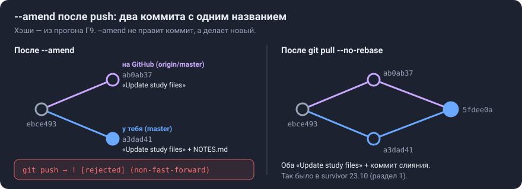
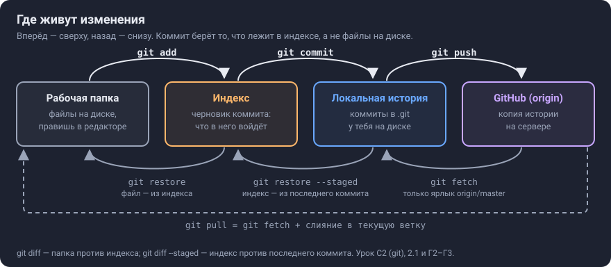
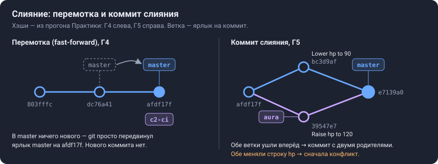

# Урок C2 (git). Ветки, история, конфликты — и как всё вернуть

**Коротко.** Git хранит снимки проекта (коммиты) и ярлыки на них (ветки). Каждый день нужны пять команд: `status`, `add`, `commit`, `push`, `pull`. С шага C2 к ним добавляются ветки: работа шага идёт в своей ветке и попадает в `master` через pull request. В уроке всё, что для этого нужно: команды и когда их применять, конфликты, отмена ошибок. Главное правило одно: **то, что уже отправлено в общую ветку, не переписывают, а отменяют новым коммитом.**

**Зачем он в шаге C2.** В `docs/roadmap.md`, шаг C2, сказано: «С этого шага каждый шаг — в своей ветке; в основную ветку — через pull request». Нужный навык записан в `docs/skills.md`: «Git: ветки, pull request, `rebase`, `bisect`». Урок CI (`docs/lessons/C2-ci.md`) — первая половина шага, этот урок — вторая.

## Как читать этот урок

- Начни с **Практики**. Песочница — учебный репозиторий, в нём можно ломать всё: делать конфликты, откаты, отклонённый push. Твой `survivor` не трогаем. В каждом пункте есть команды, вывод, который ты должен увидеть, и то же самое кнопками CLion.
- Потом **шпаргалка** — таблица «ситуация → команда → кнопки». Её держи под рукой.
- Разделы 1–5 объясняют, почему так: что такое коммит и индекс, что такое ветка, почему нельзя переписывать отправленное.
- Весь вывод команд в Практике настоящий: Claude прогнал её шаг за шагом ровно в таком порядке (git 2.43, Linux, 26.10.2026). У тебя будут другие хэши коммитов (`803fffc` и т. п.) и пути. В другой версии git текст подсказок местами чуть другой.
- **Ответь сам** — вопрос к тебе. Сначала ответь, потом открой «Ответ».

| Раздел | Что поймёшь | Ориентир, мин |
|---|---|---|
| Практика Г1–Г10 | все нужные команды руками, в песочнице | 60–90, можно за несколько раз |
| Шпаргалка | что набрать в типичной ситуации | 5 |
| 1. Зачем | что уже случалось в твоём репозитории | 5 |
| 2. Идея | четыре места для изменений; ветка — ярлык; переписывание истории | 15 |
| 3. Как устроено у тебя | твой `.git/config`, `.gitignore`, круг шага | 5 |
| 4. Пример | когда git сливает сам, а когда спрашивает | 5 |
| 5. Подвохи и края | что ломается чаще всего | 10 |
| 6–7. Собеседование, самопроверка | рассказать и проверить себя | 15 |

---

## Практика: песочница

**Зачем.** Конфликт, откат и отклонённый push лучше один раз увидеть там, где ничего не жалко. Тогда в настоящем репозитории это будут уже знакомые экраны, а не паника.

**Где работать.** В терминале CLion (`View | Tool Windows | Terminal`, `Alt+F12`) или в любой консоли Windows. Файлы правь Блокнотом: команда `notepad game.txt` откроет файл, а если его нет — Блокнот предложит создать.

**Если в начале строки терминала `PS C:\…>`, это PowerShell.** В нём ссылки с фигурными скобками, вроде `HEAD@{1}`, пиши в кавычках: `"HEAD@{1}"`. Без кавычек PowerShell разбирает скобки по-своему, и git получает обрывок `HEAD@` (проверка Claude в PowerShell 7.6). В уроке такие места уже в кавычках.

### Г1. Подготовка

```
git --version
git config --global user.name
git config --global user.email
```

Имя и почта уже должны быть: ты ведь коммитишь в `survivor`. Если пусто, задай их: `git config --global user.name "Имя"` и `git config --global user.email "почта"`. Почта попадёт в каждый коммит.

В песочнице роль «GitHub» играет обычная папка `origin.git` рядом с рабочей. Ничего никуда не уходит.

```
mkdir C:\dev\sandbox
cd C:\dev\sandbox
git init --bare origin.git
git clone origin.git work
cd work
```

Чего ждать:

- `git init --bare` может вывести подсказку `hint: Using 'master' as the name for the initial branch…`. Это нормально. Если у тебя в настройках имя ветки по умолчанию `main`, то везде в уроке читай `main` вместо `master`.
- `git clone` напишет `warning: You appear to have cloned an empty repository.` Тоже нормально: репозиторий пока пустой.

### Г2. Цикл коммита: status → add → commit → push

Создай `game.txt` с двумя строками: `hp = 100` и `speed = 150`.

```
git status
```
```
Untracked files:
  (use "git add <file>..." to include in what will be committed)
	game.txt
```

Git видит файл, но не следит за ним. Команда `git add` кладёт изменения в **индекс** — список того, что войдёт в следующий коммит (раздел 2.1):

```
git add game.txt
git status
```
```
Changes to be committed:
  (use "git rm --cached <file>..." to unstage)
	new file:   game.txt
```

```
git commit -m "Add game settings"
```
```
[master (root-commit) 803fffc] Add game settings
 1 file changed, 2 insertions(+)
```

Теперь поменяй `speed = 150` на `speed = 200` и посмотри, что изменилось:

```
git status --short
git diff
```
```
 M game.txt
...
 hp = 100
-speed = 150
+speed = 200
```

Буква `M` значит «изменён». `git diff` показывает изменения, которых **ещё нет** в индексе. Сделай `git add game.txt`: теперь `git diff` выведет пустоту, а те же строки покажет `git diff --staged` — это то, что уже в индексе и уйдёт в коммит.

```
git commit -m "Raise player speed"
git log --oneline
```
```
dc76a41 Raise player speed
803fffc Add game settings
```

Отправь коммиты на «GitHub» и посмотри, с чем связана ветка:

```
git push
git branch -vv
```
```
 * [new branch]      master -> master
* master dc76a41 [origin/master] Raise player speed
```

`[origin/master]` — это **upstream** ветки `master`: куда уходит `git push` и откуда приходит `git pull`. Клон настроил его сам, поэтому здесь хватает `git push` без аргументов. В новой ветке upstream'а нет (Г4).

**Кнопками CLion:**

- Окно Commit открывается `Alt+0`. Отметь файлы галочками (это и есть `add`), напиши сообщение, нажми **Commit**.
- Новые файлы лежат в группе Unversioned Files: «CLion will stage and commit these files in one step».
- **Commit and Push** — `Ctrl+Alt+K`.

Источник — CLion, «Commit and push changes».

### Г3. Передумал до коммита: restore

Испорти строку: `hp = 100` → `hp = 1`. Вернуть файл как в последнем коммите:

```
git restore game.txt
```

Если ты уже успел сделать `git add`, сначала убери изменения из индекса. Сам файл останется изменённым:

```
git restore --staged game.txt
git status --short
```
```
 M game.txt
```

Теперь `git restore game.txt` вернёт и файл. Документация: «By default, if `--staged` is given, the contents are restored from `HEAD`, otherwise from the index» (git, `git-restore`).

**Осторожно:** `git restore файл` выбрасывает правки насовсем, потому что их нет ни в одном коммите.

**Кнопками:** в окне Commit — правый клик по файлу → **Rollback** (`Ctrl+Alt+Z`). Документация CLion: «All changes made to the selected files since the last commit will be discarded» (CLion, «Undo changes»).

### Г4. Ветка, upstream, слияние

```
git switch -c c2-ci
```
```
Switched to a new branch 'c2-ci'
```

Создай `ci.txt` и закоммить его: `git add ci.txt`, затем `git commit -m "Add trial CI"`. Теперь отправь:

```
git push
```
```
fatal: The current branch c2-ci has no upstream branch.
To push the current branch and set the remote as upstream, use

    git push --set-upstream origin c2-ci
```

У новой ветки нет upstream'а, и git не гадает, куда её отправлять. **Запоминать команду не нужно**: git сам напечатал, что набрать. `-u` — короткая запись `--set-upstream`:

```
git push -u origin c2-ci
git branch -vv
```
```
 * [new branch]      c2-ci -> c2-ci
branch 'c2-ci' set up to track 'origin/c2-ci'.
* c2-ci  afdf17f [origin/c2-ci] Add trial CI
  master dc76a41 [origin/master] Raise player speed
```

Дальше в этой ветке хватает просто `git push`.

**Чтобы не набирать `-u` вообще:** `git config --global push.autoSetupRemote true`. После этой настройки первый `git push` в новой ветке сам создаёт upstream. Документация: «assume `--set-upstream` on default push when no upstream tracking exists» (git, `git-config`, `push.autoSetupRemote`). Прогон Claude: с этой настройкой `git push` в новой ветке вывел `branch 'c3-x' set up to track 'origin/c3-x'.`

**Слияние.** На GitHub ветку вливает кнопка Merge в pull request (урок C2-ci, 2.2). Здесь сделаем то же самое руками, чтобы увидеть механику:

```
git switch master
git merge c2-ci
```
```
Updating dc76a41..afdf17f
Fast-forward
 ci.txt | 1 +
```

**Fast-forward** — «перемотка». В `master` за это время ничего нового не появилось, поэтому git просто передвинул ярлык `master` на последний коммит ветки. Нового коммита нет (раздел 2.2).

Отправь `master` и убери ветку — у себя и на «GitHub» (на настоящем GitHub это делает кнопка Delete branch в PR):

```
git push
git branch -d c2-ci
git push origin --delete c2-ci
```
```
   dc76a41..afdf17f  master -> master
Deleted branch c2-ci (was afdf17f).
 - [deleted]         c2-ci
```

**Ответь сам Г4.** Почему в `master` первый `git push` прошёл без `-u`, а в `c2-ci` упал?

<details>
<summary>Ответ</summary>

У `master` upstream настроил `git clone`: ветка связана с `origin/master`, это видно в `git branch -vv`. Новая ветка `c2-ci` создана у тебя, и связи у неё нет, пока ты её не задашь: `-u` при первом push или настройкой `push.autoSetupRemote`.

</details>

**Кнопками:**

- Создать ветку: виджет с именем ветки в заголовке окна → **New Branch**. Галочка **Checkout branch** — сразу перейти в новую ветку (CLion, «Manage branches»).
- Слить: сначала перейди в ветку, *в которую* сливаешь. Потом в том же виджете выбери другую ветку → «Merge <branch_name> into <target_branch>» (CLion, «Apply changes from one branch to another»).
- Push: `Ctrl+Shift+K`.

### Г5. Конфликт

**Зачем.** Конфликт — не ошибка, а вопрос git к тебе. Обе ветки поменяли одно и то же место, и git не берётся выбирать за тебя.

Сделай так, чтобы две ветки поменяли одну строку по-разному:

1. `git switch -c aura`. Поменяй `hp = 100` на `hp = 120` и закоммить: `git commit -am "Raise hp to 120"`. Ключ `-a` сначала делает `add` всех изменённых файлов, за которыми git уже следит. Новые файлы он не берёт.
2. `git switch master`. Поменяй ту же строку на `hp = 90` и закоммить: `git commit -am "Lower hp to 90"`.
3. Влей ветку:

```
git merge aura
```
```
Auto-merging game.txt
CONFLICT (content): Merge conflict in game.txt
Automatic merge failed; fix conflicts and then commit the result.
```

Открой `game.txt` — git вписал в него обе версии:

```
<<<<<<< HEAD
hp = 90
=======
hp = 120
>>>>>>> aura
speed = 200
```

Как читать маркеры:

- между `<<<<<<<` и `=======` — твоя сторона (`HEAD`, текущая ветка);
- между `=======` и `>>>>>>>` — вливаемая ветка;
- строки вне маркеров git слил сам.

Документация: «The part before the `=======` is typically your side, and the part afterwards is typically their side» (git, `git-merge`, «How conflicts are presented»).

**Два выхода** (там же, «How to resolve conflicts»):

- **Передумал сливать:** `git merge --abort` — всё вернётся как до `merge`.
- **Решить:** оставь в файле то, что должно быть, например `hp = 110`, и удали все три строки-маркера. Потом:

```
git add game.txt
git status
```
```
All conflicts fixed but you are still merging.
  (use "git commit" to conclude merge)
```
```
git commit --no-edit
git log --oneline --graph -5
```
```
[master e7139a0] Merge branch 'aura'
*   e7139a0 Merge branch 'aura'
|\
| * 39547e7 Raise hp to 120
* | bc3d9af Lower hp to 90
|/
* afdf17f Add trial CI
```

Получился **коммит слияния** — у него два родителя (раздел 2.2). `--no-edit` берёт готовое сообщение `Merge branch 'aura'` и не открывает текстовый редактор (раздел 5). Ветка больше не нужна: `git branch -d aura`.

**Ответь сам Г5.** Ты удалил маркеры, но забыл `git add` и сразу написал `git commit --no-edit`. Что будет?

<details>
<summary>Ответ</summary>

Коммит не пройдёт:

```
error: Committing is not possible because you have unmerged files.
hint: Fix them up in the work tree, and then use 'git add/rm <file>'
hint: as appropriate to mark resolution and make a commit.
fatal: Exiting because of an unresolved conflict.
```

Это прогон Claude. Пока ты не сказал `git add`, для git файл всё ещё в конфликте: `git add` здесь значит «решено».

</details>

**Кнопками.** CLion сам откроет окно Conflicts. Для каждого файла там есть **Accept Yours**, **Accept Theirs** и ручное решение (в документации CLion кнопка называется **Resolve Manually**). Окно ручного решения состоит из трёх панелей:

- слева — твоя версия, только для чтения;
- справа — вливаемая, тоже только для чтения;
- в центре — результат, его можно править.

Готово — **Apply Changes**. Когда конфликтов не осталось, нажми **Accept and Finish** (CLion, «Resolve conflicts»).

### Г6. Работа с GitHub: отклонённый push, fetch, pull

**Зачем.** Так бывает, когда на GitHub есть коммиты, которых нет у тебя. Причины разные: правка через сайт, другой компьютер или, как у тебя 23.10, переписанный коммит (Г9).

Изобрази «кого-то ещё» вторым клоном:

```
cd C:\dev\sandbox
git clone origin.git other
cd other
```

Создай `README.md`, закоммить и отправь: `git add README.md`, `git commit -m "Add README"`, `git push`. Потом вернись в `work` (`cd ..\work`), сделай там свой коммит (`notes.txt`, сообщение `"Add notes"`) и попробуй отправить:

```
git push
```
```
 ! [rejected]        master -> master (fetch first)
hint: Updates were rejected because the remote contains work that you do not
hint: have locally. ...
```

Git отказывается затирать чужое. Сначала посмотри, что там:

```
git fetch
git status
```
```
Your branch and 'origin/master' have diverged,
and have 4 and 1 different commits each, respectively.
```

`fetch` только скачивает чужие коммиты и обновляет ярлык `origin/master`. Твои файлы и твой `master` он не трогает: «Fetch branches and/or tags … from one or more other repositories» (git, `git-fetch`). **Diverged** — «разошлись»: у каждой стороны есть коммиты, которых нет у другой. «4» — это все твои коммиты, которых нет на «GitHub» (`Raise hp to 120`, `Lower hp to 90`, коммит слияния из Г5 и `Add notes`); «1» — `Add README`.

`pull` = `fetch` + соединение. Когда ветки разошлись, git спросит, как соединять:

```
git pull
```
```
hint: You have divergent branches and need to specify how to reconcile them.
hint:   git config pull.rebase false  # merge
hint:   git config pull.rebase true   # rebase
hint:   git config pull.ff only       # fast-forward only
fatal: Need to specify how to reconcile divergent branches.
```

| Как | Команда | Что получится |
|---|---|---|
| слиянием | `git pull --no-rebase --no-edit` | коммит слияния `Merge branch 'master' of …` |
| перебазированием | `git pull --rebase` | твои коммиты переедут поверх чужих, история прямая (раздел 2.3) |

```
git pull --no-rebase --no-edit
git push
```
```
Merge made by the 'ort' strategy.
   d16ac9b..393d5dc  master -> master
```

Теперь вернись в `other` и сделай там `git pull`. У `other` своих коммитов нет, поэтому git просто перемотает ветку и ничего не спросит:

```
Updating d16ac9b..393d5dc
Fast-forward
```

Настраивать `pull` не обязательно. Без настройки он перематывает, когда может, а когда ветки разошлись — останавливается с подсказкой (прогон Claude, git 2.43). Свежая документация git описывает это так же: «`git pull --ff-only` … fails if your local branch has diverged from the remote branch. This is the default» (git, `git-pull`). В круге шага (раздел 3) ты не коммитишь в `master`, поэтому `git pull` в нём — всегда перемотка.

**Кнопками:**

- `Git | Fetch`.
- `Git | Update Project` (`Ctrl+T`). CLion предложит «Merge the incoming changes into the current branch» или «Rebase the current branch on top of the incoming changes» (CLion, «Sync with a remote repository»).

### Г7. Вернуть как было: revert, reset, reflog

| Ситуация | Команда | Что делает |
|---|---|---|
| плохой коммит **уже отправлен** | `git revert <коммит>` | новый коммит, обратный плохому; история не переписывается |
| плохой коммит **только у тебя**, правки нужны | `git reset --soft HEAD~1` | коммита нет, его изменения лежат в индексе |
| то же, но без индекса | `git reset HEAD~1` (это `--mixed`) | коммита нет, изменения в файлах, индекс пуст |
| не нужны ни коммит, ни правки | `git reset --hard HEAD~1` | всё как в предыдущем коммите; **незакоммиченное пропадёт** |
| «сделал `reset --hard` зря» | `git reflog`, потом `git reset --hard "HEAD@{1}"` | вернуть ветку туда, где она была шаг назад |

`HEAD~1` — «коммит перед текущим». Режимы описаны в документации git (`git-reset`):

- `--soft` — «Leave your working tree files and the index unchanged»;
- `--mixed` — «Update the index to match the new `HEAD`, so nothing will be staged»;
- `--hard` — «Overwrite all files and directories with the version from <commit>».

`revert` — «record some new commits to reverse the effect of some earlier commits» (git, `git-revert`).

**Отправленная ошибка → revert.** Поставь `hp = 0` и сделай `git commit -am "Break game"`, затем `git push`. Ошибка «ушла на GitHub». Отмени её:

```
git revert --no-edit HEAD
git log --oneline -3
git push
```
```
[master 5230597] Revert "Break game"
5230597 Revert "Break game"
7588868 Break game
393d5dc Merge branch 'master' of …/origin
```

Плохой коммит остался в истории, а следом за ним идёт коммит, который его отменяет. Никто ничего не переписывал.

**Своё, неотправленное → reset.** Создай `t.txt`, сделай `git add t.txt` и `git commit -m "Add t"`.

```
git reset --soft HEAD~1
git status --short
```
```
A  t.txt
```

Коммита нет, а изменения лежат в индексе (`A` — добавлен). Закоммить снова (`git commit -m "Add t"`) и попробуй жёсткий вариант:

```
git reset --hard HEAD~1
```
```
HEAD is now at 5230597 Revert "Break game"
```

Файла `t.txt` больше нет даже на диске. Но коммит помнит **reflog**:

```
git reflog -3
```
```
5230597 HEAD@{0}: reset: moving to HEAD~1
ebce493 HEAD@{1}: commit: Add t
5230597 HEAD@{2}: reset: moving to HEAD~1
```
```
git reset --hard "HEAD@{1}"
```
```
HEAD is now at ebce493 Add t
```

Reflog — журнал того, куда указывали `HEAD` и ветки **в твоём** репозитории: «`HEAD@{2}` means "where HEAD used to be two moves ago"» (git, `git-reflog`). Закоммиченное потерять почти невозможно. Незакоммиченное после `reset --hard` или `restore` — можно: reflog его не хранит. В конце сделай `git push`.

**Кнопками** (CLion, «Undo changes»). Окно Git, вкладка Log (`Alt+9`), правый клик по коммиту:

- **Revert Commit**;
- **Undo Commit** — отменить последний коммит; его изменения CLion перенесёт в список изменений (changelist), то есть они останутся в файлах;
- **Reset Current Branch to Here** — с режимами Soft, Mixed, Hard и Keep.

### Г8. Отложить незаконченное: stash

**Зачем.** Ты посреди правки, а надо срочно в другую ветку. Если правка мешает переключению, git не пустит.

Подготовь ветку: `git switch -c side`, поставь `speed = 300`, `git commit -am "Speed 300 on side"`, `git switch master`. Теперь в `master` поставь `speed = 250`, **не коммить** и попробуй перейти:

```
git switch side
```
```
error: Your local changes to the following files would be overwritten by checkout:
	game.txt
Please commit your changes or stash them before you switch branches.
Aborting
```

```
git stash
```
```
Saved working directory and index state WIP on master: ebce493 Add t
```

Папка чистая, можно переключаться: `git switch side`, потом обратно `git switch master`. Вернувшись, достань отложенное:

```
git stash pop
```
```
	modified:   game.txt
Dropped refs/stash@{0} (3e6c146…)
```

Правки снова в файлах, а запись из списка удалена. Список отложенного показывает `git stash list`. Документация: stash «saves your local modifications away and reverts the working directory to match the `HEAD` commit» (git, `git-stash`). В конце выброси учебную правку: `git restore game.txt`.

**Кнопками.** В окне Commit (`Alt+0`): правый клик → `Git | Stash Changes`. Вернуть — на вкладке **Stash**:

- **Pop** — применить и убрать из списка;
- **Apply** — применить и оставить в списке.

Источник — CLion, «Shelve or stash changes».

### Г9. Типичные ошибки — и как выйти

**Закоммитил в `master`, а хотел в ветку шага** (коммит ещё не отправлен). Сделай для пробы: создай `weapon.txt` и закоммить его в `master` с сообщением `"Start weapon interface"`. `git status` пишет `Your branch is ahead of 'origin/master' by 1 commit.`

```
git switch -c c3-weapon
git switch master
git reset --hard origin/master
git branch -v
```
```
HEAD is now at ebce493 Add t
  c3-weapon 636fa11 Start weapon interface
* master    ebce493 Add t
```

Что сделала каждая команда:

1. `git switch -c c3-weapon` создала ветку на текущем коммите — теперь он есть в ветке.
2. `git switch master` вернула тебя в `master`.
3. `git reset --hard origin/master` вернула `master` туда, где он на GitHub.

Перед `--hard` проверь `git status --short`: незакоммиченного быть не должно.

**Переписал уже отправленный коммит** — так было у тебя 23.10.2026 (раздел 1). Повтори в песочнице:

1. Создай `PLAN.md`, закоммить с сообщением `"Update study files"` и отправь (`git push`).
2. Создай `NOTES.md`, сделай `git add NOTES.md` и «допиши» его в тот же коммит: `git commit --amend --no-edit`.
3. Отправь:

```
git push
```
```
 ! [rejected]        master -> master (non-fast-forward)
```
```
git status
```
```
Your branch and 'origin/master' have diverged,
and have 1 and 1 different commits each, respectively.
```



`--amend` не правит коммит, а делает **новый**, с другим хэшем (раздел 2.3). Теперь на GitHub лежит старый коммит, у тебя — новый, и ветки разошлись. `git pull --no-rebase --no-edit` сольёт их:

```
*   5fdee0a Merge branch 'master' of …/origin
|\
| * ab0ab37 Update study files
* | a3dad41 Update study files
|/
* ebce493 Add t
```

Два коммита с одним названием и слияние между ними. Вывод: в `master` отправленное не переписывай. Ошибку чини новым коммитом или `revert`. Отправь результат: `git push`.

**То же, но в своей ветке шага.** Пока PR не слит и в ветке работаешь только ты, переписать можно, а отправить — с `--force-with-lease`:

```
git switch c3-weapon
git push -u origin c3-weapon
```

Допиши строку в `weapon.txt`, сделай `git add weapon.txt` и `git commit --amend --no-edit`.

```
git push
```
```
 ! [rejected]        c3-weapon -> c3-weapon (non-fast-forward)
```
```
git push --force-with-lease
```
```
 + 636fa11...8cf32d3 c3-weapon -> c3-weapon (forced update)
```

Почему не просто `--force`: `--force-with-lease` перезапишет ветку на GitHub, только если она там такая же, какой ты её видел последний раз, иначе откажет. Документация: «It is like taking a "lease" on the ref without explicitly locking it» (git, `git-push`). В CLion это кнопка Push → выпадающий список → **Force push**: «Under the hood, when you choose to force push, CLion performs the `git push --force-with-lease` operation» (CLion, «Commit and push changes»).

**Ответь сам Г9.** В `c3-weapon` ты работаешь один. Почему же после `--amend` обычный `git push` отклонён?

<details>
<summary>Ответ</summary>

`--amend` сделал новый коммит `8cf32d3` вместо `636fa11`. На «GitHub» ветка указывает на `636fa11`, а в твоей истории этого коммита больше нет. Обычный push только добавляет коммиты сверху (перематывает ветку на сервере) и не выбрасывает чужое, поэтому отказ: `non-fast-forward`. Git не знает, что «чужое» — это твой же старый коммит.

</details>

**Закоммитил папку сборки.** `.gitignore` не действует на файлы, за которыми git уже следит: «Files already tracked by Git are not affected» (git, `gitignore`). Повтори:

1. Создай папку `cmake-build-x` с любым файлом и закоммить её.
2. Допиши в `.gitignore` строку `cmake-build-*/`.

`git status --short` покажет только `?? .gitignore`: файлы папки по-прежнему отслеживаются. Перестать следить за ними, не удаляя с диска:

```
git rm -r --cached cmake-build-x
git add .gitignore
git commit -m "Stop tracking build dir"
```
```
 delete mode 100644 cmake-build-x/a.o
```

После этого `git status --short` пуст, а папка `cmake-build-x` на диске осталась (прогон Claude). Отправь результат: `git push`.

### Г10. Когда пригодится: rebase, tag, cherry-pick, bisect

**Rebase** — переставить коммиты ветки поверх свежего `master`, чтобы история была прямой. Попробуй:

1. `git switch -c feat`, создай `dash.txt`, закоммить: `"Add dash"`.
2. `git switch master`, поставь `speed = 220`, `git commit -am "Speed 220"`.
3. `git switch feat`.

```
git log --oneline --graph master feat -4
```
```
* 44e0c42 Speed 220
| * 2f205b4 Add dash
|/
* 038935c Stop tracking build dir
```
```
git rebase master
git log --oneline --graph master feat -4
```
```
Successfully rebased and updated refs/heads/feat.
* f2e29cb Add dash
* 44e0c42 Speed 220
* 038935c Stop tracking build dir
```

`Add dash` стал другим коммитом (`2f205b4` → `f2e29cb`): содержимое то же, а родитель новый. Rebase **переписывает** коммиты, поэтому правило то же, что для `--amend`: только для неотправленного или своей ветки (раздел 2.3). Если при rebase случился конфликт, будут те же маркеры. Реши его, сделай `git add` и `git rebase --continue`; передумал — `git rebase --abort` (прогон Claude, отдельный сценарий).

Теперь `git switch master` и `git merge feat` дают перемотку: `Updating 44e0c42..f2e29cb`, `Fast-forward`.

**Тег** — пометка версии. В плане он нужен для версии 0.1 (`v0.1.0`):

```
git tag -a v0.1.0 -m "Prototype 0.1"
git push origin v0.1.0
```
```
 * [new tag]         v0.1.0 -> v0.1.0
```

Обычный `git push` теги не отправляет, поэтому нужна отдельная команда: «By default, the `git push` command doesn't transfer tags to remote servers» (Pro Git, 2.6, «Sharing Tags»). В прогоне так и было: `git push` отправил только `master`, тег ушёл второй командой.

**Только для справки** (прогоны Claude в отдельных репозиториях):

| Команда | Когда | Что было в прогоне |
|---|---|---|
| `git cherry-pick <коммит>` | взять один коммит из другой ветки, не сливая её | `[master c8c05ba] Add side` |
| `git bisect start <плохой> <хороший>`, затем `git bisect run <тест>` | найти коммит, который что-то сломал: git сам гоняет тест на половинках истории | из 5 коммитов за 3 запуска теста: `273ce6a… is the first bad commit`; в конце — `git bisect reset` |

`bisect` вместе с тестом повторяемости `[hash]` — то, что в B4 было «по желанию» (`docs/roadmap.md`, B4). В CLion: `Git | Rebase`; Cherry-pick — кнопка на панели вкладки Log (CLion, «Apply changes from one branch to another»).

---

## Шпаргалка

| Ситуация | Команда | CLion |
|---|---|---|
| что изменилось? | `git status`, `git diff`, `git diff --staged` | окно Commit (`Alt+0`) |
| закоммитить | `git add <файлы>`, `git commit -m "…"` | окно Commit: галочки, **Commit** |
| отправить | `git push`; в новой ветке первый раз — `git push -u origin <ветка>` | `Ctrl+Shift+K` |
| забрать с GitHub | `git pull`; если разошлись — `--no-rebase --no-edit` или `--rebase` | `Git | Update Project`, `Ctrl+T` |
| посмотреть, не трогая свои файлы | `git fetch`, потом `git status` | `Git | Fetch` |
| история | `git log --oneline --graph --all` | окно Git, вкладка Log (`Alt+9`) |
| новая ветка шага | `git switch master`, `git pull`, `git switch -c c3-weapon` | виджет ветки → **New Branch** |
| перейти в ветку | `git switch <ветка>` | виджет ветки → ветка → Checkout |
| влить ветку в текущую | `git merge <ветка>` | виджет ветки → ветка → **Merge … into …** |
| удалить слитую ветку | `git branch -d <ветка>` (после squash может понадобиться `-D`) | виджет ветки → ветка → Delete |
| выбросить правки в файле | `git restore <файл>` | Rollback, `Ctrl+Alt+Z` |
| убрать из индекса | `git restore --staged <файл>` | снять галочку в окне Commit |
| поправить последний **неотправленный** коммит | `git add …`, `git commit --amend --no-edit` | галочка **Amend** в окне Commit |
| отменить **отправленный** коммит | `git revert --no-edit <коммит>` | Log → **Revert Commit** |
| отменить последний неотправленный коммит | `git reset --soft HEAD~1` | Log → **Undo Commit** |
| конфликт | правишь файл, `git add`, `git commit --no-edit`; передумал — `git merge --abort` | окно Conflicts |
| отложить правки | `git stash`, потом `git stash pop` | `Git | Stash Changes`, вкладка Stash |
| «всё пропало» | `git reflog`, потом `git reset --hard "HEAD@{N}"` | — |
| отправить переписанную **свою** ветку | `git push --force-with-lease` | Push → **Force push** |

---

## 1. Зачем

**Что уже случалось у тебя.** Журнал `.git/logs/HEAD`, время твоё (+03:00):

| Когда | Что |
|---|---|
| 22.10, 23:44 | коммит `update study files` |
| 23.10, 03:07 | `commit (amend): update study files` — тот же коммит переписан |
| 23.10, 03:07 | `commit (merge): Merge remote-tracking branch 'origin/master'` |
| 23.10, 03:10 | `Revert "update study files"` |
| 23.10, 03:37 | снова `update study files` |

Слияние с `origin/master` сразу после `--amend` значит, что на GitHub уже лежала старая версия коммита. Это ровно ситуация «разошлись» из Г9: переписанный отправленный коммит, отклонённый push, слияние двух коммитов с одним названием. Дальше пошли откат и откат отката. В журнале `PLAN.md` за 23–24.10 так и записано: «Отменён откат `Revert "update study files"`». Песочница повторяет этот случай за четыре команды (Г9).

Ещё раньше, 17.10, в `master` попал коммит, который не собирался (`docs/history.md`, «Коммиты 17.10»). С веткой и PR он остался бы в ветке.

**Почему сейчас.** С C2 каждый шаг — это ветка и pull request. Без уверенного git каждый шаг будет начинаться и заканчиваться вопросом «а что набрать», а конфликт или отказ push станут тупиком.

**Чего урок не даст.** Git не проверяет, что код правильный, — он только хранит версии. Проверяет CI (урок C2-ci).

---

## 2. Идея

### 2.1. Четыре места для изменений



| Место | Что это | Как туда попадает |
|---|---|---|
| рабочая папка | файлы, которые ты правишь | ты сам, в редакторе |
| индекс (staging area) | черновик следующего коммита: что именно в него войдёт | `git add` |
| локальная история | коммиты в `.git` на твоём диске | `git commit` |
| удалённый репозиторий (`origin`, GitHub) | копия истории на сервере | `git push`; обратно — `git fetch`, `git pull` |

Коммит — снимок всех отслеживаемых файлов в момент `commit`. К снимку прилагаются автор, время, сообщение и ссылка на предыдущий коммит (родителя). Хэш коммита (`dc76a41…`) вычисляется из всего этого вместе. Поэтому изменённый коммит — это уже другой хэш (2.3).

**Аналогия — фотоальбом.**

- Рабочая папка — комната, где ты всё переставляешь.
- Индекс — фото, которые ты отложил на стол, чтобы вклеить.
- Коммит — страница альбома: вклеил — не исчезнет.
- `push` — отправить копию страниц в облачный альбом.

*Где аналогия кончается.* На странице git не одно фото, а снимок всех файлов сразу. А «переклеить» страницу незаметно нельзя: у переклеенной будет другой номер (хэш).

**Ответь сам 2.1.** Ты поменял `game.txt`, сделал `git add`, потом ещё раз поправил тот же файл и закоммитил, не делая `add` снова. Что попадёт в коммит?

<details>
<summary>Ответ</summary>

Только то, что было в индексе на момент `add`. Вторая правка останется в рабочей папке, и `git status` покажет файл как изменённый. Коммит берёт содержимое индекса, а не файлов на диске. Это видно в Г2: после `add` `git diff` пуст, а `git diff --staged` показывает изменения.

</details>

### 2.2. Ветка — ярлык, HEAD — «ты здесь»



Pro Git (3.1): «A branch in Git is simply a lightweight movable pointer to one of these commits». При коммите вперёд двигается только ярлык текущей ветки. `HEAD` — «a pointer to the local branch you're currently on» (там же).

Слияние бывает двух видов (Г4, Г5):

- **Перемотка (fast-forward).** В целевой ветке нет новых коммитов: git просто двигает ярлык, нового коммита нет.
- **Коммит слияния.** Обе ветки ушли вперёд: git делает коммит с двумя родителями. Если обе меняли одно место — конфликт.

`origin/master` — тоже ярлык, но он означает «как было на GitHub, когда ты последний раз делал `fetch` или `pull`». Поэтому `git status` может писать «up to date with 'origin/master'», даже когда на GitHub уже есть новое: он сравнивает с последним известным состоянием.

### 2.3. Переписывание истории

`commit --amend`, `rebase`, `reset` и squash-слияние делают **новые** коммиты вместо старых. Другое содержимое или другой родитель — другой хэш (Г9, Г10). Для GitHub твой переписанный коммит — просто другой коммит, а старый у него никуда не делся. Отсюда «разошлись» в Г9.

Правило Pro Git: «Do not rebase commits that exist outside your repository and that people may have based work on» (Pro Git, 3.6, «The Perils of Rebasing»). Для нас это значит:

| Где коммит | Переписывать (`--amend`, `rebase`, `reset`) | Отменять |
|---|---|---|
| только у тебя, не отправлен | можно | — |
| отправлен в свою ветку шага, PR не слит | можно, отправка — `--force-with-lease` | — |
| отправлен в `master` | **нет** | `git revert` |

Merge или rebase при получении чужого — вопрос вкуса истории: «There is no difference in the end product of the integration, but rebasing makes for a cleaner history» (Pro Git, 3.6).

---

## 3. Как устроено у тебя

| Что | Где | Что значит |
|---|---|---|
| `[remote "origin"] url = https://github.com/koulplay/survivor.git` | `.git/config` | `origin` — твой репозиторий на GitHub |
| `[branch "master"] remote = origin, merge = refs/heads/master` | там же | у `master` есть upstream `origin/master`, поэтому хватает `git push` без аргументов |
| `[branch "c2-ci"] remote = origin, merge = refs/heads/c2-ci` | там же | у ветки `c2-ci` upstream тоже уже настроен: `git push` и `git pull` в ней работают без аргументов |
| `ignorecase = true` | там же | Windows не различает регистр букв; переименование, где меняется только регистр, git не заметит (урок C2-ci, 4.3) |
| `cmake-build-*/`, `.idea/` | `.gitignore` | папки сборки и настройки CLion в коммиты не попадают, включая новую `cmake-build-debug-ucrt64` |

CLion переписывал историю и раньше. В журнале за 12.10 есть `reword … by CLion Git plugin` и `interactive in-memory rebase by CLion Git plugin` (`.git/logs/HEAD`). Это те же `--amend` и `rebase`, только кнопками. Они безопасны, пока коммиты не отправлены.

**Круг шага с C2** (подробно — урок C2-ci, раздел 2.2):

1. `git switch master`, `git pull`, `git switch -c <шаг>`.
2. Коммиты и `git push` (в первый раз — с `-u`). CI проверяет каждый push.
3. Pull request на GitHub → зелёный CI и список самопроверки → Merge.
4. Кнопка **Delete branch** на GitHub. У себя: `git switch master`, `git pull`, `git branch -d <шаг>` (после squash-слияния может понадобиться `-D`, раздел 5). Ярлык `origin/<шаг>` у тебя останется, пока ты не сделаешь `git fetch --prune`: «Before fetching, remove any remote-tracking references that no longer exist on the remote» (git, `git-fetch`).

---

## 4. Пример: когда git сливает сам

**Зачем.** Конфликт возникает не «когда две ветки трогали один файл», а когда они трогали одно и то же **место** в файле. Понимая, что считается «одним местом», ты заранее видишь, где будет конфликт: например, две ветки меняют соседние поля в `struct Player`.

Возьми `game.txt` из двух строк, как в Г5:

```
hp = 100
speed = 200
```

В `master` меняем `hp = 100` → `hp = 90`, в ветке `aura` — `speed = 200` → `speed = 300`. Строки разные.

**Предскажи:** `git merge aura` сольёт сам или будет конфликт?

<details>
<summary>Ответ</summary>

Конфликт (прогон Claude, git 2.43):

```
<<<<<<< HEAD
hp = 90
speed = 200
=======
hp = 100
speed = 300
>>>>>>> aura
```

Git сравнивает не отдельные строки, а куски изменений, и правки в **соседних** строках для него сливаются в один кусок. Обе ветки поменяли этот кусок, и выбирать git не берётся.

</details>

**Измени одну деталь:** вставь между ними третью строку `magnet = 60` (в общем предке, до веток) и повтори те же две правки. Теперь `git merge` проходит сам: `Merge made by the 'ort' strategy.`, в файле `hp = 90`, `magnet = 60`, `speed = 300` (прогон Claude). Нетронутая строка между правками разделяет их на два независимых куска.

Вывод для кода: две ветки, которые правят соседние строки (поля одной структуры, соседние `case`), почти наверняка дадут конфликт. Это не страшно: решается за минуту, как в Г5.

---

## 5. Подвохи и края

- **`git add .` берёт всё подряд** — в том числе случайные файлы, если их нет в `.gitignore`. Перед коммитом смотри `git status` или окно Commit.
- **`git restore` и `git reset --hard` удаляют незакоммиченное насовсем.** Reflog хранит только коммиты (Г7).
- **Переписал отправленное в `master`** — ветки разошлись (Г9, твой случай 23.10). Чини новым коммитом или `revert`.
- **`--force` без `-with-lease`** может затереть чужие коммиты. CLion в Push предлагает именно `--force-with-lease`.
- **`.gitignore` не действует на уже отслеживаемые файлы** — нужен `git rm --cached` (Г9).
- **После squash-слияния `git branch -d` то удаляет, то отказывает.** Пока у тебя есть ярлык `origin/c2-ci`, удалит с предупреждением `warning: deleting branch 'c2-ci' that has been merged to 'refs/remotes/origin/c2-ci', but not yet merged to HEAD`. После `git fetch --prune` ярлыка нет — откажет: `error: the branch 'c2-ci' is not fully merged.` Если PR точно влит — `git branch -D c2-ci` (прогоны Claude, git 2.43, 26 и 27.10.2026).
- **Конфликт решён только после `git add`** (вопрос Г5). Забытые маркеры `<<<<<<<` в коде поймает компилятор как синтаксическую ошибку, а в `.md` их не поймает никто.
- **`git status` знает о GitHub только после `fetch`** (2.2).
- **Команда без сообщения открывает текстовый редактор.** Это касается `git commit` без `-m`, `--amend` без `--no-edit`, `merge`, `pull`, `revert` без `--no-edit`. Поэтому в уроке везде стоят `-m` или `--no-edit`. Какой редактор откроется, показывает `git var GIT_EDITOR`; по документации, если ничего не настроено, это «usually 'vi'» (git, `git-var`). Если открылся Vim: нажми `Esc`, набери `:wq` и Enter. `:wq` — «Write the current file and close the window» (Vim, `:help :wq`); git возьмёт сообщение из сохранённого файла.
- **`warning: in the working copy of '…', LF will be replaced by CRLF the next time Git touches it`** — это про концы строк в Windows, а не про ошибку. Предупреждение появляется при `core.autocrlf=true` (проверить: `git config core.autocrlf`), если в файле концы строк в стиле Linux. Блокнот пишет в стиле Windows, и с ним предупреждения нет (прогон Claude).
- **Фигурные скобки в PowerShell** — пиши `"HEAD@{1}"` в кавычках (Практика, начало).

---

## 6. Как рассказать на собеседовании

**Ответ на 30 секунд.** «Работаю через ветки. Шаг — своя ветка от свежего `master`, коммиты маленькие, каждый push запускает CI, в `master` — через pull request, когда CI зелёный. Отправленное в общую ветку не переписываю: ошибку отменяю `revert`. Переписываю только своё — `--amend`, `rebase`, — а если уже отправил в свою ветку, то `push --force-with-lease`. Конфликт — правлю файл, `git add`, коммит; передумал — `merge --abort`. Если сломалось неизвестно когда — `git bisect run` с тестом».

Вопросы, которые зададут следом:

- **Merge или rebase?** Результат в файлах одинаковый. Rebase даёт прямую историю, но переписывает коммиты — только для неотправленного или своей ветки (2.3).
- **Чем `revert` отличается от `reset`?** `revert` добавляет обратный коммит, это безопасно для отправленного. `reset` двигает ветку назад и выкидывает коммиты из её истории — только для своего (Г7).
- **Чем `fetch` отличается от `pull`?** `fetch` только скачивает и обновляет `origin/…`. `pull` = `fetch` + слияние или перебазирование в текущую ветку (Г6).
- **Что такое конфликт и почему он возникает?** Обе стороны изменили одну область файла относительно общего предка, и git не выбирает за тебя (Г5).
- **Как найти коммит, который сломал тест?** `git bisect start <плохой> <хороший>`, затем `git bisect run <скрипт>` — бинарный поиск по истории (Г10).
- **Зачем `--force-with-lease`?** Перезаписать свою ветку на сервере, но не затереть то, чего ты не видел (Г9).

## 7. Самопроверка

1. Что лежит в индексе и чем `git diff` отличается от `git diff --staged`?
2. Почему первый `git push` в новой ветке падает и что делает `-u`?
3. Ты сделал коммит в `master`, а хотел в ветку шага. Коммит не отправлен. Что делаешь?
4. Push отклонён: `rejected … (fetch first)`. Что это значит и какие у тебя два способа продолжить?
5. Почему `git commit --amend` для уже отправленного коммита приводит к «разошлись»?
6. Когда `revert`, а когда `reset --soft`?
7. В файле маркеры конфликта. Что ты делаешь шаг за шагом — в консоли и в CLion?

## 8. Источники

- **Твой репозиторий** (на 26.10.2026):
  - `.git/config`, `.git/logs/HEAD`, `.gitignore`;
  - `PLAN.md` — журнал за 23–24.10;
  - `docs/history.md` — «Коммиты 17.10»;
  - `docs/roadmap.md` — C2 и B4;
  - `docs/skills.md`.
- **Документация git** (исходники в репозитории git, состояние на 22.10.2026) — https://git-scm.com/docs :
  - `git-restore`, `git-merge` («How conflicts are presented», «How to resolve conflicts»);
  - `git-fetch` (`--prune`), `git-pull`, `git-push` (`--force-with-lease`);
  - `git-reset`, `git-revert`, `git-reflog`, `git-stash`;
  - `git-config` (`push.autoSetupRemote`), `git-var` (`GIT_EDITOR`), `gitignore`.
- **Vim:** `:help :wq` — https://vimhelp.org/editing.txt.html
- **Pro Git:**
  - 2.6 «Tagging», «Sharing Tags» — https://git-scm.com/book/en/v2/Git-Basics-Tagging
  - 3.1 «Branches in a Nutshell» — https://git-scm.com/book/en/v2/Git-Branching-Branches-in-a-Nutshell
  - 3.6 «Rebasing», «The Perils of Rebasing» — https://git-scm.com/book/en/v2/Git-Branching-Rebasing
- **CLion:**
  - «Commit and push changes» — https://www.jetbrains.com/help/clion/commit-and-push-changes.html
  - «Manage branches» — https://www.jetbrains.com/help/clion/manage-branches.html
  - «Apply changes from one branch to another» — https://www.jetbrains.com/help/clion/apply-changes-from-one-branch-to-another.html
  - «Resolve conflicts» — https://www.jetbrains.com/help/clion/resolve-conflicts.html
  - «Sync with a remote repository» — https://www.jetbrains.com/help/clion/sync-with-a-remote-repository.html
  - «Undo changes» — https://www.jetbrains.com/help/clion/undo-changes.html
  - «Shelve or stash changes» — https://www.jetbrains.com/help/clion/shelving-and-unshelving-changes.html
  - «Terminal» — https://www.jetbrains.com/help/clion/terminal-emulator.html
- **Прогоны Claude, 26.10.2026**, git 2.43, Linux:
  - вся Практика Г1–Г10 подряд, ровно в порядке урока, с «GitHub» в виде локального `origin.git`;
  - отдельные сценарии: соседние строки и строка между ними (раздел 4), rebase с конфликтом и `--abort`, cherry-pick, `bisect run`, squash и `branch -d`/`-D`, `push.autoSetupRemote`, `core.autocrlf`;
  - PowerShell 7.6: как передаётся `HEAD@{1}` без кавычек и в кавычках.
