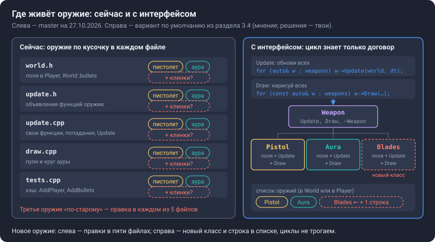
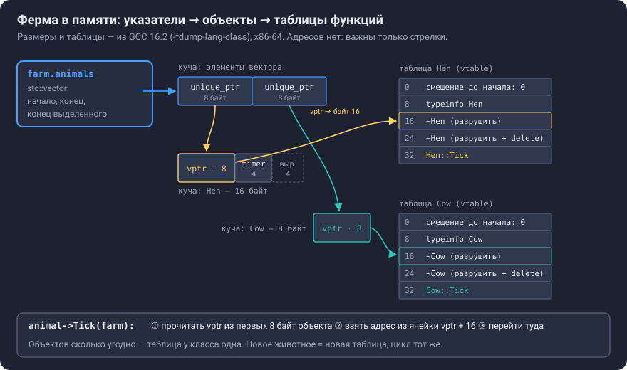
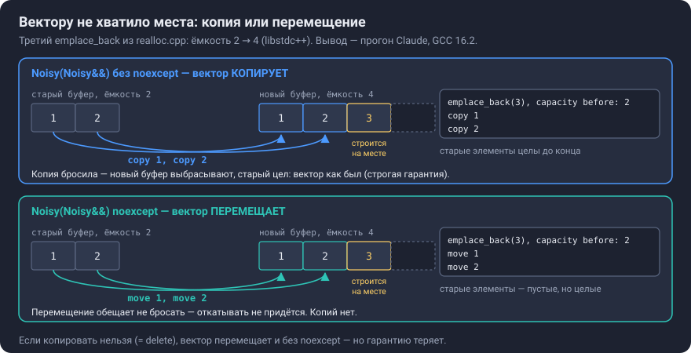
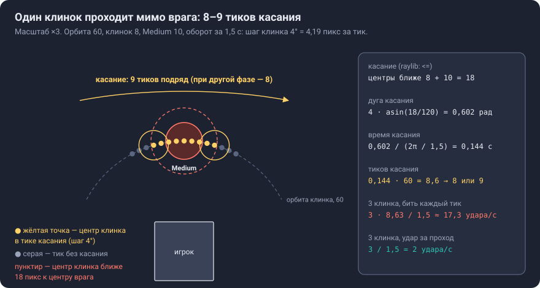

# Урок C3. Интерфейс `Weapon`: цикл знает только «обнови всех»

**Коротко.** Сейчас пистолет и аура разложены по всему коду: поля в `Player`, свои функции в `update.cpp`, ветки в `UpdatePlayerDamage`, строки в `Draw`, поля в хэш-тесте. Третье оружие тем же способом — ещё одна порция правок в тех же файлах. Интерфейс `Weapon` — договор «что умеет любое оружие»: обновиться за тик, а если выберешь, ещё и нарисоваться (раздел 3.4). Игра хранит список оружий (в `World` или в `Player` — решаешь ты, раздел 3.4) и каждый тик говорит всем «обновись» — это паттерн Update Method. Новое в языке: абстрактный класс с виртуальным деструктором, владение через `std::unique_ptr` и его последствие — `World` больше нельзя копировать, только перемещать. Мини-урок: как устроен виртуальный вызов, срезка, `dynamic_cast` против виртуальной функции и почему `std::vector` иногда копирует вместо перемещения.

**Что строишь в шаге** (`docs/roadmap.md`, C3): интерфейс — когда оружий два; третье оружие — вращающиеся клинки — новым классом, как проверка интерфейса. Края: рестарт `world = World{}` работает — это перемещение, а любая копия мира перестаёт компилироваться; в флаги — `-Wnon-virtual-dtor`. **Готово, когда:** новое оружие — новый класс и строка в списке, без правок цикла обновления и отрисовки.

## Что сделать

Где ты сейчас — `PLAN.md`, «Сейчас». Подшаги и решения внутри пунктов 2–5 — твои; перед каждым подшагом — «какой первый подшаг и как поймёшь, что он готов?» (`PLAN.md`, «Как работаем»).

| № | Что сделаешь | Готово, когда | Ориентир, мин |
|---|---|---|---|
| 0 | обязательно, до первой правки кода: сначала закоммить учебные файлы (урок, схемы, `PLAN.md`) прямо в `master` и сделай push — новые файлы в окне Commit лежат в Unversioned Files; потом ветка шага: `git switch -c c3-weapon` (шпаргалка в `C2-git.md`) | `git status` пишет `On branch c3-weapon`, учебные файлы — в `master` на GitHub | 5 |
| 1 | прочитать «Что сделать», «Слова урока» и раздел 1 «Зачем» | одной-двумя фразами скажешь, какую проблему игры решает `Weapon` | 15 |
| 2 | пистолет и аура — за интерфейсом `Weapon`, поведение прежнее (разделы 2–3) | игра играет как раньше; тесты зелёные — переписанные на новые имена; сборка без предупреждений | 90–120 |
| 3 | `-Wnon-virtual-dtor` в флагах (раздел 5.1) | убрал `virtual` у деструктора `Weapon` — предупреждение; вернул — тишина | 5 |
| 4 | клинки — третье оружие | клинки видны и бьют; цикл обновления и отрисовки не тронут: новый класс и строка в списке | 60 |
| 5 | тест на правило удара клинков (раздел 5.8) | тест зелёный; нарочная поломка делает его красным | 20 |
| 6 | мини-урок: эксперимент 4.3 «перевыделение вектора» | вывод предсказан до запуска; объяснишь, почему без `noexcept` — копии | 15 |
| 7 | pull request `c3-weapon` → `master` со списком самопроверки (`docs/roadmap.md`, C2) | CI зелёный на обеих машинах, PR влит | 10 |

## Слова урока

| Слово | Что это и зачем мне |
|---|---|
| интерфейс, абстрактный класс | класс-договор «что умеет любое оружие»: объявляет функции, но объект такого класса создать нельзя — только наследника |
| виртуальная функция (`virtual`) | функция, версию которой выбирают при выполнении — по настоящему классу объекта, а не по типу указателя |
| чисто виртуальная функция (`= 0`) | функция без тела в базе: каждый наследник обязан её определить, иначе он тоже абстрактный |
| `override` | пометка «эта функция заменяет виртуальную из базы»: не совпала сигнатура — ошибка компиляции, а не тихая новая функция |
| полиморфизм | один и тот же вызов `w->Update(…)` делает разное у разных классов |
| таблица виртуальных функций (vtable), `vptr` | у каждого класса с виртуальными функциями — таблица их адресов; в каждом объекте — скрытый указатель на таблицу своего класса |
| виртуальный деструктор | деструктор, который при удалении через указатель на базу вызывает деструктор настоящего класса |
| `std::unique_ptr<T>`, владение | указатель-владелец: единственный; удаляет объект сам; копировать нельзя, перемещать можно |
| `std::make_unique<T>()` | создаёт объект `T` в куче и сразу отдаёт его `unique_ptr` |
| перемещение | передача внутренностей объекта другому без копирования; источник остаётся пустым, но целым |
| `noexcept` | обещание «эта функция не бросает исключений»; `std::vector` при переезде перемещает элементы только с таким обещанием (или если копировать нельзя) |
| срезка (slicing) | копия наследника в объект базового класса: остаётся только базовая часть |
| `dynamic_cast` | проверка при выполнении «это на самом деле `Pistol`?»; для указателя ответ «нет» — `nullptr` |
| Update Method | паттерн: каждый объект сам обновляется за тик, цикл знает только «обнови всех» |
| правило нуля / правило пяти | не объявлять копирование, перемещение и деструктор, если класс сам не управляет ресурсом; объявил одно — реши про все пять |
| предварительное объявление | строка `struct World;` — «такой тип есть»: хватает для ссылок и указателей, но не для полей и не для удаления через `unique_ptr` |

## Как читать этот урок

- Примеры учебные — ферма: `Animal`, `Hen`, `Cow`. Код игры — там, где разбираем его строки; номера строк — по `master` на 27.10.2026 (коммит `08e6e6b`).
- **Ответь сам** — вопрос к тебе: сначала ответь, потом открой «Ответ». **Измени одну деталь** — поправь пример и предскажи, что изменится. **Сам** — без ответа: это уже часть шага.
- Каждое число и каждый вывод компилятора — из прогона Claude на Linux: GCC 16.2 (как у тебя), 14.2 (как в CI) и 13.3; где версии расходятся — сказано. Вывод AddressSanitizer — только с Linux: по `docs/roadmap.md` («Решения по умолчанию», «Санитайзеры») с MinGW он не линкуется; у тебя это ещё не проверено. На Windows я ничего не запускал.
- Решения шага — твои (раздел 3.4). Где тексту или схеме нужен конкретный вид оружия, взят мой вариант по умолчанию из 3.4 — это мнение, а не решение: список — в `Player`, `Update(World&, float dt)`, `Draw` у самого оружия. Такие места помечены «по умолчанию»; выберешь другое — поменяются только они.
- Схемы лежат в `docs/lessons/img/` (`C3-*.svg`).
- Сегодня (`PLAN.md`, «Следующее действие») — «Что сделать», «Слова урока» и раздел 1.

| Раздел | Что поймёшь | Ориентир, мин |
|---|---|---|
| 1. Зачем | где сейчас живёт оружие и что сломают клинки «по-старому» | 5 |
| 2. Идея | договор, «обнови всех», владение, виртуальный деструктор, перемещаемый мир | 20 |
| 3. Как устроено у нас | что переедет в классы, что поменяется в порядке тика, решения шага | 20 |
| 4. Примеры и мини-урок | ферма; таблица функций; перевыделение вектора; срезка; `dynamic_cast` | 30 |
| 5. Подвохи и края | флаг, фигурные скобки, заголовки, указатель на мир, `const`, клинки | 15 |
| 6–7. Собеседование, самопроверка | рассказать и проверить себя | 15 |

---

## 1. Зачем

**Что даст игре.** В жанре новый забег начинают ради нового набора оружия (`docs/roadmap.md`, этап C). Оружие будет прибывать и дальше: клинки — в этом шаге, цепная молния — в самостоятельной задаче C, эволюции — в C8; а шаги C5–C7 (уровни, предметы, меню) работают со всеми оружиями сразу. Клинки, кружащие вокруг игрока, в жанре есть: так устроена King Bible в Vampire Survivors — «King Bibles will be flying around you in circles, hitting and damaging enemies» (Prima Games).

**Где оружие живёт сейчас.** Пистолет и аура — это не два куска кода, а строки в пяти файлах:

| Где | Пистолет | Аура |
|---|---|---|
| `world.h`, `Player` | 5 полей `bullet_*`, строки 97–101 | 4 поля `aura_*`, 103–106 |
| `world.h`, `World` | `bullets` (176) и `struct Bullet` (87–92) | — |
| `update.h`, объявления | `UpdateBullets` (5), `UpdatePlayerDamage` (9) | `UpdateAura` (6), `IsAuraReady` (8) |
| `update.cpp`, своя функция | `UpdateBullets`: полёт 238–245, выстрел 247–257 | `UpdateAura` 260–263, `IsAuraReady` 265–271 |
| `update.cpp`, попадания | `UpdatePlayerDamage`, 297–306 | там же, 290–296 |
| `update.cpp`, `Update` | вызов 319, уборка пуль 328 | вызов 320 |
| `update.cpp`, `ApplyUpgrade` | `FireInterval` 336, `BulletSpeed` 340 | — |
| `draw.cpp`, `Draw` | пули 83–85 | круг 72 |
| `tests.cpp`, хэш | `AddPlayer` 36–39 и 46, `AddBullets` 61–70 | `AddPlayer` 40–43 |

**Клинки «по-старому»** — ещё одна колонка в этой таблице: поля в `Player`, функция в `update.cpp` и её объявление в `update.h`, вызов в `Update`, ветка в `UpdatePlayerDamage`, строки в `Draw`, поля в хэше. Компилятор не напомнит ни об одном месте: забыл `Draw` — клинки бьют невидимыми; забыл хэш — тест `[hash]` молча стал слабее (урок B4: хэш видит только то, что в него положили). А `Update` и `UpdatePlayerDamage` растут с каждым оружием.

**С интерфейсом** таблица переворачивается: всё про одно оружие — в одном классе, а цикл обновления знает одно: «у каждого оружия есть `Update`». Если оружие рисует себя само (по умолчанию, раздел 3.4, вопрос 3), так же и `Draw`: «у каждого есть `Draw`». Новое оружие — новый класс и строка в списке. Это и есть «Готово, когда» шага.



**Почему сейчас.** «Правило трёх»: два похожих куска кода ещё терпимы, на третий раз общее выносится (`docs/roadmap.md`, «Принципы»). В C1 аура появилась без интерфейса — «второе оружие — ещё не повод». Клинки — третье.

**Чего интерфейс не даст.** Порядок событий в тике и «одна смерть на двоих» из C1 никуда не денутся: оружий станет больше, а проверка `dead` в `EnemyGotDamage` (строка 225) по-прежнему держит всё на себе (раздел 3.2).

**Ответь сам 1.1.** Посмотри на таблицу. Какие строки для клинков исчезнут совсем, какие переедут в класс, а что останется даже с интерфейсом?

<details>
<summary>Ответ</summary>

Исчезнут — вызов в `Update` и строки в `Draw`: их заменят цикл «обнови всех» и — если оружие рисует себя само (по умолчанию) — цикл «нарисуй всех». Переедут в класс — поля, своя функция, ветка попаданий. Останутся — строка в списке оружий (там, где создаются стартовые оружия) и тесты клинков; если класс в новом `.cpp`, ещё строка в `CMakeLists.txt` (раздел 5.4). Хэш — зависит от твоего решения (раздел 3.4, вопрос 6).

</details>

## 2. Идея

### 2.1. Интерфейс — договор «что умеет любое оружие»

Учебный пример — ферма; целиком она в разделе 4.1.

```cpp
struct Farm;                                       // «такой тип есть» — раздел 5.4

struct Animal {                                    // интерфейс: что умеет любое животное
    virtual ~Animal() = default;                   // виртуальный деструктор — раздел 2.4
    virtual void Tick(Farm& farm) = 0;             // чисто виртуальная: тела нет
};

struct Hen : Animal {                              // наследник: «курица — это животное»
    int timer = 0;                                 // своё состояние — внутри класса
    void Tick(Farm& farm) override;                // «заменяю Tick из Animal»
};
```

- `virtual` — какую `Tick` вызвать, решается при выполнении по настоящему классу объекта: вызов `animal->Tick(farm)` через указатель на `Animal` попадёт в `Hen::Tick`, если там курица.
- `= 0` — своей `Tick` у `Animal` нет. Класс с такой функцией — **абстрактный**: `Animal a;` не скомпилируется; создать можно только наследника, который определил все функции с `= 0`.
- `override` — проверка компилятором: сигнатура должна совпасть с виртуальной функцией базы. Без него опечатка — `double dt` вместо `float dt`, забытый `const` — тихо даёт новую функцию рядом со старой (раздел 5.9).

**Аналогия — розетка.** Стене всё равно, что в неё включено, — чайник, лампа или зарядка: договор — форма вилки и напряжение. Цикл обновления — стена, `Weapon` — стандарт вилки, пистолет и клинки — приборы. Новый прибор не требует новой проводки.

*Где аналогия кончается:*

- розетка прибором не владеет, а список оружий — владеет: удаляет оружие сам (раздел 2.3);
- у розетки одна обязанность — дать ток, а у договора их может быть несколько (`Update` и, по умолчанию, `Draw`), и каждое оружие обязано уметь все (`= 0`);
- включить прибор в розетку бесплатно, а виртуальный вызов — косвенный переход через таблицу функций (раздел 4.2).

**Ответь сам 2.1.** `Animal` абстрактный. Что из этого не скомпилируется и почему: `Animal a;`, `std::unique_ptr<Animal> p = std::make_unique<Hen>();`, `void Feed(Animal a) { a.Tick(); }`?

<details>
<summary>Ответ</summary>

Первое и третье. Объект абстрактного класса создать нельзя, а параметр по значению — это объект. GCC 16.2 на третье пишет `cannot declare parameter 'a' to be of abstract type 'Animal'` (прогон Claude). Второе — можно: объект — `Hen`, а указатель — на базу. Запрет параметра по значению полезный: он защищает от срезки (раздел 4.4). Одна строка-объявление `void Feed(Animal a);` без тела, кстати, компилируется — ошибка появляется в определении функции и в её вызове (прогон Claude: GCC 16.2, 14.2, 13.3 и clang 18).

</details>

### 2.2. Update Method — цикл знает только «обнови всех»

Паттерн из книги Роберта Нистрома: «The game world maintains a collection of objects. Each object implements an update method that simulates one frame of the object's behavior. Each frame, the game updates every object in the collection» (Game Programming Patterns, «Update Method», раздел «The Pattern»). У нас «кадр» — тик: `Update(world, input)` — ровно один тик (урок B3).

```cpp
for (auto& animal : farm.animals) animal->Tick(farm);   // цикл не знает, кто там
```

Цена паттерна — порядок. Нистром: «If A comes before B in the list of objects, then when A updates, it will see B's previous state. But when B updates, it will see A's new state» (там же, «Objects all simulate each frame but are not truly concurrent»). У нас порядок оружий в списке — это порядок ударов в тике. Что из этого следует для пистолета и ауры — раздел 3.2.

### 2.3. Владение: кто удалит оружие

**Почему не `std::vector<Weapon>`.** В векторе все элементы одного типа и одного размера, а оружия разные: в примере фермы `Hen` занимает 16 байт, `Cow` — 8 (`-fdump-lang-class`, GCC 16.2). Вектор базового типа либо не скомпилируется — база абстрактная, — либо срежет наследников до базы (раздел 4.4). Поэтому в векторе — указатели, а сами объекты — в куче.

**Кто их удалит.** `std::unique_ptr<T>` — указатель-владелец:

- владелец один; когда `unique_ptr` разрушается, он удаляет свой объект;
- копировать нельзя: конструктор копирования объявлен `= delete` (libstdc++ 16.2, `bits/unique_ptr.h`, строка 543);
- перемещать можно: владение переходит, источник становится пустым;
- размер — как у обычного указателя: `sizeof(std::unique_ptr<Animal>)` — 8 байт (прогон Claude).

Создают его через `std::make_unique<Hen>()`: объект в куче и его владелец — одной строкой, без голого `new`. В вектор — `push_back(std::make_unique<Hen>())`; а вот список в фигурных скобках не скомпилируется (раздел 5.2).

**Аналогия — прокат и квитанция.** Квитанция на велосипед из проката одна. Её можно отдать другу — тогда сдавать велосипед будет он, а у тебя квитанции больше нет (перемещение). Ксерокопию сделать нельзя: иначе велосипед «сдадут» дважды (двойное удаление). Кто держит квитанцию, когда прокат кончился, тот и сдаёт (деструктор `unique_ptr`).

*Где кончается:* прокат напомнит о просрочке, а `unique_ptr` не следит за обычными указателями, взятыми у него через `.get()`: удалил владелец объект — такой указатель повис (раздел 5.5).

### 2.4. Виртуальный деструктор

Список удаляет оружие через `unique_ptr<Weapon>` — то есть через указатель на базу. Без виртуального деструктора это неопределённое поведение: «Deleting an object through pointer to base invokes undefined behavior unless the destructor in the base class is virtual» (cppreference, «Destructors», раздел «Virtual destructors»; в стандарте — [expr.delete]/3).

```cpp
// dtor.cpp — учебная программа: удаление наследника через указатель на базу
#include <cstdio>
#include <memory>
#include <vector>

struct Animal {
    virtual void Tick() = 0;
    ~Animal() { std::puts("~Animal"); }          // НЕ virtual
};

struct Cow : Animal {
    std::vector<int> milk = std::vector<int>(1000);   // 4000 байт в куче
    void Tick() override {}
    ~Cow() { std::puts("~Cow"); }
};

int main() {
    std::unique_ptr<Animal> a = std::make_unique<Cow>();
}
```

**Ответь сам 2.4.** Что напечатает программа? Что станет с вектором `milk`?

<details>
<summary>Ответ</summary>

Одну строку: `~Animal` (прогон Claude, GCC 16.2). `unique_ptr<Animal>` позвал деструктор того типа, который видит, — `Animal`. Деструктор `Cow` не вызван, и 4000 байт вектора `milk` никто не освободил. AddressSanitizer (Linux, GCC 13.3) ловит это так: `new-delete-type-mismatch … size of the allocated type: 32 bytes; size of the deallocated type: 8 bytes`, а если эту проверку выключить — `Direct leak of 4000 byte(s)`. С `virtual ~Animal()` программа печатает `~Cow`, потом `~Animal`.

</details>

**Кто это заметит при сборке** (прогон Claude; GCC 13.3, 14.2 и 16.2 — одинаково):

| Флаги | Удаляет `unique_ptr<Animal>` | Удаляет голый `delete a;` |
|---|---|---|
| `-Wall -Wextra -Wpedantic` (как у нас) | молчат | `deleting object of abstract class type 'Animal' which has non-virtual destructor will cause undefined behavior [-Wdelete-non-virtual-dtor]` |
| те же + `-Wnon-virtual-dtor` | `'struct Animal' has virtual functions and accessible non-virtual destructor [-Wnon-virtual-dtor]` — у объявления класса | так же |

Почему `-Wall` молчит при `unique_ptr`: сам `delete` стоит внутри `bits/unique_ptr.h` — системного заголовка, а предупреждения из системных заголовков GCC не показывает. С флагом `-Wsystem-headers` то же предупреждение появляется — в `unique_ptr.h`, строка 92 (прогон Claude, GCC 16.2). Документация GCC советует `-Wdelete-non-virtual-dtor` вместо `-Wnon-virtual-dtor`, потому что первый «warns about the unsafe cases without false positives» («C++ Dialect Options»), — но наш `delete` ему не виден. Поэтому в плане `-Wnon-virtual-dtor` (`NOTES.md`, «Ловушки»).

Правило — C++ Core Guidelines, C.35: «A base class destructor should be either public and virtual, or protected and non-virtual»; C.127: «A class with a virtual function should have a virtual or protected destructor».

### 2.5. Мир перемещают, но не копируют

Цепочка: `unique_ptr` копировать нельзя → `std::vector<std::unique_ptr<Weapon>>` тоже → и `World`, в котором он лежит (или `Player`, а через него — `World`). Перемещать — можно.

**Рестарт — это перемещение.** В `main.cpp` (строка 38) — `world = World{};`. Справа — временный объект без имени, его содержимое можно забрать. Поэтому вызывается перемещающее присваивание: векторы новичка переезжают в `world`, а старые враги и оружия удаляются. Тест `[hash]` делает то же — `w1 = World(43);` (строки 122–123).

Прогон Claude на копии твоего кода: в `world.h` добавлено поле `std::vector<std::unique_ptr<Weapon>> weapons;` — `world.cpp`, `update.cpp`, `draw.cpp`, `main.cpp` и `tests.cpp` скомпилировались без единой правки (GCC 16.2): копий мира в коде сейчас нет. Перемещение осталось `noexcept`: `std::is_nothrow_move_constructible_v<World>` — `true`.

**Перемещение бесплатно не всегда.** Компилятор сам объявит перемещающие конструктор и присваивание, только пока в классе нет объявленных тобой копирования, копирующего присваивания, перемещающего присваивания и деструктора (стандарт, [class.copy.ctor]/8). cppreference: «the presence of a user-defined (include = default or = delete declared) destructor, copy-constructor, or copy-assignment operator prevents implicit definition of the move constructor» («The rule of three/five/zero»). Отсюда два способа сделать `World` только перемещаемым:

| Способ | Как | Цена |
|---|---|---|
| правило нуля | ничего не писать: `World` сам станет только перемещаемым | случайная копия — ошибка на сотню строк из глубины стандартной библиотеки, и GCC показывает на `struct World {`, а не на строку с копией (раздел 5.7); трейт `std::is_copy_constructible_v<World>` (шаблон из `<type_traits>`, который отвечает на вопрос о типе) при этом говорит `true` |
| явно | `World(const World&) = delete;`, `World& operator=(const World&) = delete;`, `World(World&&) = default;`, `World& operator=(World&&) = default;` | четыре строки; ошибка копии — короткая и на своей строке; забыл строки с `= default` — рестарт перестаёт компилироваться (раздел 5.7) |

C++ Core Guidelines дают оба правила: C.20 — «If you can avoid defining any default operations, do» (за правило нуля); C.21 — «If you define or =delete any copy, move, or destructor function, define or =delete them all» (объявил одну — объяви все).

Мнение: явный способ. Это «правило — в код, а не в голову» (`docs/roadmap.md`, «Принципы»): что мир не копируют, написано в `world.h`, и ошибка случайной копии показывает свою строку. Цена — четыре строки. Решение — твоё.

**Ответь сам 2.5.** Почему `world = World{};` компилируется, а `World copy = world;` — нет, хотя в обоих случаях справа `World`?

<details>
<summary>Ответ</summary>

`World{}` — временный объект, у него нет имени, и после строки он никому не нужен: компилятор выбирает перемещение, которое отнимает его векторы. `world` справа во второй строке — именованный объект, он нужен и после: компилятор выбирает копирование, а копировать `unique_ptr` нельзя. Переместить именованный объект можно только явно — `std::move(world)`; после этого `world` пустой, но целый.

</details>

## 3. Как устроено на нашем коде

### 3.1. Что переедет в классы, а что останется общим

| Оружие | Переедет в класс | Строки сейчас |
|---|---|---|
| пистолет | поля `bullet_*`; выстрел по таймеру; полёт пуль и срок жизни (если пули — его, раздел 3.4); попадания пуль; рисование пуль (если рисует само оружие — 3.4, вопрос 3) | `world.h` 97–101; `update.cpp` 238–257 и 297–306; `draw.cpp` 83–85 |
| аура | поля `aura_*`; таймер; импульс; круг (если рисует само оружие) | `world.h` 103–106; `update.cpp` 260–271 и 290–296; `draw.cpp` 72 |

Общим останется то, что не про одно оружие:

- урон и смерть — `EnemyGotDamage` (224–234) с проверкой `dead`, `EnemyDead` (214–222), `OnSplitterDeath` (273–284): одно место для последствий смерти (урок C1). Оружие решает только, кого и сколько бить;
- очередь новых врагов `world.enemies_to_spawn` и её вливание (308–309);
- поиск цели `NearestEnemyPos` (51–66) — сейчас её зовёт только пистолет.

Если класс оружия будет в своём `.cpp`, учти: `EnemyGotDamage` и `NearestEnemyPos` лежат в безымянном `namespace` (строки 14–235), и другому файлу их не видно — та же история, что `NOTES.md`, №12.

### 3.2. Порядок в тике

Сейчас (`Update`, строки 312–331):

| Строка | Что | Что делает |
|---|---|---|
| 318 | `UpdateContactDamage` | касания: урон игроку |
| 319 | `UpdateBullets` | полёт пуль и выстрел пистолета |
| 320 | `UpdateAura` | таймер ауры |
| 321 | `UpdatePlayerDamage` | импульс ауры и попадания пуль — вперемешку, по врагам; вливание `Twin` |
| 327–330 | `std::erase_if` | уборка мёртвых |

С интерфейсом строки 319–321 станут циклом по оружиям, и каждое оружие за свой `Update` и целится, и бьёт. Три следствия:

1. **Порядок в списке — порядок ударов.** Сейчас импульс ауры и пули бьют врага по очереди внутри одного цикла по врагам (290–306). В цикле по оружиям сначала бьёт всё одно оружие, потом всё следующее.
2. **Мёртвая цель.** `NearestEnemyPos` не пропускает `dead` (строки 51–66; `docs/backlog.md`). Пока выстрел стоит до всех попаданий (строка 319 раньше 321), убитых в этом тике ещё нет. Если аура в списке раньше пистолета, пистолет может выбрать врага, которого аура только что убила: в уроке C1 это уже показал прогон на копии кода (раздел 1, третья строка таблицы — «пуля — в убитого»).
3. **Новые `Twin`.** Вливание `enemies_to_spawn` сейчас в конце `UpdatePlayerDamage` (308–309), одно на тик. Где оно будет — решаешь ты; правило из `NOTES.md`, №32: строка, которая забирает накопленное в цикле, — после этого цикла, а не внутри.

**Ответь сам 3.1.** Список оружий — `[аура, пистолет]`. Ближайший к игроку враг — `Medium` с 1 HP внутри круга ауры; импульс ауры готов, пистолет готов. Что случится в этом тике? А при `[пистолет, аура]`?

<details>
<summary>Ответ</summary>

`[аура, пистолет]`: аура убивает `Medium` — `dead = true`, кристалл. Пистолет ищет ближайшего; убитый ещё в векторе до `erase_if`, и `NearestEnemyPos` его не пропускает — выстрел уходит в труп, хотя рядом мог быть живой враг. Это ошибка.

`[пистолет, аура]`: пистолет стреляет в живого `Medium`, потом аура его убивает — пуля летит туда, где цели уже нет. Это не ошибка, а порядок событий: так бывает и сейчас, ведь выстрел (строка 319) идёт раньше импульса (321).

</details>

### 3.3. Что упрётся при переносе

- `ApplyUpgrade` (333–351) меняет поля пистолета напрямую: `FireInterval` — строка 336, `BulletSpeed` — 340. Уедут поля в класс — эти строки перестанут компилироваться (раздел 3.4, вопрос 5).
- Тесты: 17 из 23 трогают оружие — 4 теста `[shooting]` зовут `UpdateBullets`, 8 тестов `[enemy]` — `UpdatePlayerDamage`, 4 теста `[weapon]` — `IsAuraReady` и `UpdateAura`, и `[hash]` (поля оружия в `AddPlayer`, строки 36–43 и 46). Компилятор покажет каждую строку. Переписать их — часть переноса: ожидание-правило остаётся тем же (например, «таймер ровно на интервале — выстрел, остаток 0»), меняется только, что вызывают.
- Тест одного оружия — вызов его `Update` напрямую, а не общего `Update`: тогда остальные оружия из списка ему не мешают («тест проверяет только то, что внутри вызванной функции», `docs/roadmap.md`, «Принципы»).

### 3.4. Решения шага — твои

| Вопрос | Варианты и цена | Мнение |
|---|---|---|
| 1. Где список оружий | в `World` — рядом с `enemies` и `bullets`, но `ApplyUpgrade(Player&, …)` (строка 333) до него не дотянется — менять её сигнатуру и вызов (393). В `Player` — оружие «чьё»: `ApplyUpgrade` его видит; в локальном кооперативе (`docs/roadmap.md`, «Куда игра может расти») у каждого игрока было бы своё. `Update` оружия в обоих случаях получает весь мир — ему нужны враги. В обоих случаях `World` станет только перемещаемым; прогон Claude: текущий код без правок компилируется с полем и в `World`, и в `Player` (GCC 16.2) | `Player` |
| 2. Что получает `Update` оружия | `World&` и `dt`, как все `Update…` (время — параметром, урок B3): оружию видно всё — и то, что трогать не должно (например, сам список оружий). Только нужное (враги, позиция игрока, …) — честнее, но сигнатура одна на всех: новому оружию нужен новый параметр — правка всех классов | `World&` и `dt` |
| 3. Кто рисует | само оружие: `Draw` в договоре, тело — рядом с `Update` в библиотеке `survivor_core`. Цена — в библиотеке логики появятся вызовы рисования raylib; собираться не мешает: `survivor_core` и так подключает raylib (`CMakeLists.txt`, строка 41), а тесты `Draw` не зовут. `Draw` оружия в `draw.cpp`, а `Update` в библиотеке — тесты не скомпонуются (раздел 5.4). Оружие отдаёт данные (например, круги), `draw.cpp` их рисует — новое оружие с новым видом (линия молнии в задаче C) снова правит `draw.cpp` | само оружие — до этапа F (спрайты), там пересмотреть |
| 4. Чьи пули | остаются в `world.bullets`: тесты `[enemy]` и `AddBullets` почти не меняются. Внутри пистолета — всё о нём в одном классе, но тесты, которые кладут пулю в `world.bullets`, и `AddBullets` переписывать | оба честные |
| 5. Улучшения пистолета (`ApplyUpgrade`, 336 и 340) | оставить эти числа в `Player` как характеристики — пистолет читает их из мира, часть пистолета живёт вне класса. Виртуальная функция «примени улучшение» у оружия — договор узнаёт про `Upgrade`, новое улучшение — проверить все классы. `dynamic_cast<Pistol*>` в `ApplyUpgrade` — ветка на каждый тип (раздел 4.5) | первое: шаги C5–C7 всё равно перестроят улучшения |
| 6. Хэш-тест | функция «положи своё состояние в хэш» в договоре — `Fnv1a` переедет из `tests.cpp` в библиотеку, и каждое новое оружие должно не забыть. Хэшировать только мир — врагов, пули, кристаллы, игрока — расхождение внутри оружия видно, только когда оно изменило мир | второе — для начала |
| 7. Как часто бьют клинки | раздел 5.8 | импульс, как у ауры |
| 8. Копия `World` | правило нуля или явно — раздел 2.5 | явно |

### 3.5. Как проверить «всё как было»

Перенос идёт по правилу `PLAN.md` («Как работаем», «Переделки»): перенос без изменения поведения → «всё как было» → коммит → новое. «Всё как было» здесь значит:

- тесты, переписанные на новые имена с теми же ожиданиями, — зелёные;
- игра на глаз: пистолет раз в 2 с стреляет в ближайшего, круг ауры на месте и бьёт;
- по желанию — «золотой хэш». Это тест-характеристика (characterization test, или Golden Master): он фиксирует, как код ведёт себя сейчас, чтобы после правок заметить нечаянные изменения (Википедия, «Characterization test»; термин Майкла Фезерса). До переноса записать хэш мира после сценария `[hash]`, после — сравнить. Совпадение — хороший знак, но не доказательство: в прогоне Claude на копии кода даже перестановка ауры и пистолета в тике (аура раньше выстрела) хэш на тиках 600, 1800 и 3599 не изменила — за 3600 тиков этого сценария такие случаи просто не встретились.

## 4. Примеры и мини-урок

Учебные программы, не часть игры. Клади их в отдельную папку вне репозитория, чтобы не попали в git. Собрать и запустить — в терминале MSYS2 UCRT64, где `g++` — твой GCC 16.2: `g++ -std=c++20 -Wall -Wextra -Wpedantic farm.cpp -o farm`, потом `./farm`.

### 4.1. Ферма: «обнови всех»

```cpp
// farm.cpp — учебная программа, не часть игры: ферма, где каждый тик «обнови всех»
#include <cstdio>
#include <memory>
#include <vector>

struct Farm;

struct Animal {                                    // интерфейс: что умеет любое животное
    virtual ~Animal() = default;
    virtual void Tick(Farm& farm) = 0;             // один тик жизни животного
};

struct Farm {
    int eggs = 0;
    int milk = 0;
    std::vector<std::unique_ptr<Animal>> animals;  // ферма владеет животными
};

struct Hen : Animal {
    int timer = 0;
    void Tick(Farm& farm) override {
        ++timer;
        if (timer == 2) {                          // яйцо раз в 2 тика
            timer = 0;
            ++farm.eggs;
        }
    }
};

struct Cow : Animal {
    void Tick(Farm& farm) override { farm.milk += 3; }   // 3 литра каждый тик
};

int main() {
    Farm farm;
    farm.animals.push_back(std::make_unique<Hen>());
    farm.animals.push_back(std::make_unique<Cow>());

    for (int tick = 0; tick < 3; ++tick) {
        for (auto& animal : farm.animals) animal->Tick(farm);   // цикл знает только «обнови всех»
    }
    std::printf("eggs %d, milk %d\n", farm.eggs, farm.milk);
}
```

**Ответь сам 4.1.** Что напечатает программа?

<details>
<summary>Ответ</summary>

`eggs 1, milk 9` (прогон Claude, GCC 16.2). Курица: таймер 1, 2 → яйцо и сброс, потом снова 1 — за три тика одно яйцо. Корова: 3 × 3 = 9.

</details>

**Измени одну деталь.** Добавь козу — новый класс и одну строку в `main`:

```cpp
struct Goat : Animal {
    int cheese = 0;
    void Tick(Farm&) override { ++cheese; }    // сыр копит сама коза
};
```

и `farm.animals.push_back(std::make_unique<Goat>());` после коровы. Вывод тот же — `eggs 1, milk 9`: сыр коза держит у себя. Главное — что *не* поменялось: цикл в `main` ни на символ. Это и есть «Готово, когда» шага, только на ферме.

### 4.2. Мини-урок: как устроен виртуальный вызов

У каждого класса с виртуальными функциями — одна таблица адресов этих функций. В каждом объекте такого класса — скрытое поле `vptr` с адресом таблицы своего класса. Так GCC 16.2 описывает классы из 4.1 (флаг `-fdump-lang-class` пишет раскладку классов в файл):

```
Vtable for Hen
Hen::_ZTV3Hen: 5 entries
0     (int (*)(...))0
8     (int (*)(...))(& _ZTI3Hen)
16    (int (*)(...))Hen::~Hen
24    (int (*)(...))Hen::~Hen
32    (int (*)(...))Hen::Tick

Class Hen
   size=16 align=8
   base size=12 base align=8
Hen (0x0x7f070c64f2d8) 0
    vptr=((& Hen::_ZTV3Hen) + 16)
```

| Байт таблицы | Что там | Зачем |
|---|---|---|
| 0 | смещение до начала объекта | нужно при множественном наследовании; у нас 0 |
| 8 | адрес сведений о типе (`_ZTI3Hen`) | по ним работает `dynamic_cast` (раздел 4.5) |
| 16 и 24 | деструктор — дважды | «просто разрушить» и «разрушить и освободить память»: «The entries for virtual destructors are actually pairs of entries» (Itanium C++ ABI, 2.5.2) |
| 32 | `Hen::Tick` | ради этой ячейки всё и затевалось |



`vptr` курицы указывает на 16-й байт таблицы — на первую функцию. Размер `Hen` — 16 байт: 8 — `vptr`, 4 — `int timer`, 4 — выравнивание до 8. `Animal` и `Cow` — по 8 байт: у них только `vptr`. У `Animal` в ячейке `Tick` стоит `__cxa_pure_virtual` — заглушка на случай, если чисто виртуальную функцию всё-таки вызовут (например, из конструктора базы, пока наследника ещё нет): программа печатает `pure virtual method called` и аварийно завершается (прогон Claude, GCC 16.2, Linux).

Функция `void TickOne(Animal& animal, Farm& farm) { animal.Tick(farm); }` после компиляции с `-O2` — две инструкции (Linux, x86-64, `-S -masm=intel`):

```
mov  rax, QWORD PTR [rdi]     ; vptr — первые 8 байт объекта
jmp  [QWORD PTR 16[rax]]      ; переход по адресу из ячейки Tick
```

`jmp` вместо `call` — потому что вызов в этой функции последний. На Windows первый параметр приходит не в `rdi`, а в `rcx` — так начинается `TryLevelUp(World&)` в твоём `update.cpp.obj`: `mov QWORD PTR [rbp+0x10], rcx` (`objdump`). Суть та же.

**Цена:** вместо прямого вызова — лишнее чтение памяти и переход по адресу, прочитанному из памяти. Для трёх оружий за тик это ничто; для тысяч объектов — предмет замера (этап E, принцип «замер, а не ощущение»).

**Это устройство компилятора, а не правило языка.** Стандарт C++ таблиц не упоминает; GCC — и на Linux, и у тебя на Windows (MinGW) — следует Itanium C++ ABI. ABI — договор компилятора о том, как объекты и вызовы выглядят в машинном коде. В твоём `update.cpp.obj` (результат компиляции `update.cpp` в папке сборки) уже есть одна такая таблица: `nm` показывает символ `_ZTVSt19bad_optional_access` — «vtable for std::bad_optional_access». Её принесли четыре вызова `std::optional::value()`: эта функция может бросить исключение `std::bad_optional_access`, а у классов исключений есть виртуальные функции. Замени `.value()` на `*` — и таблица из объектного файла пропадёт (прогон Claude, GCC 16.2). Рядом в том же файле — `_Z6UpdateR5WorldRK5Input`: так по правилам Itanium ABI записано имя `Update(World&, Input const&)`.

**Ответь сам 4.2.** В списке три пистолета и одна аура. Сколько в объектах `vptr` и сколько таблиц на классы `Pistol` и `Aura`?

<details>
<summary>Ответ</summary>

`vptr` — четыре: по одному в каждом объекте. Таблиц — две: одна на класс, сколько бы ни было объектов. Своя таблица бывает и у базы — по ней работает объект, пока строится его базовая часть; оптимизатор может её выбросить: в ферме с `-O0` в объектном файле есть `vtable for Animal`, с `-O2` — нет (прогон Claude, `nm`).

</details>

### 4.3. Мини-урок: эксперимент «что делает вектор при переезде»

**Зачем.** `std::vector` хранит элементы подряд. Когда место кончилось, он выделяет новый кусок памяти и переносит туда старые элементы. Переносит копией или перемещением — зависит от одного слова: `noexcept`. Для `unique_ptr` разницы нет — его перемещение `noexcept`; у `Enemy`, `Player` и `World` тоже (`std::is_nothrow_move_constructible_v` — `true`, прогон Claude). Разница появится в этапе F, когда ты напишешь классы-владельцы текстур и звуков со своим конструктором перемещения (правило пяти). Сегодня — увидеть её своими глазами.

```cpp
// realloc.cpp — учебная программа, не часть игры: что вектор делает со старыми элементами при переезде
#include <cstdio>
#include <vector>

struct Noisy {
    int id;
    explicit Noisy(int id) : id(id) {}
    Noisy(const Noisy& other) : id(other.id) { std::printf("  copy %d\n", id); }
    Noisy(Noisy&& other) : id(other.id) { std::printf("  move %d\n", id); }   // без noexcept
};

int main() {
    std::vector<Noisy> v;
    for (int id = 1; id <= 3; ++id) {
        std::printf("emplace_back(%d), capacity before: %zu\n", id, v.capacity());
        v.emplace_back(id);                        // строит элемент прямо в векторе
    }
    std::printf("capacity after: %zu\n", v.capacity());
}
```

**Ответь сам 4.3.** До запуска: сколько строк `copy`/`move` будет и после каких `emplace_back`? Копии или перемещения? Потом запусти.

<details>
<summary>Ответ</summary>

Прогон Claude — GCC 16.2, 14.2 и 13.3 печатают одно и то же:

```
emplace_back(1), capacity before: 0
emplace_back(2), capacity before: 1
  copy 1
emplace_back(3), capacity before: 2
  copy 1
  copy 2
capacity after: 4
```

Ёмкость в libstdc++ (она и у тебя, и в CI) удваивается: 0 → 1 → 2 → 4. Переезды — на втором и третьем `emplace_back`, и это **копии**, хотя конструктор перемещения есть.

</details>

**Почему копии.** У `push_back` строгая гарантия: если при переезде вылетит исключение, вектор останется как был (cppreference, `std::vector::push_back`, «Exceptions»); эксперимент показывает, что `emplace_back` поступает так же. С копиями это легко: старый кусок памяти цел, новый можно выбросить. Если же перемещение бросит на середине, часть старых элементов уже выпотрошена — вернуть нечего. Поэтому вектор берёт перемещение, только если оно обещает не бросать. Решает `std::move_if_noexcept`: он «obtains an rvalue reference to its argument if its move constructor does not throw exceptions or if there is no copy constructor (move-only type), otherwise obtains an lvalue reference» (cppreference, `std::move_if_noexcept`).

**Измени одну деталь.** Допиши `noexcept` после `Noisy(Noisy&& other)`. Что будет? (Прогон: на тех же местах `move 1`, потом `move 1` и `move 2`.) А если вместо этого удалить копирование — `Noisy(const Noisy&) = delete;` — и оставить перемещение без `noexcept`? (Прогон: тоже `move` — копировать нечем, и вектор перемещает, теряя гарантию: «If T's move constructor is not noexcept and T is not CopyInsertable into *this, vector will use the throwing move constructor. If it throws, the guarantee is waived», cppreference, `push_back`.)



**Сам.** Это пункт 6 из «Что сделать»: запусти у себя на GCC 16.2 оба варианта и сверь с выводом выше.

### 4.4. Мини-урок: срезка

```cpp
// slicing.cpp — учебная программа: срезка при передаче по значению
#include <cstdio>

struct Animal {                                    // НЕ абстрактный: у Sound есть тело
    int legs = 4;
    virtual ~Animal() = default;
    virtual const char* Sound() const { return "..."; }
};

struct Hen : Animal {
    int eggs = 3;
    Hen() { legs = 2; }
    const char* Sound() const override { return "ko-ko"; }
};

void ByValue(Animal a) { std::printf("by value:     %s, legs %d\n", a.Sound(), a.legs); }
void ByReference(const Animal& a) { std::printf("by reference: %s, legs %d\n", a.Sound(), a.legs); }

int main() {
    Hen hen;
    ByValue(hen);
    ByReference(hen);
}
```

**Ответь сам 4.4.** Что напечатают две строки?

<details>
<summary>Ответ</summary>

```
by value:     ..., legs 2
by reference: ko-ko, legs 2
```

(прогон Claude, GCC 16.2, без единого предупреждения). `ByValue` получила новый объект `Animal`, скопированный из базовой части курицы: `legs` скопировалось, `eggs` отрезано, а `vptr` у копии — от `Animal`, ведь это настоящий `Animal`. Отсюда `...`. По ссылке объект тот же — курица.

</details>

У абстрактной базы такой параметр по значению просто не скомпилируется (раздел 2.1) — ещё один довод за `= 0` в договоре. Но присваивание через ссылки на базу режет молча и там — раздел 5.9.

### 4.5. Мини-урок: `dynamic_cast` или виртуальная функция

```cpp
// dyncast.cpp — учебная программа: «удобрение» для всех животных
#include <cstdio>
#include <memory>
#include <vector>

struct Animal {
    virtual ~Animal() = default;
    virtual void Tick() = 0;
    virtual void Feed() {}                         // способ 2: каждый решает сам
};

struct Hen : Animal {
    int eggs_per_day = 1;
    void Tick() override {}
    void Feed() override { ++eggs_per_day; }
};

struct Cow : Animal {
    int milk_per_day = 10;
    void Tick() override {}
    void Feed() override { milk_per_day += 5; }
};

struct Goat : Animal {                             // третье животное — новый класс
    int cheese = 0;
    void Tick() override {}
};

void FeedAllWithCasts(std::vector<std::unique_ptr<Animal>>& animals) {   // способ 1
    for (auto& a : animals) {
        if (auto* hen = dynamic_cast<Hen*>(a.get())) ++hen->eggs_per_day;
        else if (auto* cow = dynamic_cast<Cow*>(a.get())) cow->milk_per_day += 5;
        // Goat? забыли — и компилятор молчит
    }
}

int main() {
    std::vector<std::unique_ptr<Animal>> animals;
    animals.push_back(std::make_unique<Hen>());
    animals.push_back(std::make_unique<Cow>());
    animals.push_back(std::make_unique<Goat>());

    FeedAllWithCasts(animals);
    for (auto& a : animals) a->Feed();             // способ 2

    auto* hen = dynamic_cast<Hen*>(animals[0].get());
    auto* not_hen = dynamic_cast<Hen*>(animals[1].get());
    std::printf("hen eggs/day: %d, cast Cow->Hen: %s\n", hen->eggs_per_day, not_hen ? "Hen*" : "nullptr");
}
```

**Ответь сам 4.5.** Что напечатает программа? И что придётся сделать в каждом способе, когда появится четвёртое животное, которое тоже надо кормить?

<details>
<summary>Ответ</summary>

`hen eggs/day: 3, cast Cow->Hen: nullptr` (прогон Claude, GCC 16.2). Курицу покормили дважды: веткой с `dynamic_cast` (1 → 2) и виртуальной `Feed` (2 → 3). `dynamic_cast<Hen*>` от коровы — `nullptr`: это не курица.

Четвёртое животное: в способе 1 — найти `FeedAllWithCasts` (и каждое такое место в программе) и дописать ветку; забыл — молча не кормится, как коза. В способе 2 — написать `Feed` в новом классе; всё остальное не трогать.

</details>

C++ Core Guidelines, C.153: «Prefer virtual function to casting» — «A virtual function call is safe, whereas casting is error-prone». И C.146: «Use dynamic_cast where class hierarchy navigation is unavoidable» — когда без конкретного типа правда не обойтись (например, отладочная панель в этапе D захочет показать что-то только про пистолет). Цикл по оружиям с цепочкой `dynamic_cast` — это старая таблица из раздела 1 в новой одежде.

### 4.6. Что в примерах соответствует игре

| Ферма | Игра |
|---|---|
| `Animal` | `Weapon` |
| `Hen`, `Cow`, `Goat` | пистолет, аура, клинки |
| `Tick(Farm&)` | `Update(World&, float dt)` и `Draw` — по умолчанию из 3.4 |
| `farm.animals` | список оружий |
| `for (auto& a : farm.animals) a->Tick(farm);` | цикл по оружиям в `Update` (и в `Draw`, если оружие рисует себя само) |
| `farm.eggs`, `farm.milk` | `world.bullets`, урон по `world.enemies` |

Чего в ферме нет, а в игре есть: `dt`, рисования, мёртвых врагов и порядка ударов (раздел 3.2), рестарта мира (раздел 5.5).

## 5. Подвохи и края

### 5.1. Флаг `-Wnon-virtual-dtor`

Строка 34 `CMakeLists.txt` станет такой:

```cmake
    set(SURVIVOR_WARNINGS -Wall -Wextra -Wpedantic -Wnon-virtual-dtor)
```

| Что | Почему так |
|---|---|
| флаг — в `SURVIVOR_WARNINGS` | переменная уходит во все три цели (строки 43, 50, 55), значит, флаг увидит и `survivor_core`, где будет `Weapon` (`NOTES.md`, «Ловушки»: флаги у каждой цели свои) |
| только в ветке `else()` | это ветка GCC; строка 32 — для MSVC, у которого свои флаги |

Прогон Claude: текущий код с этим флагом — ноль предупреждений на GCC 16.2 и 14.2. Заголовки Catch2 тоже молчат: проверено на `catch_amalgamated.hpp` из твоей папки сборки — в нём собраны все заголовки Catch2. Это важно, потому что в цели `tests` они подключены через `-I`, а не как системные (так в `compile_commands.json` твоей папки сборки), и предупреждения из них были бы видны. Проверка, что флаг работает, — пункт 3 «Что сделать».

### 5.2. Список в фигурных скобках не компилируется

```cpp
std::vector<std::unique_ptr<Animal>> animals{std::make_unique<Hen>(), std::make_unique<Cow>()};
```

GCC 16.2 — 104 строки ошибки; суть — `use of deleted function 'std::unique_ptr<…>::unique_ptr(const std::unique_ptr<…>&)'`, а строку в твоём файле ищи в «required from here» (прогон Claude). Причина: `{…}` создаёт `std::initializer_list`, а он даёт доступ к «an array of objects of type `const T`» (cppreference, `std::initializer_list`). Из константы нельзя переместить — можно только скопировать, а копировать `unique_ptr` нельзя. Выход — `push_back` (или `emplace_back`) по одному.

### 5.3. Два конструктора `World`

`World()` и `explicit World(unsigned)` (строки 168–172). Тесты в основном создают `World world;`, тест `[hash]` — `World w1(42);`. Если список наполняет конструктор `World`, то наполнишь в одном — в мире из другого оружия не будет, и тесты разойдутся с игрой. (Если список в `Player` и наполняется при создании игрока, этой ловушки нет: `Player` в обоих конструкторах `World` создаётся одинаково.) Два способа, оба проверены на GCC 16.2: делегирующий конструктор — конструктор, который вызывает другой конструктор того же класса: `World() : World(std::random_device{}()) {}`, и тогда всё заполняется в одном месте; или инициализатор поля — функция, которая возвращает готовый вектор: возврат из функции перемещает, копии нет.

### 5.4. Заголовки: кто кого должен видеть

- Если `Update` получает `World&` (по умолчанию, 3.4, вопрос 2), `World` нужен только по ссылке: в заголовке оружия хватает `struct World;`.
- `World` хранит `std::vector<std::unique_ptr<Weapon>>` и удаляет оружия в своём неявном деструкторе — ему нужен полный `Weapon`. С одним `struct Weapon;` в `world.h` — `invalid application of 'sizeof' to incomplete type` (GCC 16.2, `unique_ptr.h`, строка 90; «required from here» — на `struct World {`).
- Класс оружия, который читает поля мира, подключает `world.h` в своём `.cpp`.
- Новый `.cpp` — строка в `add_library(survivor_core …)` (`CMakeLists.txt`, строки 38–40). Забудешь — ошибку выдаст не компилятор, а компоновщик (он склеивает объектные файлы — скомпилированные `.cpp` — в программу): `undefined reference to 'vtable for Hen'` (прогон на ферме). Таблица функций попадает в тот объектный файл, где определена первая не-inline виртуальная функция класса (Itanium C++ ABI, примечание в 2.9.4): нет файла — нет таблицы.
- `Draw` оружия в `draw.cpp` (цель `survivor`), а `Update` — в библиотеке: тесты не скомпонуются — `undefined reference to 'Hen::Draw() const'`. Таблица функций лежит в библиотеке и ссылается на `Draw`, которого в тестах нет (прогон на ферме).

<details>
<summary>Как это выглядит на ферме — четыре файла, собрано GCC 16.2</summary>

```cpp
// animal.h
#pragma once
struct Farm;                                       // объявления хватает: ниже только ссылка Farm&

struct Animal {
    virtual ~Animal() = default;
    virtual void Tick(Farm& farm) = 0;
};
```

```cpp
// farm.h
#pragma once
#include <memory>
#include <vector>
#include "animal.h"                                // нужен полный Animal: ферма удаляет животных

struct Farm {
    std::vector<std::unique_ptr<Animal>> animals;
    int eggs = 0;
};
```

```cpp
// hen.h
#pragma once
#include "animal.h"

struct Hen : Animal {
    void Tick(Farm& farm) override;
};
```

```cpp
// hen.cpp
#include "hen.h"
#include "farm.h"                                  // здесь нужна полная Farm: читаем её поле

void Hen::Tick(Farm& farm) { ++farm.eggs; }
```

`main.cpp` подключает `farm.h` и `hen.h`, кладёт курицу и тикает: `eggs: 1`. Без `hen.cpp` в сборке — `undefined reference to 'vtable for Hen'`.

</details>

### 5.5. Оружие не хранит адрес мира

```cpp
// dangling.cpp — учебная программа: животное помнит адрес фермы
#include <cstdio>
#include <memory>
#include <vector>

struct Farm;

struct Animal {
    virtual ~Animal() = default;
    virtual void Tick() = 0;
};

struct Hen : Animal {
    int* eggs_in_barn;                                   // адрес поля фермы
    explicit Hen(int* barn) : eggs_in_barn(barn) {}
    void Tick() override { ++*eggs_in_barn; }
};

struct Farm {
    int eggs = 0;
    std::vector<std::unique_ptr<Animal>> animals;
    Farm() { animals.push_back(std::make_unique<Hen>(&eggs)); }   // строка 22
};

int main() {
    Farm farm;
    farm.animals[0]->Tick();
    std::printf("before restart: %d\n", farm.eggs);
    farm = Farm{};                                       // рестарт, как world = World{}
    farm.animals[0]->Tick();                             // строка 30
    std::printf("after restart:  %d\n", farm.eggs);
}
```

**Ответь сам 5.5.** Что напечатает вторая строка?

<details>
<summary>Ответ</summary>

`after restart:  0` (прогон Claude, GCC 16.2, без предупреждений и без падения). Курица новой фермы родилась во временном `Farm{}` и запомнила адрес *его* `eggs`. Перемещение передало `farm` только указатели — сама курица осталась на месте в куче и помнит старый адрес. Временный объект умер в конце строки 29, и яйцо ушло в мёртвую ферму. AddressSanitizer (Linux) называет это `stack-use-after-scope` в `Hen::Tick`, вызванной из строки 30; на Windows без санитайзера — тишина.

</details>

В игре то же самое: оружие, которое в конструкторе `World` запомнило `Player*` или `World*`, после рестарта пишет в мёртвый временный мир. Мир или его части — параметром `Update`, а не полем оружия, как всё с урока B3 («зависимость — параметром»).

### 5.6. `const World&` больше не защищает оружие

В `NOTES.md`, №2, `const World&` в `Draw` не дал поменять игрока из рисования. С оружием в `unique_ptr` эта защита пропадает: `operator->` у `unique_ptr` — константная функция, которая возвращает неконстантный указатель (libstdc++ 16.2, `bits/unique_ptr.h`, строки 479–485).

```cpp
// constptr.cpp — учебная программа: защищает ли const Farm& животных?
#include <cstdio>
#include <memory>
#include <vector>

struct Animal {
    int eggs = 0;
    virtual ~Animal() = default;
    virtual void Tick() = 0;                       // меняет животное
    virtual void Print() const = 0;                // только читает
};

struct Hen : Animal {
    void Tick() override { ++eggs; }
    void Print() const override { std::printf("hen: %d eggs\n", eggs); }
};

struct Farm {
    Hen by_value;                                  // животное прямо в ферме
    std::vector<std::unique_ptr<Animal>> animals;  // животные в куче
};

void Show(const Farm& farm) {                      // как Draw(const World&)
    farm.animals[0]->Tick();                       // компилируется?
    farm.animals[0]->Print();
}

int main() {
    Farm farm;
    farm.animals.push_back(std::make_unique<Hen>());
    Show(farm);
    Show(farm);
}
```

Прогон Claude: компилируется без предупреждений и печатает `hen: 1 eggs`, потом `hen: 2 eggs` — «рисование» дважды поменяло курицу. А `farm.by_value.Tick();` в той же `Show` — ошибка `passing 'const Hen' as 'this' argument discards qualifiers`. Что делать, если `Draw` в договоре (по умолчанию): объяви его `const`, и в `Draw` мира не зови у оружия ничего, кроме `Draw`. Компилятор за этим больше не следит — следишь ты (и ревью в PR). Есть `std::experimental::propagate_const` — обёртка, которая возвращает защиту (в libstdc++ — `<experimental/propagate_const>`, GCC 16.2 её собирает), но это не стандарт C++20, а техническая спецификация; сейчас не нужна.

### 5.7. Копия мира и деструктор в `World`: куда покажет GCC

Прогоны Claude на копии твоего кода с полем `std::vector<std::unique_ptr<Weapon>> weapons;` в `World` (GCC 16.2):

| Что в `World` | Что случилось | Что пишет GCC |
|---|---|---|
| ничего (правило нуля) | где-то `World copy = world;` | около сотни строк из `stl_construct.h`; «required from here» — на `struct World {` в `world.h`; строки с копией в выводе нет (GCC 14.2 — так же; clang 18 её называет: «in implicit copy constructor for 'World' first required here») |
| пустой `~World() {}` — например, чтобы поставить точку останова | рестарт в `main.cpp` | 281 строка ошибок, все «required from here» — на `struct World {`; строка 38 `main.cpp` не названа. Деструктор убрал неявное перемещение, рестарт выбрал копирующее присваивание |
| копирование `= delete`, перемещение `= default` (явный способ) | `World copy = world;` | `error: use of deleted function 'World::World(const World&)'` — на строке копии |
| только копирование `= delete` | рестарт в `main.cpp` | `main.cpp:38:…: error: use of deleted function 'World& World::operator=(const World&)'` — перемещающее присваивание не объявлено, выбрано удалённое копирующее |

Вывод: ошибка «use of deleted function … unique_ptr» с «required from here» на `struct World {` значит «где-то копируют мир» — ищи передачу `World` по значению или копию.

### 5.8. Клинки: касание длится 8–9 тиков

Числа для примера — свои выберешь сам: орбита 60 пикс — между краем квадрата игрока (16 пикс от центра) и кругом ауры (100); клинок радиусом 8 — чуть меньше `Medium`; оборот за 1,5 с — просто круглое число; неподвижный `Medium` (радиус 10) прямо на орбите. Расчёт и счёт по тикам — Claude:

| Величина | Как получено | Значение |
|---|---|---|
| скорость клинка | 2π × 60 / 1,5 | 251,3 пикс/с — 4,19 пикс за тик |
| касание | центры ближе 8 + 10 = 18 пикс (`CheckCollisionCircles` сравнивает через `<=`); дуга касания 4 × asin(18 / 120) = 0,602 рад; 0,602 / (2π / 1,5) | 0,144 с — 8,6 тика |
| тиков касания за один проход | счёт по тикам при 1000 разных фазах | 8 (37 %) или 9 (63 %) |
| ударов в секунду: 3 клинка, «бить каждый тик касания» | 3 × 8,63 / 1,5 | 17,3 |
| то же, «один удар за проход» | 3 / 1,5 | 2 |



Клинок, который бьёт каждый тик касания, наносит за проход в 8–9 раз больше, чем «один удар за проход». Варианты «как бить» — твоё решение:

| Как бить | Как устроено | Цена |
|---|---|---|
| импульс, как у ауры | раз в N секунд — урон всем, кого сейчас касается любой клинок (урок C1: «общий импульс») | враг, задетый сразу после импульса, может пройти без удара |
| свой срок у каждого врага | поле во враге «когда его последний раз бил клинок» | `Enemy` узнаёт про клинки — новое оружие уже не «только новый класс»; поле — в хэш |
| клинок помнит, кого бил за проход | список врагов внутри клинка | нужен устойчивый номер врага, а номера в векторе сдвигает `erase_if` (устойчивые номера — этап E) |

Мнение: импульс — он уже есть у ауры и проверен тестами C1. Края для теста: враг ровно в 18 пикс от клинка — касание (`<=`); враг, прижатый к игроку сбоку (центр в 16 + 10 = 26 пикс от центра игрока), — клинки при этих числах до него не достают: до орбиты 60 − 26 = 34 пикс, больше 18; импульс, когда никого не касаются, — что с таймером (урок C1, раздел 5.2).

### 5.9. Остальное — коротко

- **`override` — у каждой заменяющей функции** (C++ Core Guidelines, C.128: «Virtual functions should specify exactly one of virtual, override, or final»). Без него опечатка в сигнатуре даёт новую функцию: GCC 16.2 с `-Wall` предупредит `'virtual void Animal::Tick(Farm&, float)' was hidden [-Woverloaded-virtual=]`, а вызовется версия базы; с `override` — ошибка `marked 'override', but does not override` (прогон Claude, `double` вместо `float`).
- **Присваивание через ссылки на базу режет молча.** `Animal& a = hen; Animal& b = cow; a = b;` — компилируется без единого предупреждения, и у курицы становится 4 ноги от коровы (прогон Claude). C++ Core Guidelines, C.67: «A polymorphic class should suppress public copy/move»; по желанию — удалить в `Weapon` копирование.
- **Не меняй список оружий изнутри `Update` оружия.** Например, эволюция в C8 заменит оружие: при перевыделении вектора итераторы цикла станут недействительными (cppreference, `push_back`; `NOTES.md`, «Ловушки»). Менять список — после цикла.

## 6. Как рассказать на собеседовании

**Ответ на 30 секунд** — для вариантов по умолчанию из 3.4; с другими решениями поменяй детали. «Оружие — классы с общим интерфейсом `Weapon`: чисто виртуальные `Update(World&, float)` и `Draw`, виртуальный деструктор. Список оружий — `std::vector<std::unique_ptr<Weapon>>`, он владеет оружием, и каждый тик игра вызывает `Update` у всех — паттерн Update Method; новое оружие — новый класс и строка в списке, цикл не меняется. Виртуальный деструктор нужен, потому что `unique_ptr<Weapon>` удаляет через указатель на базу; `-Wall` этого не ловит, поэтому включён `-Wnon-virtual-dtor`. Из-за `unique_ptr` `World` стал только перемещаемым: рестарт — перемещающее присваивание, случайная копия не компилируется. Цена — косвенный вызов через таблицу функций и то, что порядок в списке задаёт порядок ударов в тике».

Вопросы следом:

- **Зачем виртуальный деструктор? Что будет без него?** Неопределённое поведение; на деле — деструктор наследника не вызван, его ресурсы утекли (раздел 2.4).
- **Что такое срезка и как от неё защищаются?** Раздел 4.4: передавать по ссылке; абстрактная база не даёт параметр по значению; C.67 — запрет копирования в полиморфной базе (5.9).
- **Что будет с `std::vector<T>`, если перемещение `T` не `noexcept`?** При переезде он копирует — ради строгой гарантии; если копировать нельзя — перемещает без гарантии (раздел 4.3).
- **Как устроен виртуальный вызов и сколько стоит?** `vptr` из объекта → ячейка таблицы → переход по адресу из неё: лишнее чтение памяти вместо прямого вызова (раздел 4.2).
- **Почему не `dynamic_cast` в цикле?** Каждая новая ветка — место, где можно забыть тип; C.153 (раздел 4.5).
- **Почему `unique_ptr`, а не `shared_ptr`?** Хозяин у оружия один — мир; совместное владение не нужно (`shared_ptr` — этап I).

## 7. Самопроверка

Без ответов: вспоминай сам, потом сверяйся с разделами.

1. Какую проблему игры решает `Weapon`? Что сломается, если клинки сделать «по-старому»?
2. Почему в списке оружий — `unique_ptr`, а не сами объекты? Назови две причины.
3. Что случится при удалении клинков через `unique_ptr<Weapon>` без виртуального деструктора и почему `-Wall` промолчит?
4. Почему `world = World{}` компилируется, а `World copy = world;` — нет? Что сломает пустой `~World() {}`?
5. Список `[аура, пистолет]`: какая ошибка возможна в тике и где её корень?
6. Без `noexcept` у перемещения вектор при переезде копирует — почему? Когда он всё-таки перемещает?
7. Клинок касается врага 8–9 тиков подряд. Как сделать «один удар за проход» и какая у каждого способа цена?

## 8. Источники

- `docs/roadmap.md`, этап C, шаг C3 и «Принципы»; `PLAN.md`, «Как работаем» («Переделки»); `NOTES.md`: №2, №12, №32, «Ловушки»; `docs/backlog.md` — строки про `NearestEnemyPos` и `MaxContactDamage`, `UpdateBullets` и хэш-тест.
- Уроки B3, B4, C1 (раздел 1 — прогон «пуля — в убитого»; 5.2 — таймер без цели) и `C2-git.md` (шпаргалка).
- Код игры на 27.10.2026 (`master`, `08e6e6b`): `src/world.h`, `src/update.cpp`, `src/update.h`, `src/draw.cpp`, `src/main.cpp`, `tests/tests.cpp`, `CMakeLists.txt`; `cmake-build-debug-ucrt64/compile_commands.json`; `cmake-build-debug-ucrt64/CMakeFiles/survivor_core.dir/src/update.cpp.obj` (`nm`).
- Robert Nystrom, Game Programming Patterns, «Update Method»: разделы «The Pattern» и «Objects all simulate each frame but are not truly concurrent» — https://gameprogrammingpatterns.com/update-method.html
- cppreference: «Destructors», раздел «Virtual destructors» — https://cppreference.com/cpp/language/destructor ; «The rule of three/five/zero» — https://cppreference.com/cpp/language/rule_of_three ; `std::move_if_noexcept` — https://en.cppreference.com/w/cpp/utility/move_if_noexcept ; `std::vector::push_back`, «Exceptions» — https://en.cppreference.com/w/cpp/container/vector/push_back ; `std::initializer_list` — https://en.cppreference.com/w/cpp/utility/initializer_list
- Стандарт C++, рабочий черновик N4861 (C++20): [expr.delete]/3 — https://www.ece.uvic.ca/~frodo/cppdraft/n4861/html/expr.delete ; [class.copy.ctor]/8 — условия неявного перемещающего конструктора (сверено по https://www.ida.liu.se/~TDDD38/ISOCPP/class.copy.ctor.html).
- GCC, «C++ Dialect Options»: `-Wnon-virtual-dtor`, `-Wdelete-non-virtual-dtor`, `-Woverloaded-virtual`, `-Wsuggest-override` — https://gcc.gnu.org/onlinedocs/gcc/C_002b_002b-Dialect-Options.html ; коммит «doc: -Wdelete-non-virtual-dtor supersedes -Wnon-virtual-dtor» — https://gnu.googlesource.com/gcc/+/51f28e3aaf8b50554e7d356c8117399e63132323
- C++ Core Guidelines: C.20, C.21, C.35, C.67, C.127, C.128, C.146, C.153 — https://isocpp.github.io/CppCoreGuidelines/CppCoreGuidelines (формулировки сверены по зеркалу https://luncliff.github.io/core-guidelines/ — разделы «C.ctor», «C.hierclass», «C.hier-access»).
- Itanium C++ ABI: 2.5.2 «Virtual Table Components and Order»; примечание в 2.9.4 — где создаётся таблица — https://itanium-cxx-abi.github.io/cxx-abi/abi.html
- Википедия, «Characterization test» — https://en.wikipedia.org/wiki/Characterization_test
- Prima Games, «How to Evolve King Bible into Unholy Vespers in Vampire Survivors» — https://primagames.com/tips/how-to-evolve-king-bible-into-unholy-vespers-in-vampire-survivors
- Прогоны Claude 27.10.2026, Linux: GCC 16.2.0 (conda-forge), 14.2.0 и 13.3.0 (Ubuntu), clang 18.1.3; libstdc++ 16.2 — исходники `bits/unique_ptr.h`. Учебные программы разделов 2, 4 и 5 (`farm.cpp`, `dtor.cpp`, `realloc.cpp`, `slicing.cpp`, `dyncast.cpp`, `dangling.cpp`, `constptr.cpp`, ферма из четырёх файлов); копия кода игры: текущий код с `-Wnon-virtual-dtor` — 0 предупреждений, 23 теста зелёные (167 проверок); с полем `std::vector<std::unique_ptr<Weapon>>` в `World` — без деструктора, с пустым деструктором, с явными `= delete` и `= default` (раздел 5.7); «золотой хэш» при перестановке ауры и пистолета (раздел 3.5); расчёт касания клинка (раздел 5.8). Функции столкновений — из `src/rshapes.c` raylib 6.0 в твоей папке сборки, `raymath.h` — оттуда же.
